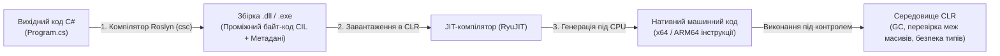

# Лекція 00: Вступний інтенсив — Синтаксис C#, Платформа CLR та Перехід із C++

Цей посібник супроводжує вступний блок проєктів (`Intro/01_ConsoleAndTypes` — `Intro/04_CoolStuff_FromCppToCsharp`) і закладає інженерний фундамент платформи .NET перед переходом до конструювання класів та ієрархій.

---

## 1. Як виконується код у .NET: Компіляція Roslyn, IL та JIT

На відміну від C++, де вихідний код компілюється безпосередньо у машинний код конкретної процесорної архітектури (x86/x64/ARM64), платформа .NET використовує **двоетапну модель компіляції** під управлінням віртуальної машини **CLR (Common Language Runtime)**:



1. **Компіляція в CIL (Common Intermediate Language)**: компілятор C# (`Roslyn`) перетворює `.cs`-файли на платформонезалежний проміжний код (IL) та таблиці метаданих типів.
2. **JIT-компіляція (Just-In-Time)**: під час першого виклику методу компонент `RyuJIT` компілює IL-інструкції у високооптимізований машинний код конкретної машини, враховуючи підтримувані векторні інструкції процесора (AVX2, AVX-512).
3. **Кероване виконання (Managed Execution)**: код працює всередині CLR, яка автоматично контролює виділення пам'яті, перевіряє межі масивів та звільняє неактуальні об'єкти за допомогою **Garbage Collector (GC)**.

---

## 2. Порівняння C++ та C#: Ключові архітектурні відмінності

Перехід від C++ до C# позбавляє розробника цілого класу критичних помилок роботи з пам'яттю, зберігаючи високу швидкодію та строгу статичну типізацію:

| Критерій | C++ (Unmanaged / Native) | C# (.NET Managed) |
|:---|:---|:---|
| **Керування пам'яттю в купі** | Ручне (`new` / `delete`) або розумні вказівники (`std::unique_ptr`, `std::shared_ptr`) | Автоматичне через надшвидкий алокатор Managed Heap та Garbage Collector |
| **Заголовок і реалізація** | Розділені на `.h` / `.hpp` та `.cpp`, препроцесор `#include` | Єдиний файл `.cs`, метадані типів зчитуються напряму зі збірок |
| **Неініціалізовані змінні** | Містять «сміття» з пам'яті (Undefined Behavior при читанні) | Заборонені компілятором (Definite Assignment Analysis) або зануляються |
| **Робота з масивами** | Небезпечна адресна арифметика (вихід за межі масиву псує сусідню пам'ять) | Масиви знають власну довжину (`arr.Length`), при виході за межі кидається `IndexOutOfRangeException` |
| **Поділ типів даних** | Будь-який `class` чи `struct` можна розмістити і на стеку, і в купі | Строгий поділ: `struct` — значущий тип (Value Type), `class` — посилальний тип (Reference Type) |

---

## 3. Базова система типів (CTS) та Фінансова точність

У C# усі примітивні типи є псевдонімами (aliases) для структур платформи .NET у просторі імен `System`. Особливу увагу слід приділяти вибору між бінарними числами з рухомою комою (`double`) та десятковим типом (`decimal`):

```csharp
// 1. Інтерполяція рядків ($"...") та форматування
string student = "Олександр";
int score = 95;
Console.WriteLine($"Студент: {student}, Бал: {score}");

// 2. Чому для грошей та фінансів ЗАВЖДИ використовують decimal (128 біт), а не double (64 біти):
double badSum = 0.1 + 0.2;
Console.WriteLine(badSum == 0.3); // false! (у двійковій системі 0.30000000000000004)

decimal exactPrice = 0.1m + 0.2m; // суфікс 'm' означає decimal (десяткова мантиса)
Console.WriteLine(exactPrice == 0.3m); // true! (абсолютна десяткова точність без похибок округлення)
```

---

## 4. Сучасне керування потоком: `switch`-вирази та Pattern Matching

Класичний оператор `switch-case` із `break` у сучасному C# поступається місцем декларативним **`switch`-виразам (switch expressions)**, які повертають значення, перевіряють вичерпність умов на етапі компіляції та підтримують реляційні шаблони (`>=`, `<`, `and`, `or`):

```csharp
// Bad: Класичний багатослівний switch-стейтмент або каскад if-else
string GetGradeOld(int points)
{
    string result;
    if (points >= 90) result = "Відмінно (A)";
    else if (points >= 75) result = "Добре (B)";
    else if (points >= 60) result = "Задовільно (C)";
    else result = "Незадовільно (F)";
    return result;
}

// Good: Сучасний лаконічний switch-вираз із реляційними патернами
string GetGradeModern(int points) => points switch
{
    >= 90 and <= 100 => "Відмінно (A)",
    >= 75 and < 90   => "Добре (B)",
    >= 60 and < 75   => "Задовільно (C)",
    >= 0 and < 60    => "Незадовільно (F)",
    _                => throw new ArgumentOutOfRangeException(nameof(points), "Бали мають бути від 0 до 100")
};
```

---

## 5. Безпечні масиви, `ref`/`out` та Незмінні записи (`record`)

У проєктах `Intro/03_Methods` та `Intro/04_CoolStuff_FromCppToCsharp` демонструються конструкції, які роблять код на C# виразним і безпечним:

```csharp
// 1. Повернення кількох значень через out без ручних вказівників C++ (int* min, int* max)
static void FindMinMax(int[] numbers, out int min, out int max)
{
    min = numbers[0];
    max = numbers[0];
    foreach (int n in numbers) // безпечний цикл foreach без ризику виходу за межі
    {
        if (n < min) min = n;
        if (n > max) max = n;
    }
}

// 2. Оголошення повноцінної незмінної моделі даних в один рядок (record):
public record Point2D(double X, double Y);
```

> [!TIP]
> Цикл `foreach` для масивів `T[]` та списків `List<T>` оптимізується JIT-компілятором так само ефективно, як і класичний цикл `for`, але повністю унеможливлює помилки індексації на одиницю (off-by-one errors).

---

## Матриця проєктів розділу

| Проєкт | Файл коду | Що демонструється в коді |
|:---|:---|:---|
| **01_ConsoleAndTypes** | [Program.cs](../Intro/01_ConsoleAndTypes/Program.cs) | `Console.WriteLine`, інтерполяція рядків `$"..."`, примітивні типи даних (`int`, `double`, `bool`, `decimal`) |
| **02_ControlFlowAndLoops** | [Program.cs](../Intro/02_ControlFlowAndLoops/Program.cs) | Умовні розгалуження `if/else`, сучасні `switch`-вирази, цикли `for`, `foreach`, `while` |
| **03_Methods** | [Program.cs](../Intro/03_Methods/Program.cs) | Оголошення статичних та локальних функцій, параметри, повернення результату через `return` |
| **04_CoolStuff_FromCppToCsharp** | [Program.cs](../Intro/04_CoolStuff_FromCppToCsharp/Program.cs) | Ключові переваги C# після C++: відсутність ручного `delete`, безпечні масиви з перевіркою меж (`Length`), властивості |
