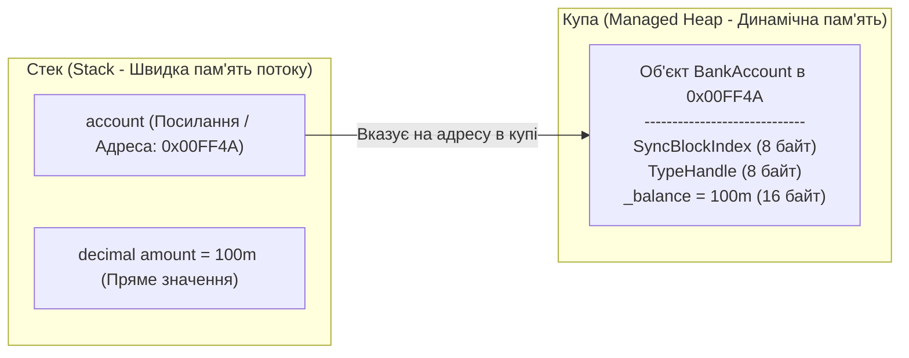

# Лекція 1: Класи, Об'єкти та Модель Пам'яті в .NET

## 1. Що таке Клас і Об'єкт?

У мові C# **клас** (`class`) є базовим будівельним блоком об'єктно-орієнтованого програмування. Це посилальний тип даних (`reference type`), який визначає контракт, поведінку та структуру даних:

* **Клас (Class)** — це абстрактний шаблон, креслення (blueprint) або тип, який описує структуру (поля, властивості) та поведінку (методи, події).
* **Об'єкт / Екземпляр (Object / Instance)** — це конкретне втілення класу, розміщене в пам'яті (у керованій купі — Managed Heap).

---

## 2. Модель пам'яті: Стек (Stack) проти Купи (Heap)

При роботі з класами в CLR задіюються дві ключові області пам'яті:



### Як це працює в коді:
```csharp
BankAccount account = new BankAccount();
```

1. **`BankAccount account`**: У стеці виділяється комірка під покажчик (4 байти для 32-розрядних систем або 8 байт для 64-розрядних систем). Початково вона містить `null`.
2. **Оператор `new`**:
   - Розраховує сумарний розмір пам'яті, необхідний для об'єкта в керованій купі (Managed Heap): заголовок об'єкта (SyncBlockIndex + TypeHandle) + поля класу.
   - Виділяє пам'ять у купі та ініціалізує поля значеннями за замовчуванням (0, `null`, `false`).
   - Викликає конструктор класу.
   - Повертає адресу виділеної області пам'яті та записує її у змінну `account` у стеці.

---

## 3. Чому відкриті поля (`public fields`) є антипатерном?

Розглянемо вихідний приклад з проекту `01_Problem_PublicField`:

```csharp
public class BankAccount
{
    public decimal Balance; // ❌ Антипатерн: поле повністю відкрите
}
```

### Наслідки відкритого стану:
1. **Порушення інваріантів:** Будь-який зовнішній код може встановити `account.Balance = -999999m`. Клас не має технічної можливості перевірити валідність присвоєння.
2. **Відсутність аудиту:** Неможливо відстежити, коли, хто і чому змінив стан об'єкта (немає точки перехоплення, як у сеттерах властивостей).
3. **Руйнування контракту при рефакторингу:** Якщо пізніше знадобиться додати валідацію або логування, заміна поля на властивість є бінарно несумісною зміною (Breaking Change) для скомпільованих збірок.

---

## 4. Висновки та кращі практики
* Поля класу **завжди** мають бути інкапсульованими (`private` або `protected`).
* Для надання доступу до даних ззовні слід використовувати властивості (`Properties`) з валідацією або чисті методи бізнес-поведінки.
