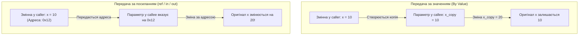

# Лекція 2: Методи, Передача Параметрів та Модифікатори в C# .NET 10

Методи визначають поведінку об'єктів та інкапсулюють алгоритми обробки даних.

---

## 1. Способи передачі аргументів у методи

За замовчуванням у C# всі аргументи передаються **за значенням (by value)**. Проте мова надає потужні модифікатори для передачі за посиланням (`by reference`):

| Модифікатор | Напрямок даних | Вимога до ініціалізації до виклику | Чи може метод змінювати значення? | Приклад використання |
|:---|:---:|:---:|:---:|:---|
| *(за замовчуванням)* | Вхідний | **Обов'язкова** | Ні (змінюється локальна копія в стеці) | `void Process(int x)` |
| **`ref`** | Вхідно-вихідний | **Обов'язкова** | Так (змінюється оригінал) | `void Swap(ref int a, ref int b)` |
| **`out`** | Вихідний | Не вимагається (ігнорується) | **Метод зобов'язаний присвоїти значення** | `bool TryParse(string s, out int res)` |
| **`in`** | Вхідний (by ref) | **Обов'язкова** | **Ні** (доступний лише для читання) | `decimal Calc(in LargeStruct data)` |

### Візуальне порівняння By-Value vs By-Ref:



---

## 2. Модифікатор `params` у сучасному C#

Модифікатор `params` дозволяє методу приймати змінну кількість аргументів:

```csharp
public static int Sum(params int[] numbers)
{
    int total = 0;
    foreach (var n in numbers) total += n;
    return total;
}

// Виклики:
Sum(1, 2);
Sum(1, 2, 3, 4, 5);
```

> [!NOTE]
> Починаючи з C# 13 та .NET 9/10, ключове слово `params` можна використовувати не тільки зі звичайними масивами `T[]`, але й з `ReadOnlySpan<T>`, що дозволяє уникнути виділення пам'яті в купі (Zero Heap Allocation)!

---

## 3. Перевантаження методів (Method Overloading)

**Перевантаження** — це створення декількох методів з однаковим ім'ям у межах одного класу, але з **різною сигнатурою**:
* Різна кількість параметрів;
* Різні типи параметрів;
* Різні модифікатори (`ref` проти звичайного).

> [!WARNING]
> Тип поверненого значення **НЕ є частиною сигнатури** для перевантаження. Два методи, що відрізняються лише типом результату, викличуть помилку компіляції.

---

## 4. Опціональні та іменовані параметри

* **Опціональні параметри:** дозволяють задавати значення за замовчуванням:
  ```csharp
  public void Configure(string host, int port = 8080, bool useSsl = true) { ... }
  ```
* **Іменовані аргументи:** підвищують читабельність коду та дозволяють опускати проміжні необов'язкові параметри:
  ```csharp
  Configure("localhost", useSsl: false); // port опускається і береться як 8080
  ```
