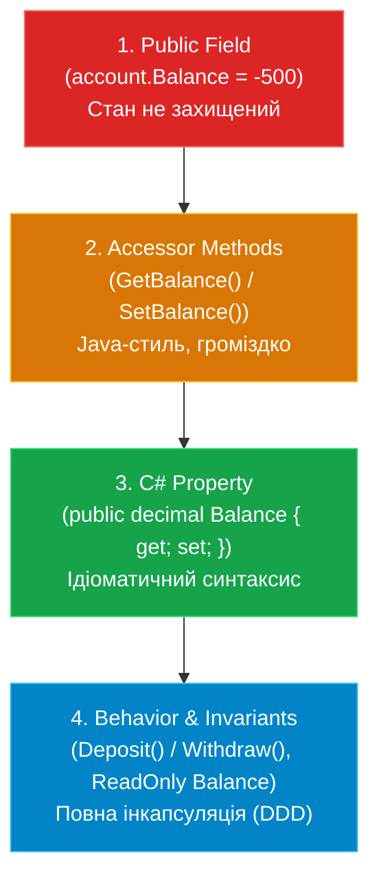

# Лекція 3: Еволюція Інкапсуляції, Властивості та Інваріанти

**Інкапсуляція (Encapsulation)** — це один із чотирьох фундаментальних принципів ООП, який полягає в:
1. Об'єднанні даних і методів для роботи з ними в одному типі;
2. Приховуванні внутрішнього стану від неконтрольованого зовнішнього втручання (Information Hiding);
3. Забезпеченні збереження **інваріантів** об'єкта.

---

## 1. Що таке інваріант класу?

> **Інваріант (Invariant)** — це логічна умова або стан об'єкта, яка **завжди** має залишатися істинною протягом усього життєвого циклу об'єкта (після завершення роботи конструктора і будь-якого публічного методу).

*Приклад:* Для банківського рахунку інваріантом є правило: `_balance >= 0` та `DepositAmount > 0`.

---

## 2. Еволюція захисту даних: 4 етапи проектування



---

### Порівняльний аналіз етапів

### Етап 1: Відкрите поле (`01_Problem_PublicField`)
```csharp
public class BankAccount {
    public decimal Balance; // ❌ Будь-хто може записати Balance = -500
}
```

### Етап 2: Методи доступу (`02_Solution_AccessorMethods`)
```csharp
public class BankAccount {
    private decimal _balance;

    public decimal GetBalance() => _balance;
    public void SetBalance(decimal value) {
        if (value < 0) throw new ArgumentException("Баланс не може бути від'ємним");
        _balance = value;
    }
}
```
*Плюс:* Поле захищене валідацією.  
*Мінус:* Неідіоматичний для C# код, синтаксично незручно.

### Етап 3: Властивості C# (`03_Solution_Property`)
```csharp
public class BankAccount {
    private decimal _balance;

    public decimal Balance {
        get => _balance;
        set {
            if (value < 0) throw new ArgumentOutOfRangeException(nameof(value), "Неприпустима сума");
            _balance = value;
        }
    }
}
```
*Плюс:* Природний синтаксис звичної змінної (`account.Balance = 100m`) при повному контролі логіки через аксесори `get` та `set`.

### Етап 4: Повна інкапсуляція поведінки (`04_Solution_BehaviorInvariants`)
У реальних бізнес-системах пряма зміна балансу ззовні взагалі не має сенсу. Рахунок поповнюють (`Deposit`) або списують з нього кошти (`Withdraw`).

```csharp
public class BankAccount {
    private decimal _balance;

    public BankAccount(decimal initialBalance = 0m) {
        if (initialBalance < 0) throw new ArgumentOutOfRangeException();
        _balance = initialBalance;
    }

    // Лише для читання — пряма мутація ззовні неможлива
    public decimal Balance => _balance;

    public void Deposit(decimal amount) {
        if (amount <= 0) throw new ArgumentOutOfRangeException("Сума поповнення має бути > 0");
        _balance += amount;
    }

    public void Withdraw(decimal amount) {
        if (amount <= 0) throw new ArgumentOutOfRangeException("Сума зняття має бути > 0");
        if (amount > _balance) throw new InvalidOperationException("Недостатньо коштів");
        _balance -= amount;
    }
}
```

---

## 3. Принцип «Tell, Don't Ask» (Кажи, а не питай)

Антипатерн:
```csharp
// Зовнішній код запитує дані і сам вирішує, що робити:
if (account.Balance >= 200) {
    account.Balance -= 200; // Порушення принципу Tell, Don't Ask
}
```

Правильний підхід:
```csharp
// Зовнішній код наказує об'єкту виконати дію, а об'єкт сам гарантує свої правила:
account.Withdraw(200);
```

Об'єкт стає самодостатнім модулем, некоректний стан якого **неможливий за побудовою**.
