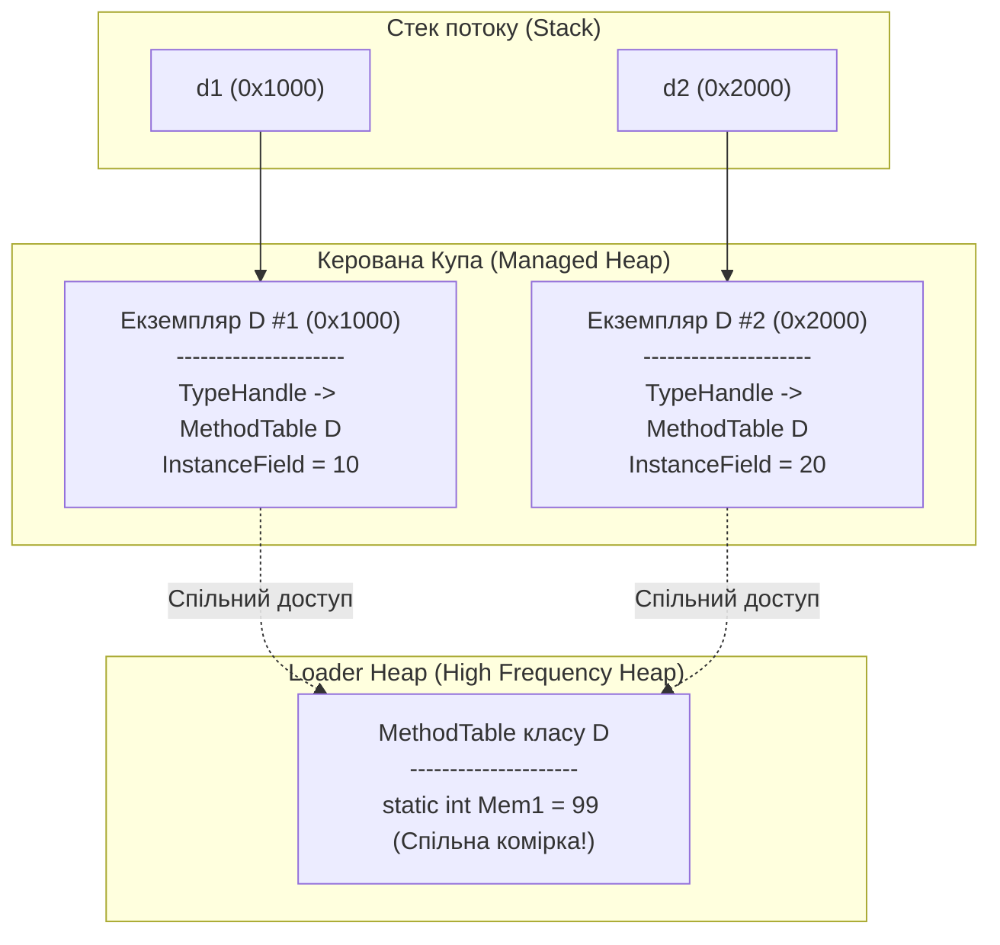

# Лекція 04: Статичні Члени (`static`), Константи (`const`, `readonly`) та Посилання `this`

Цей розділ об'єднує приклади з книги Д. Соліса (`SOLIS-p119` — `SOLIS-p124`), які показують фундаментальну різницю між членами екземпляра (instance members) та членами рівня типу (`static`), механізм фіксації незмінних значень (`const` проти `readonly`), а також роботу прихованого параметра `this`.

---

## 1. Статичні члени (`static`) проти Членів екземпляра у Пам'яті CLR

Коли клас містить звичайні (нестатичні) поля, кожен виклик `new MyClass()` виділяє в керованій купі (Managed Heap) окрему копію цих полів. Проте поля, позначені ключовим словом **`static`**, існують **в єдиному екземплярі на весь домен застосунку** і належать самому типу, а не окремим об'єктам.

Де саме зберігаються статичні поля? Середовище CLR виділяє їх у спеціальному сегменті завантажувача типів — **High Frequency Heap** (пов'язаному з таблицею методу типу `MethodTable`), який живе до завершення процесу і не переміщується звичайним збирачем сміття:



### Ключові правила `static`:
1. **Статичне поле (`SOLIS-p120`)**: якщо змінити статичне поле через один метод або ззовні (`D.Mem1 = 99`), усі екземпляри класу миттєво побачать це нове значення, оскільки читають ту саму комірку пам'яті.
2. **Статичний метод (`SOLIS-p119`)**: викликається безпосередньо через ім'я класу (`MyClass.PrintStatic()`). Оскільки статичний метод не прив'язаний до конкретного об'єкта, він **не отримує неявного параметра `this`** і не може напряму звертатися до нестатичних полів чи методів класу.

---

## 2. Константи часу компіляції (`const`) проти Полів лише для читання (`readonly`)

У C# існують два різних механізми оголошення величин, які не можна змінити під час роботи програми (`SOLIS-p122` та `SOLIS-p123`):

| Характеристика | Константа (`const`) | Поле лише для читання (`readonly`) |
|:---|:---|:---|
| **Коли визначається значення?** | **Під час компіляції (Compile-Time)** | **Під час виконання (Run-Time)** — у конструкторі |
| **Де можна присвоїти значення?** | Виключно в рядку оголошення (`const double PI = 3.1416;`) | При оголошенні **або** всередині конструктора класу |
| **Які типи підтримуються?** | Лише примітиви (`int`, `double`, `bool`, `char`), `enum`, `string` або `null` | **Будь-який тип** (`class`, `struct`, `List<T>`, `DateTime`) |
| **Чи є статичним за замовчуванням?** | **Так** (завжди неявно `static`, звернення через ім'я класу) | **Ні** (може бути екземплярним для кожного об'єкта або явно `static readonly`) |
| **Як зберігається на рівні IL?** | Не має адреси в пам'яті — значення буквально «впікається» (inlined) у місце виклику | Справжнє поле в пам'яті об'єкта (або в High Frequency Heap для `static readonly`) |

### Проблема версіонування `const` між збірками (Versioning Trap):
Оскільки компілятор підставляє літеральне значення `const` безпосередньо в IL-код збірки, що його викликає (`ldc.r8 3.1416`), зміна значення `public const` у бібліотеці `Core.dll` **не оновить** це значення у програмі `App.exe`, доки `App.exe` не буде перекомпільовано з нуля! Для публічних констант, які можуть змінюватися у майбутніх релізах (ліміти, таймаути, версії), завжди використовуйте `public static readonly`.

```csharp
public class ShapeConfig
{
    // 1. const — тільки для фундаментальних величин, які НІКОЛИ не зміняться:
    public const double Pi = 3.141592653589793;

    // 2. static readonly — обчислюється один раз під час запуску програми:
    public static readonly DateTime ProcessStartTime = DateTime.UtcNow;

    // 3. instance readonly — може мати своє унікальне значення для кожного об'єкта:
    public readonly Guid ShapeId;

    public ShapeConfig()
    {
        ShapeId = Guid.NewGuid(); // Дозволено ініціалізувати в конструкторі!
    }
}
```

---

## 3. Як працює ключове слово `this` під капотом (`SOLIS-p124`)

Звідки нестатичний метод класу знає, з полями якого саме об'єкта у купі (`obj1` чи `obj2`) він зараз працює? Під час компіляції будь-який екземплярний метод отримує **прихований нульовий параметр `this`**, у який передається адреса поточного об'єкта:

```csharp
// Те, що пише розробник у коді C# (SOLIS-p124):
public class MyClass
{
    private int var1 = 10;

    public int ReturnMaxSum(int var1)
    {
        // Параметр 'var1' перекриває (shadowing) поле класу 'var1'.
        // Ключове слово 'this.var1' явно звертається до поля поточного об'єкта в купі:
        return var1 > this.var1 ? var1 : this.var1;
    }
}

// Як цей самий виклик виглядає для процесора та CLR після компіляції:
// MyClass.ReturnMaxSum(MyClass this, int var1)
```

### Коли використовується `this`:
1. **Усунення конфлікту імен (Name Shadowing)**: коли параметр конструктора або методу має те саме ім'я, що й поле класу (`this.var1 = var1;`).
2. **Передача поточного об'єкта в інший метод**: наприклад, `logger.LogCreated(this);`.
3. **Ланцюжки конструкторів**: делегування ініціалізації іншому конструктору цього ж класу (`: this(...)`).

---

## Матриця проєктів розділу

| Проєкт | Файл коду | Сторінка книги та концепція |
|:---|:---|:---|
| **SOLIS-p119** | [Program.cs](../SOLIS-p119/Program.cs) | **Статичні методи (`static`)**: виклик методу через ім'я класу без створення об'єкта `new` |
| **SOLIS-p120** | [Program.cs](../SOLIS-p120/Program.cs) | **Статичні поля**: спільна комірка пам'яті, яку розділяють усі екземпляри класу |
| **SOLIS-p122** | [Program.cs](../SOLIS-p122/Program.cs) | **Константи часу компіляції (`const`)**: значення підставляється безпосередньо в IL-код під час збірки |
| **SOLIS-p123** | [Program.cs](../SOLIS-p123/Program.cs) | **Поля лише для читання (`readonly`)**: ініціалізація дозволена під час оголошення або в конструкторі класу |
| **SOLIS-p124** | [Program.cs](../SOLIS-p124/Program.cs) | **Ключове слово `this`**: явне посилання на поточний екземпляр для усунення конфлікту імен між полем і параметром |
