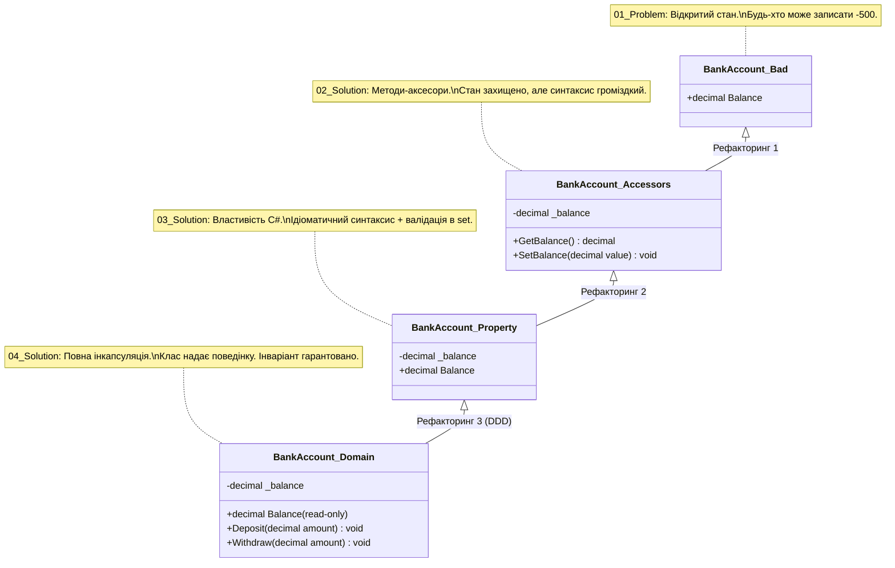

# Модуль 01: Класи, Методи та Еволюція Інкапсуляції у .NET 10

[](https://dotnet.microsoft.com/)
[](https://github.com/)

Ласкаво просимо до першого фундаментального модуля курсу **«C# & OOP Mastery»**. У цьому розділі розглядаються базові будівельні блоки об'єктно-орієнтованого програмування: сутність класу та об'єкта, розподіл пам'яті в середовищі CLR (Stack vs Heap), модифікатори передачі аргументів, перевантаження методів та повна 4-етапна еволюція захисту даних (інкапсуляція).

---

## 📖 Навчальні лекції та теоретичні гайди

Модуль супроводжується повноцінними лекційними посібниками у папці [`Docs/`](Docs/):

| # | Лекція | Ключові концепції | Посилання |
|:---:|:---|:---|:---:|
| **01** | **Класи, Об'єкти та Модель Пам'яті** | Reference Types, виділення пам'яті в Managed Heap, заголовок об'єкта (SyncBlock, TypeHandle), вказівники у Stack, антипатерн `public fields` | [👉 Читати лекцію](Docs/01_Classes_Objects_Memory_Model.md) |
| **02** | **Методи та Модифікатори Параметрів** | Передача за значенням vs за посиланням (`ref`, `out`, `in`), `params` у .NET 10 (`ReadOnlySpan<T>`), перевантаження (Overloading), іменовані параметри | [👉 Читати лекцію](Docs/02_Methods_And_Parameter_Passing.md) |
| **03** | **Еволюція Інкапсуляції та Інваріанти** | 4 етапи захисту стану, властивості (Properties), backing fields, захист бізнес-інваріантів, патерн «Tell, Don't Ask» | [👉 Читати лекцію](Docs/03_Encapsulation_Properties_And_Invariants.md) |

---

## 🏛️ Архітектурна схема еволюції інкапсуляції



---

## 📁 Структура проектів у модулі

### 1. Практикум інкапсуляції (Еволюція захисту даних)
* **[`01_Problem_PublicField/`](01_Problem_PublicField/Program.cs)** — Проблема відкритого поля: клас не контролює стан, пряме присвоєння від'ємного балансу.
* **[`02_Solution_AccessorMethods/`](02_Solution_AccessorMethods/Program.cs)** — Рішення через методи `GetBalance()` / `SetBalance()` з валідацією аргументів.
* **[`03_Solution_Property/`](03_Solution_Property/Program.cs)** — Ідіоматичне C#-рішення через повноцінну властивість `Balance { get; set; }` з backing-полем.
* **[`04_Solution_BehaviorInvariants/`](04_Solution_BehaviorInvariants/Program.cs)** — Еталонне рішення: властивість лише для читання, зміна стану виключно через поведінкові методи `Deposit()` та `Withdraw()`.

### 2. Вступний інтенсив (Основи середовища C#)
* **[`Intro/01_ConsoleAndTypes/`](Intro/01_ConsoleAndTypes/Program.cs)** — Консольне введення/виведення, формати рядків, базові типи даних.
* **[`Intro/02_ControlFlowAndLoops/`](Intro/02_ControlFlowAndLoops/Program.cs)** — Умовні конструкції, switch-вирази, цикли.
* **[`Intro/03_Methods/`](Intro/03_Methods/Program.cs)** — Оголошення методів, сигнатури, повернення значень.
* **[`Intro/04_CoolStuff_FromCppToCsharp/`](Intro/04_CoolStuff_FromCppToCsharp/Program.cs)** — Ключові відмінності для розробників, які перейшли з C++ (управління пам'яттю, безпека посилань).

### 3. Академічний атлас Solis (Детальні механізми методів та класів)
* **[`SOLIS-p074/`](SOLIS-p074/Program.cs)** — Оголошення класу та створення першого екземпляра через `new`.
* **[`SOLIS-p075/`](SOLIS-p075/Program.cs)** — Методи екземпляра класу.
* **[`SOLIS-p095/`](SOLIS-p095/Program.cs)** — Передача параметрів за значенням (By-Value).
* **[`SOLIS-p098/`](SOLIS-p098/Program.cs)** — Модифікатор `ref` (передача за посиланням із читанням і записом).
* **[`SOLIS-p100/`](SOLIS-p100/Program.cs)** — Модифікатор `out` (вихідні параметри методу).
* **[`SOLIS-p102/`](SOLIS-p102/Program.cs)** — Оголошення `out`-змінних за місцем виклику.
* **[`SOLIS-p105/`](SOLIS-p105/Program.cs)** — Модифікатор `in` (передача за посиланням лише для читання).
* **[`SOLIS-p107/`](SOLIS-p107/Program.cs)** — Модифікатор `params` (змінна кількість аргументів).
* **[`SOLIS-p110/`](SOLIS-p110/Program.cs)** — Перевантаження методів (Method Overloading).
* **[`SOLIS-p112/`](SOLIS-p112/Program.cs)** — Необов'язкові (опціональні) параметри.
* **[`SOLIS-p113/`](SOLIS-p113/Program.cs)** — Іменовані аргументи при виклику методів.
* **[`SOLIS-p114/`](SOLIS-p114/Program.cs)** — Розподіл пам'яті: Стек (значущі типи) проти Купи (посилальні типи).
* **[`SOLIS-p115/`](SOLIS-p115/Program.cs)** — Рекурсивні виклики методів та переповнення стеку.
* **[`SOLIS-p119/`](SOLIS-p119/Program.cs)** — Статичні методи (`static`).
* **[`SOLIS-p120/`](SOLIS-p120/Program.cs)** — Статичні поля та їхній життєвий цикл.
* **[`SOLIS-p122/`](SOLIS-p122/Program.cs)** — Константи (`const`) та компіляторна підстановка.
* **[`SOLIS-p123/`](SOLIS-p123/Program.cs)** — Поля лише для читання (`readonly`).
* **[`SOLIS-p124/`](SOLIS-p124/Program.cs)** — Ключове слово `this` та розділення областей видимості.
* **[`SOLIS-p126/`](SOLIS-p126/Program.cs)** — Базовий синтаксис властивостей.

---

## 🛠️ Збірка та запуск

Рішення зібрано під **.NET 10**:
```bash
# Збірка всього модуля
dotnet build OOP-Classes.sln -c Release

# Запуск еталонного прикладу інкапсуляції
dotnet run --project 04_Solution_BehaviorInvariants/04_Solution_BehaviorInvariants.csproj
```
