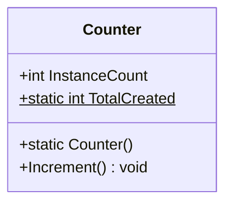

# Лекція 1: Статичні Члени Класу та Незмінність (Immutability)

## 1. Екземплярні проти Статичних Членів

У мові C# члени класу можуть належати або конкретному екземпляру, або типу загалом:

* **Поле екземпляра (`instance field`):** у кожного створеного через `new` об'єкта виділяється власна незалежна комірка в пам'яті (купі).
* **Статичне поле (`static field`):** існує в єдиному екземплярі для всього домену додатку (AppDomain), незалежно від того, скільки об'єктів класу створено (або навіть якщо жодного не створено).

---

## 2. Статичний Конструктор (`static constructor`)

* Викликається середовищем виконання CLR **автоматично рівно один раз** перед створенням першого екземпляра або перед першим зверненням до будь-якого статичного члена класу.
* Не має модифікаторів доступу (`public`, `private`) та не приймає параметрів.
* Ідеальне місце для ініціалізації складних статичних ресурсів, завантаження конфігурацій або кешів.

---

## 3. Градація незмінності: `const` проти `readonly`

| Характеристика | `const` | `static readonly` | `readonly` (екземплярне) |
|:---|:---:|:---:|:---:|
| **Час обчислення** | Compile-Time (під час компіляції) | Run-Time (під час запуску) | Run-Time (при створенні екземпляра) |
| **Де ініціалізується** | Лише за місцем оголошення | У статичному конструкторі | У звичайному конструкторі |
| **Підстановка значення** | Інлайниться компілятором у викликаючий код | Читається з комірки пам'яті | Читається з об'єкта |
| **Допустимі типи** | Лише примітиви, string, enum | Будь-які типи (включаючи посилання) | Будь-які типи |

> [!WARNING]
> **«Версійна пастка» констант (`const`):** Якщо у збірці-бібліотеці `Lib.dll` змінити значення `public const int Timeout = 60;` на `120` і перекомпілювати тільки бібліотеку, викликаюча програма `App.exe` продовжуватиме використовувати старе значення `60`, тому що воно було «впечене» (inlined) у її бінарний код! Для публічних API завжди використовуйте `static readonly`.

---

## 4. Статичні Класи (`static class`)

* Не можуть містити нестатичних членів.
* Не можуть бути інстанційовані через `new`.
* Запечатані (`sealed`) за замовчуванням і не можуть брати участь в успадкуванні.
* Застосування: утилітарні класи (`Math`, `Convert`), фабричні методи, контейнери методів розширення (`Extension Methods`).
