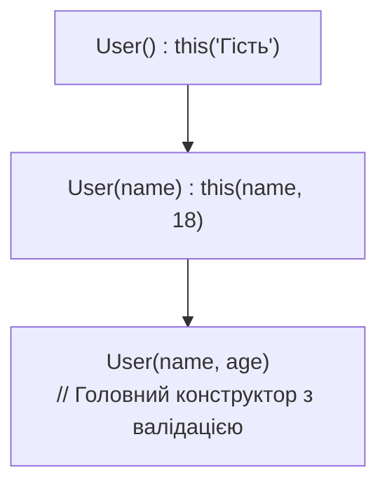

# Лекція 3: Конструктори, Первинні Конструктори та Ключове Слово `this`

## 1. Конструктор за замовчуванням та перевантаження

* Якщо у класі **не оголошено жодного конструктора**, компілятор C# автоматично генерує публічний конструктор без параметрів, який ініціалізує всі поля нулями.
* Як тільки розробник оголошує **хоча б один власний конструктор з параметрами**, автоматичний конструктор більше не генерується.

---

## 2. Усунення дублювання: Делегування через `this(...)`

У старих підходах часто зустрічається антипатерн копіювання коду ініціалізації між кількома конструкторами. Рішення — ланцюжок викликів через `this(...)`:



```csharp
public class User
{
    public string Name { get; }
    public int Age { get; }

    // Конструктор за замовчуванням делегує виконання:
    public User() : this("Анонім") { }

    // Перевантажений конструктор делегує головному:
    public User(string name) : this(name, 18) { }

    // Головний канонічний конструктор, де зосереджено всю валідацію:
    public User(string name, int age)
    {
        if (string.IsNullOrWhiteSpace(name)) throw new ArgumentException("Помилка імені");
        if (age < 0) throw new ArgumentOutOfRangeException("Вік не може бути від'ємним");

        Name = name;
        Age = age;
    }
}
```

---

## 3. Первинні конструктори (Primary Constructors у C# 12+)

У сучасних версіях C# 12+ / .NET 10 класи можуть оголошувати конструктор безпосередньо у заголовку типу:

```csharp
public class OrderService(ILogger logger, IOrderRepository repository)
{
    public void ProcessOrder(int orderId)
    {
        logger.Log($"Обробка замовлення {orderId}");
        repository.Save(orderId);
    }
}
```
Параметри первинного конструктора доступні у всьому тілі класу для ініціалізації властивостей та виклику методів.

---

## 4. Сім ролей ключового слова `this`
1. **Розрізнення областей видимості:** `this.name = name;` (коли ім'я поля збігається з параметром).
2. **Делегування конструкторів:** `public MyClass() : this(0) { }`.
3. **Оголошення індексатора:** `public int this[int index] { get => ...; }`.
4. **Оголошення методу розширення:** `public static void Dump(this object obj)`.
5. **Методи-ланцюжки (Method Chaining / Fluent API):** `return this;`.
6. **Передача поточного об'єкта як аргументу:** `notifier.Register(this);`.
7. **Порівняння посилань в `Equals`:** `if (ReferenceEquals(this, other)) return true;`.
