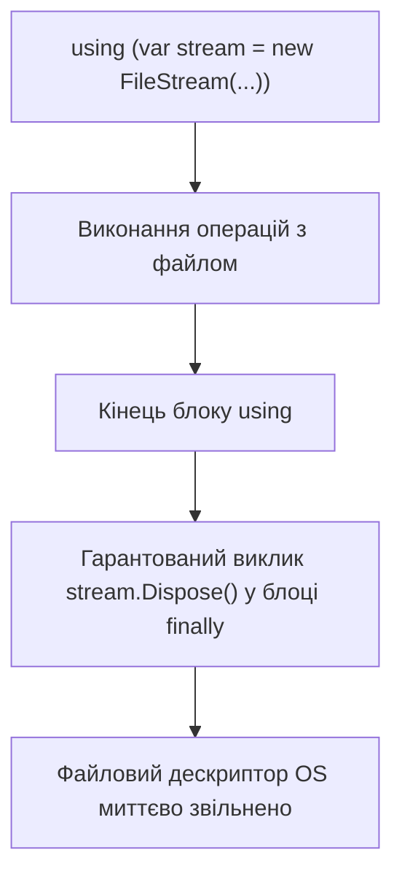

# Лекція 6: Управління Ресурсами (`IDisposable`), Фіналізатори та `record`

## 1. Звільнення некерованих ресурсів: Патерн `Dispose`

CLR автоматично звільняє пам'ять керованої купи через **Garbage Collector (GC)**. Проте GC нічого не знає про **некеровані ресурси операційної системи**:
* Файлові дескриптори (`FileHandle`)
* Сокети та мережеві з'єднання
* Підключення до бази даних
* Графічні контексти GDI/DirectX

Для детермінованого своєчасного закриття таких ресурсів використовується інтерфейс **`IDisposable`** та конструкція **`using`**:



### Еталонний патерн `Dispose`:
```csharp
public class ResourceHolder : IDisposable
{
    private bool _disposed;

    public void Dispose()
    {
        Dispose(disposing: true);
        GC.SuppressFinalize(this); // Повідомляємо GC, що фіналізатор викликати не потрібно
    }

    protected virtual void Dispose(bool disposing)
    {
        if (_disposed) return;

        if (disposing)
        {
            // Звільняємо керовані IDisposable об'єкти
        }

        // Звільняємо некеровані дескриптори OS
        _disposed = true;
    }

    ~ResourceHolder() // Фіналізатор (страховка на випадок, якщо Dispose забули викликати)
    {
        Dispose(disposing: false);
    }
}
```

---

## 2. Сучасний C#: Записи (`record`) проти Звичайних Класів (`class`)

Тип **`record`** призначений для представлення **незмінних моделей даних (DTO, Value Objects)**:

| Функціональність | Звичайний `class` | `record` / `record class` |
|:---|:---:|:---:|
| **Порівняння на рівність (`Equals`, `==`)** | За посиланням (Reference Equality) | **За значеннями полів (Value-based Equality)** |
| **Хешування (`GetHashCode`)** | За адресою об'єкта | **Хеш від значень усіх властивостей** |
| **Рядкове представлення (`ToString`)** | Назва типу (`"MyApp.Person"`) | **Зручний JSON-подібний дамп усіх полів** |
| **Клонування з мутацією (`with`)** | Лише вручну | **Підтримується оператор `with`** |
| **Деконструкція (`Deconstruct`)** | Потрібно писати вручну | **Генерується автоматично з Primary Ctor** |

```csharp
// Всього 1 рядок коду замінює 60 рядків шаблонного класу:
public record Person(string FirstName, string LastName, int Age);

var p1 = new Person("Юрій", "Коваленко", 25);
var p2 = new Person("Юрій", "Коваленко", 25);

Console.WriteLine(p1 == p2); // ✅ True (порівняння за значенням!)

// Недеструктивна мутація:
var p3 = p1 with { Age = 26 };
```
