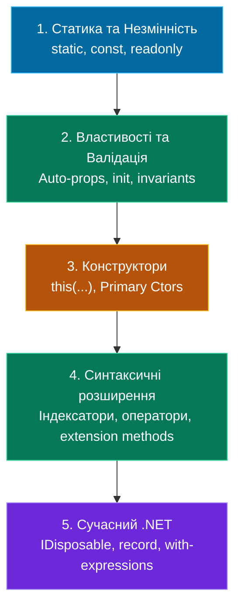

# Модуль 02: Поглиблене Вивчення Класів та Моделей у .NET 10

[](https://dotnet.microsoft.com/)
[](https://github.com/)

Другий модуль курсу **«C# & OOP Mastery»** присвячений поглибленим механізмам конструювання класів у C# .NET 10: статичним членам, градації незмінності (`const` vs `readonly`), розширеному управлінню життєвим циклом об'єкта (`IDisposable`, фіналізатори), індексаторам, перевантаженню операторів, методам розширення та сучасним записам (`record`).

---

## 📖 Навчальні лекції та теоретичні гайди

Модуль структуровано за 6 логічними блоками у каталозі [`Docs/`](Docs/):

| # | Лекція | Ключові концепції | Посилання |
|:---:|:---|:---|:---:|
| **01** | **Статичні Члени та Незмінність** | Екземплярні vs статичні поля, статичний конструктор, `const` vs `static readonly`, версійна пастка, статичні класи | [👉 Читати лекцію](Docs/01_Static_Members_And_Immutability.md) |
| **02** | **Властивості та Валідація** | Backing fields, авто-властивості, обчислювані властивості, асиметричний доступ, `init`-only аксесори | [👉 Читати лекцію](Docs/02_Properties_And_Validation.md) |
| **03** | **Конструктори та Ключове Слово `this`** | Делегування через `this(...)`, первинні конструктори (Primary Ctors), 7 ролей `this`, ініціалізатори об'єктів | [👉 Читати лекцію](Docs/03_Constructors_And_This.md) |
| **04** | **Індексатори та Оператори** | Синтаксис `this[...]`, перевантаження індексаторів, перевантаження операторів (`+`, `==`, `!=`), приведення типів `implicit`/`explicit` | [👉 Читати лекцію](Docs/04_Indexers_And_Operators.md) |
| **05** | **Методи Розширення та Вкладені Класи** | Extension Methods (базис LINQ), вкладені типи (Nested classes), `partial` класи та Source Generators | [👉 Читати лекцію](Docs/05_Extension_Methods_And_Nested_Classes.md) |
| **06** | **Управління Ресурсами та Записи (`record`)** | Керовані vs некеровані ресурси, патерн `IDisposable`, `using`, Value-based equality у `record`, оператор `with` | [👉 Читати лекцію](Docs/06_IDisposable_And_Records.md) |

---

## 🗺️ Ментальна карта модуля



---

## 📁 Каталог навчальних проектів

### Блок 1: Поля, статика та константи
* **[`SOLIS-p132/`](SOLIS-p132/Program.cs)** — Поля екземпляра (кожен об'єкт має свою копію).
* **[`SOLIS-p135/`](SOLIS-p135/Program.cs)** — Статичне поле (одне спільне поле на весь клас).
* **[`SOLIS-p137/`](SOLIS-p137/Program.cs)** — Доступ до статичних членів через ім'я класу.
* **[`SOLIS-p156/`](SOLIS-p156/Program.cs)** — Статичний конструктор класу.
* **[`SOLIS-p140/`](SOLIS-p140/Program.cs)** — Константи `const`.
* **[`Ex-Readonly-vs-Const/`](Ex-Readonly-vs-Const/Program.cs)** — Практикум: `const` проти `static readonly` проти `readonly`.
* **[`Ex-Static-Class/`](Ex-Static-Class/Program.cs)** — Повністю статичні класи.

### Блок 2: Властивості
* **[`SOLIS-p145/`](SOLIS-p145/Program.cs)** — Властивість з явним backing-полем.
* **[`SOLIS-p150/`](SOLIS-p150/Program.cs)** — Автоматичні властивості.
* **[`SOLIS-p149/`](SOLIS-p149/Program.cs)** — Обчислювані властивості лише для читання.
* **[`SOLIS-p170/`](SOLIS-p170/Program.cs)** — Асиметричний доступ (`public get; private set;`).
* **[`SOLIS-p151/`](SOLIS-p151/Program.cs)** — Статичні властивості та директива `using static`.
* **[`Ex-Property-Validation/`](Ex-Property-Validation/Program.cs)** — Захист інваріантів та валідація у властивостях.

### Блок 3: Конструктори та `this`
* **[`Ex-Default-Constructor/`](Ex-Default-Constructor/Program.cs)** — Конструктор за замовчуванням проти параметризованого.
* **[`SOLIS-p153/`](SOLIS-p153/Program.cs)** — Перевантаження конструкторів.
* **[`Ex-This-In-Constructor-02/`](Ex-This-In-Constructor-02/Program.cs)** — Делегування через `this(...)`.
* **[`Ex-This-In-Constructor/`](Ex-This-In-Constructor/Program.cs)** — 7 практичних ролей ключового слова `this`.
* **[`SOLIS-p160/`](SOLIS-p160/Program.cs)** — Використання `this` для розрізнення полів та параметрів.
* **[`SOLIS-p158/`](SOLIS-p158/Program.cs)** — Ініціалізатори об'єктів `new T { ... }`.

### Блок 4: Індексатори та перевантаження операторів
* **[`SOLIS-p168/`](SOLIS-p168/Program.cs)** — Базовий індексатор `this[int]`.
* **[`Ex-Indexers-01/`](Ex-Indexers-01/Program.cs)** — Індексатор, що повертає модельні об'єкти.
* **[`Ex-Idexers-02/`](Ex-Idexers-02/Program.cs)** — Перевантаження індексаторів за різними типами ключів.
* **[`Ex-Operator-Overloading/`](Ex-Operator-Overloading/Program.cs)** — Канонічне перевантаження операторів `+`, `==`, `!=`.

### Блок 5: Розширення класу та ресурси
* **[`Ex-Extension-Methods/`](Ex-Extension-Methods/Program.cs)** — Створення власних методів розширення.
* **[`Ex-Nested-Class/`](Ex-Nested-Class/Program.cs)** — Вкладені класи та доступ до приватного стану.
* **[`SOLIS-p175/`](SOLIS-p175/Program.cs)** — Часткові (`partial`) класи та методи.
* **[`Ex-IDisposable-Finalizer/`](Ex-IDisposable-Finalizer/Program.cs)** — Звільнення ресурсів, `IDisposable` та `Dispose pattern`.

### Блок 6: Сучасні типи C#
* **[`Ex-Record-vs-Class/`](Ex-Record-vs-Class/Program.cs)** — Порівняльний аналіз `record` та `class`, Value Equality, `with`.

---

## 🛠️ Збірка та запуск

```bash
# Збірка всього модуля
dotnet build OOP-More-About-Сlasses.sln -c Release

# Запуск демонстрації record vs class
dotnet run --project Ex-Record-vs-Class/Ex-Record-vs-Class.csproj
```
