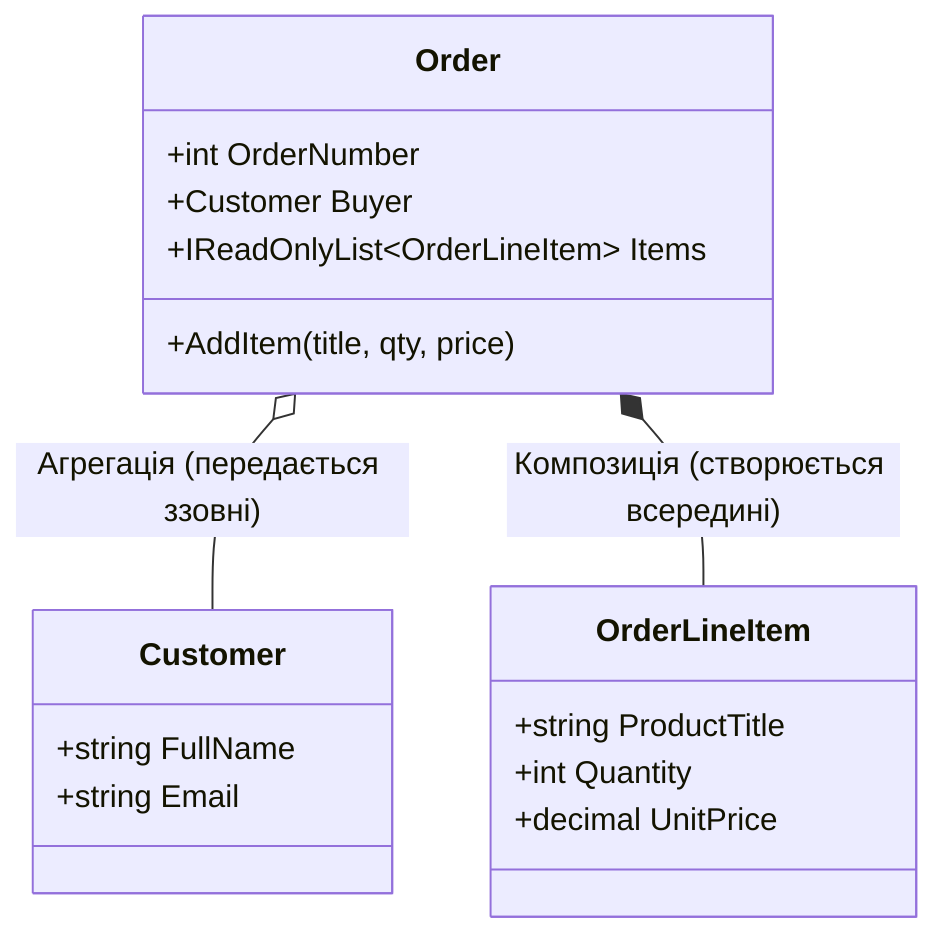

# 01. Взаємодія класів (`Has-A`): Композиція проти Агрегації

Перш ніж вивчати успадкування (`Is-A` у главі `02-OOP-Core`), важливо засвоїти золоте правило об'єктно-орієнтованого дизайну: **перевагу композиції над успадкуванням**. Коли один клас містить посилання на інші класи, це називається зв'язком **`Has-A` («Має у своєму складі»)**.

| Вид зв'язку | Хто створює вкладений об'єкт? | Чи живе частина після знищення контейнера? | Приклад у коді |
|:---|:---|:---|:---|
| **Агрегація (`o--`)** | Створюється ззовні та передається в конструктор | **Так** (`Customer` продовжує існувати без `Order`) | [Program.cs](../01-CompositionVsAggregation/Program.cs#L43) |
| **Композиція (`*--`)** | Створюється виключно всередині контейнера | **Ні** (`OrderLineItem` не існує окремо від `Order`) | [Program.cs](../01-CompositionVsAggregation/Program.cs#L56) | 