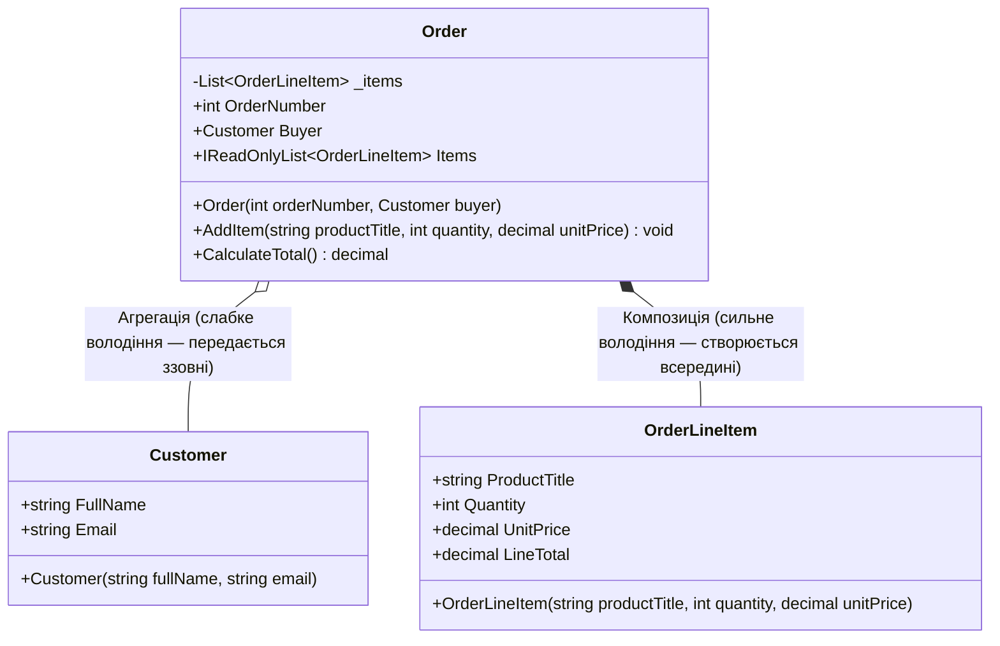

# Лекція 01: Взаємодія класів (`Has-A`) — Композиція проти Агрегації

Перш ніж переходити до успадкування (`Is-A` у главі `02-OOP-Core`), необхідно опанувати фундаментальний спосіб побудови складних об'єктних систем із простіших класів — зв'язок володіння **`Has-A` («Має у своєму складі»)**. Саме через `Has-A` конструюється переважна більшість бізнес-моделей у реальних застосунках.

---

## 1. Два різновиди зв'язку `Has-A`: Агрегація та Композиція

В об'єктно-орієнтованому аналізі та нотації UML зв'язок `Has-A` поділяється на два види залежно від **сили володіння** та **спільного чи незалежного життєвого циклу об'єктів**:



### Детальне порівняння:

| Критерій | Агрегація (Aggregation — `o--`) | Композиція (Composition — `*--`) |
|:---|:---|:---|
| **Суть відношення** | Контейнер використовує об'єкт або тримає на нього посилання («слабке володіння») | Частина є невід'ємним внутрішнім елементом цілого («сильне/монопольне володіння») |
| **Хто створює вкладений об'єкт?** | Створюється **ззовні** (`new Customer(...)`) і передається в конструктор або метод контейнера | Створюється **виключно всередині** контейнера (`new OrderLineItem(...)` у методі `AddItem`) |
| **Чи може частина належати кільком контейнерам?** | **Так** (один і той самий `Customer` може бути покупцем у десятках різних замовлень `Order`) | **Ні** (конкретний рядок чека `OrderLineItem` належить лише одному замовленню `Order`) |
| **Що стається при знищенні контейнера?** | Вкладений об'єкт **продовжує жити** і використовуватися іншими частинами програми | Вкладені об'єкти **знищуються разом із контейнером** (стають недосяжними для GC) |
| **Приклад у проєкті** | Поле `Customer Buyer` у класі `Order` ([Program.cs](../01-CompositionVsAggregation/Program.cs#L43)) | Колекція `_items` типу `List<OrderLineItem>` у класі `Order` ([Program.cs](../01-CompositionVsAggregation/Program.cs#L56)) |

---

## 2. Аналіз життєвого циклу в Пам'яті (Sequence Diagram)

Подивімося, як відрізняється час життя агрегованого об'єкта `Customer` та скомпонованих об'єктів `OrderLineItem` під час виконання програми:

```mermaid
sequenceDiagram
    participant Main as Клієнтський код (Main)
    participant Cust as Customer (Агрегація)
    participant Ord as Order (Контейнер)
    participant Item as OrderLineItem (Композиція)

    Main->>Cust: new Customer("Олена Коваленко", ...)
    Main->>Ord: new Order(1042, customer)
    Note right of Ord: Order зберігає посилання на існуючий Customer
    Main->>Ord: order.AddItem("Клавіатура", 1, 3500m)
    Ord->>Item: new OrderLineItem(...) (створюється всередині!)
    Main->>Ord: order = null (замовлення скасовано / знищено)
    Destroy Ord
    Note over Ord,Item: OrderLineItem втрачає єдине посилання і збирається GC разом з Order
    Main->>Cust: Console.WriteLine(customer.FullName)
    Note right of Cust: Customer продовжує жити незалежно від Order!
```

---

## 3. Інкапсуляція колекцій при Композиції: Антипатерн проти Еталона

Часто розробники-початківці правильно задумують композицію, але випадково руйнують її, відкриваючи внутрішній список `List<T>` назовні через публічну властивість:

```csharp
// Bad: Антипатерн — внутрішній список відкритий для прямих маніпуляцій ззовні
public class BadOrder
{
    // Будь-хто ззовні може викликати order.Items.Clear() або додати невалідний елемент в обхід правил!
    public List<OrderLineItem> Items { get; set; } = new();
}

// Good: Еталонна Композиція (як у проєкті 01-CompositionVsAggregation)
public sealed class Order
{
    private readonly List<OrderLineItem> _items = new(); // Приватне сховище

    public int OrderNumber { get; }
    public Customer Buyer { get; } // Агрегація: посилання приходить ззовні

    // Назовні віддаємо лише захищене представлення "тільки для читання"
    public IReadOnlyList<OrderLineItem> Items => _items.AsReadOnly();

    public Order(int orderNumber, Customer buyer)
    {
        OrderNumber = orderNumber;
        Buyer = buyer ?? throw new ArgumentNullException(nameof(buyer));
    }

    // Order сам конструює свої частини (Композиція) і перевіряє бізнес-інваріанти
    public void AddItem(string productTitle, int quantity, decimal unitPrice)
    {
        var item = new OrderLineItem(productTitle, quantity, unitPrice);
        _items.Add(item);
    }

    public decimal CalculateTotal()
    {
        decimal total = 0m;
        foreach (var item in _items)
            total += item.LineTotal;
        return total;
    }
}
```

> [!IMPORTANT]
> У справжній Композиції зовнішній код взагалі не повинен викликати `new OrderLineItem(...)` самостійно. Контейнер `Order` виступає **Коренем Агрегату (Aggregate Root у термінології DDD)**: всі зміни дочірніх об'єктів проходять виключно через публічні методи власника (`order.AddItem(...)`), що гарантує цілісність замовлення.

---

## Матриця проєктів розділу

| Проєкт | Файл коду | Ключові рядки | Що демонструється в коді |
|:---|:---|:---|:---|
| **01-CompositionVsAggregation** | [Program.cs](../01-CompositionVsAggregation/Program.cs) | [Рядки 38–67](../01-CompositionVsAggregation/Program.cs#L38-L67) | Повна реалізація класів `Customer`, `OrderLineItem` та контейнера `Order` із демонстрацією збереження `Customer` після обнулення посилання `order = null` |
