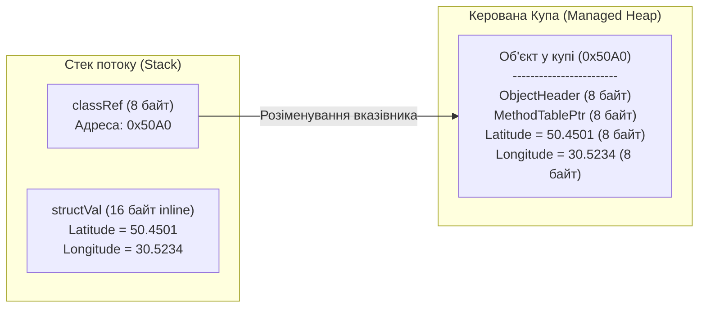

# Лекція 02: Значущі типи (`struct`) проти Класів (`class`) та Механізм Boxing / Unboxing

Поділ усіх типів на **Посилальні (`Reference Types` — `class`)** та **Значущі (`Value Types` — `struct`, `enum`)** є фундаментальною архітектурною особливістю платформи .NET. Розуміння того, як структури розміщуються в пам'яті та коли виникає неявне пакування (`Boxing`), безпосередньо визначає швидкодію програм.

---

## 1. Порівняння `class` та `struct` на рівні CLR



| Характеристика | Клас (`class` — Reference Type) | Структура (`struct` — Value Type) |
|:---|:---|:---|
| **Де зберігаються байти полів?** | Завжди в **Managed Heap** (у змінній лежить лише 8-байтна адреса) | **Безпосередньо в місці оголошення**: на Стеку (для локальних змінних) або всередині пам'яті масиву/об'єкта |
| **Накладні витрати пам'яті (Overhead)** | **+16 байт** на кожен екземпляр у 64-бітній CLR (`ObjectHeader` + `TypeHandle`) + 8 байт сам вказівник | **0 байт** службового заголовка (зберігаються виключно чисті дані полів) |
| **Семантика присвоєння `b = a`** | Копіює лише 8-байтне посилання; обидві змінні дивляться на **той самий** об'єкт у купі | Створює **повну побітову копію** всіх полів; зміна `b` ніяк не впливає на оригінал `a` |
| **Спадкування** | Підтримує ієрархії спадкування класів (`virtual`, `override`, `abstract`) | Завжди неявно `sealed` (успадковується від `System.ValueType`), але **може реалізовувати інтерфейси** |
| **Навантаження на Garbage Collector** | Кожен `new` навантажує GC | Не створює сміття в купі (миттєво звільняється при згортанні стек-фрейму методу) |

---

## 2. Чому структури мають бути незмінними (`readonly struct`)?

Мутабельні (змінювані) структури є небезпечним антипатерном у C#. Оскільки при кожному читанні властивості або передачі у метод повертається **копія** структури, спроба змінити поле на тимчасовій копії або не скомпілюється, або мовчки змінить клон замість оригіналу (Defensive Copy):

```csharp
// Bad: Мутабельна структура — джерело плутанини та прихованих захисних копій
public struct MutablePoint
{
    public double X { get; set; }
    public double Y { get; set; }
    public void Move(double dx, double dy) { X += dx; Y += dy; } // Мутує стан!
}

// Good: Еталонна незмінна структура (як у 02-StructVsClassAndBoxing)
public readonly struct GeoCoordinate
{
    public double Latitude { get; }
    public double Longitude { get; }

    public GeoCoordinate(double latitude, double longitude)
    {
        Latitude = latitude;
        Longitude = longitude;
    }

    // Замість мутації повертаємо новий обчислений екземпляр структури:
    public GeoCoordinate OffsetBy(double deltaLat, double deltaLon)
        => new GeoCoordinate(Latitude + deltaLat, Longitude + deltaLon);
}
```

### Коли варто створювати `readonly struct`:
1. Розмір усіх полів структури невеликий — рекомендовано **до 16–24 байт** (інакше побітове копіювання при кожному передаванні у метод стає дорожчим за передачу 8-байтного посилання, якщо не використовувати `in`).
2. Тип логічно представляє одне атомарне значення (координати, грошова сума, комплексне число, колір RGB, діапазон дат).
3. Дані є незмінними (`readonly struct`) і не потребують частого приведення до `object`.

---

## 3. Механізм Boxing (Пакування) та Unboxing (Розпакування)

Що відбувається, коли значущий тип (`int`, `double`, `GeoCoordinate`) передається у метод, який очікує посилальний тип `object` або інтерфейс (наприклад, `IFormattable`)? Оскільки змінна типу `object` зобов'язана зберігати **адресу об'єкта в Купі із заголовком `MethodTable`**, середовище CLR виконує операцію **Boxing**:

```mermaid
sequenceDiagram
    participant Stack as Стек потоку (Stack)
    participant CLR as Середовище CLR (RyuJIT)
    participant Heap as Керована Купа (Managed Heap)

    Note over Stack: GeoCoordinate coord = new(50.45, 30.52)<br/>(16 байт на стеку)
    Stack->>CLR: object boxed = coord; (IL-інструкція: box)
    CLR->>Heap: 1. Виділяє 32 байти в Купі (16 байт Header + 16 байт даних)
    CLR->>Heap: 2. Копіює байти полів Latitude та Longitude зі Стеку в Купу
    Heap-->>Stack: 3. Записує адресу створеного об'єкта в змінну boxed
    Stack->>CLR: GeoCoordinate unboxed = (GeoCoordinate)boxed; (IL: unbox.any)
    CLR->>Heap: 4. Перевіряє тотожність типу в MethodTable (інакше InvalidCastException)
    Heap-->>Stack: 5. Копіює 16 байт полів із Купи назад у локальну змінну на Стеку
```

### Як виглядає Boxing та Unboxing у коді ([Program.cs](../02-StructVsClassAndBoxing/Program.cs#L58-L69)):

```csharp
GeoCoordinate kyiv = new GeoCoordinate(50.4501, 30.5234); // Лежить на стеку (0 алокацій у купі)

// 1. BOXING (IL: box GeoCoordinate):
// Виділяє новий об'єкт у Managed Heap і копіює туди значення зі стеку!
object boxedCoord = kyiv;

// 2. UNBOXING (IL: unbox.any GeoCoordinate):
// Перевіряє тип у купі та копіює байти назад на стек:
GeoCoordinate unboxedCoord = (GeoCoordinate)boxedCoord;
```

> [!WARNING]
> **Чому Boxing небезпечний у гарячих циклах?** Пакування не лише витрачає час процесора на копіювання байтів, а й створює тимчасові об'єкти-обгортки в Купі, які одразу після завершення виклику стають сміттям і змушують Garbage Collector запускатися значно частіше. Саме тому в C# використовують узагальнені колекції `List<GeoCoordinate>` (без боксингу) замість застарілого `ArrayList` або `List<object>`.

---

## Матриця проєктів розділу

| Проєкт | Файл коду | Ключові рядки | Що демонструється в коді |
|:---|:---|:---|:---|
| **02-StructVsClassAndBoxing** | [Program.cs](../02-StructVsClassAndBoxing/Program.cs) | [Рядки 28–69](../02-StructVsClassAndBoxing/Program.cs#L28-L69) | Наочне порівняння копіювання посилання (`class MutableLocation`) проти незалежного копіювання значення (`readonly struct GeoCoordinate`), а також демонстрація `Boxing` та `Unboxing` |
