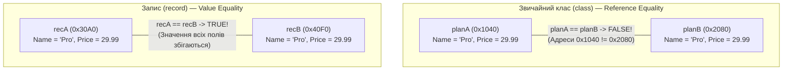

# Лекція 03: Моделі даних `record` — Структурна Рівність (`Value Equality`), `with` та `Deconstruct`

У класичних об'єктно-орієнтованих програмах об'єкти поділяються на дві великі категорії: **Сутності (Entities)**, які мають власну ідентичність і змінюють стан у часі, та **Об'єкти-Значення / DTO (Value Objects / Data Transfer Objects)**, які визначаються виключно набором своїх атрибутів. Для другої категорії у C# створено спеціальний вид типів — **записи (`record`)**.

---

## 1. `Reference Equality` (`class`) проти `Value Equality` (`record`)

У звичайних класах (`class`) оператор `==` та метод `Equals()` за замовчуванням перевіряють **рівність посилань (`Reference Equality`)** — тобто чи вказують дві змінні на ту саму фізичну адресу в керованій купі:



### Що генерує компілятор для позиційного `record`?

Коли ми оголошуємо позиційний запис в один рядок ([Program.cs](../03-RecordEqualityAndWith/Program.cs#L70)):
```csharp
public sealed record SubscriptionPlan(string Name, decimal MonthlyPrice, int MaxUsers);
```
Компілятор Roslyn автоматично синтезує повноцінний клас із понад 60 рядків шаблонного коду:
1. **Незмінні автовластивості `init`**: `public string Name { get; init; }`, які можна задати лише під час створення об'єкта.
2. **Реалізацію `IEquatable<SubscriptionPlan>`**: перевизначені методи `Equals(object?)`, типізований `Equals(SubscriptionPlan?)` та оператори `==` і `!=`, які порівнюють значення кожного поля.
3. **Узгоджений `GetHashCode()`**: обчислює комбінований хеш-код на основі значень `Name`, `MonthlyPrice` та `MaxUsers` (завдяки чому два окремі екземпляри `record` з однаковими даними коректно працюють як один ключ у `Dictionary` або `HashSet`).
4. **Форматований `ToString()` через `PrintMembers(StringBuilder)`**: замість беззмістовного імені типу виводить усі назви та значення властивостей:
   `SubscriptionPlan { Name = Pro, MonthlyPrice = 29.99, MaxUsers = 10 }`.

---

## 2. Неруйнівна мутація (Non-destructive Mutation) через оператор `with`

Оскільки поля позиційного `record` захищені модифікатором `init`, змінити одну властивість уже створеного об'єкта напряму не можна (`plan.MonthlyPrice = 39.99m;` викличе помилку компіляції). Як тоді оновити стан незмінного об'єкта?

Для цього використовується оператор **`with`** ([Program.cs](../03-RecordEqualityAndWith/Program.cs#L50)):

```csharp
var basePlan = new SubscriptionPlan("Pro", 29.99m, 10);

// Створює НОВИЙ екземпляр у купі, копіюючи всі поля з basePlan, окрім явно змінених:
var discountedPlan = basePlan with { MonthlyPrice = 19.99m };

Console.WriteLine(basePlan);       // SubscriptionPlan { Name = Pro, MonthlyPrice = 29.99, MaxUsers = 10 }
Console.WriteLine(discountedPlan); // SubscriptionPlan { Name = Pro, MonthlyPrice = 19.99, MaxUsers = 10 }
Console.WriteLine(ReferenceEquals(basePlan, discountedPlan)); // false (оригінал залишився незмінним!)
```

### Як `with` працює під капотом?
Компілятор генерує в записі захищений **конструктор копіювання** `protected SubscriptionPlan(SubscriptionPlan original)` і віртуальний метод клонування `<Clone>$()`. Вираз `basePlan with { MonthlyPrice = 19.99m }` спочатку викликає конструктор копіювання (копіюючи всі поля оригіналу), а потім застосовує `init`-сеттер для змінених властивостей. Це робить роботу з незмінними станами у багатопотокових системах абсолютно безпечною.

---

## 3. Деконструкція (`Deconstruct`) та `record class` проти `record struct`

Позиційні записи автоматично отримують метод `public void Deconstruct(out string Name, out decimal MonthlyPrice, out int MaxUsers)`, який дозволяє миттєво розпакувати об'єкт у набір локальних змінних або використати позиційний Pattern Matching ([Program.cs](../03-RecordEqualityAndWith/Program.cs#L55)):

```csharp
// Розпакування об'єкта у змінні за один рядок:
var (planName, price, usersLimit) = discountedPlan;
Console.WriteLine($"Тариф {planName}: {price} USD до {usersLimit} користувачів");
```

### Порівняння різновидів `record` у C# 10+:

| Різновид | Вид типу в CLR | Де живе в пам'яті? | Мутабельність позиційних властивостей за замовчуванням | Коли використовувати |
|:---|:---|:---|:---|:---|
| **`record`** (або `record class`) | Reference Type | У Купі (`Managed Heap`) | **Незмінний (`get; init;`)** | Стандартний вибір для DTO, подій, відповідей API, конфігурацій та Value Objects із >3 полями |
| **`record struct`** | Value Type | На Стеку / Inline | Мутабельний (`get; set;`)! | Рідко — краще додавати модифікатор `readonly` |
| **`readonly record struct`** | Value Type | На Стеку / Inline | **Повністю незмінний (`get; init;`)** | Ідеальний вибір для малих примітивів (до 16–24 байт), де потрібна автогенерація `==`, `ToString()` та `with` без алокацій у купі |

---

## Матриця проєктів розділу

| Проєкт | Файл коду | Ключові рядки | Що демонструється в коді |
|:---|:---|:---|:---|
| **03-RecordEqualityAndWith** | [Program.cs](../03-RecordEqualityAndWith/Program.cs) | [Рядки 28–71](../03-RecordEqualityAndWith/Program.cs#L28-L71) | Порівняння поведінки звичайного класу `ClassPlan` (`Reference Equality`) із записом `SubscriptionPlan` (`Value Equality`), демонстрація клонування через `with`, виведення `ToString()` та розпакування `Deconstruct` |
