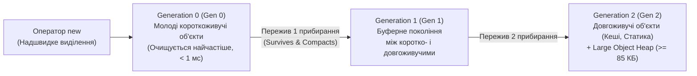

# Лекція 04: Життєвий цикл об'єкта — Garbage Collector (`Gen 0/1/2`) та Патерн `IDisposable`

У C# розробник не звільняє пам'ять об'єктів вручну через `delete`. За очищення керованої купи (Managed Heap) відповідає **Garbage Collector (GC)**, а за вчасне закриття зовнішніх некерованих ресурсів операційної системи (файлів, мережевих сокетів, транзакцій БД) — детермінований контракт **`IDisposable`**.

---

## 1. Як працює Поколіннєвий Збирач Сміття (Generational GC)

Робота GC у .NET базується на **гіпотезі поколінь (Generational Hypothesis)**:
1. Більшість об'єктів помирають дуже молодими (локальні об'єкти методів, DTO одного HTTP-запиту, рядкові буфери).
2. Якщо об'єкт пережив кілька циклів прибирання, він, найімовірніше, житиме довго (кеш, конфігурація, Singleton-сервіси).

Тому керована купа (Small Object Heap для об'єктів `< 85 000` байт) поділена на **3 покоління**:



### Три фази циклу GC:
1. **Mark (Позначення)**: GC зупиняє потоки та будує граф досяжних («живих») об'єктів, починаючи від **Коренів (GC Roots)** — локальних змінних у стеках потоків, регістрів CPU та статичних полів. Усі об'єкти, до яких немає шляху від коренів, вважаються сміттям.
2. **Sweep (Очищення)**: пам'ять недосяжних об'єктів позначається як вільна.
3. **Compact (Ущільнення)**: живі об'єкти зсуваються впритул один до одного на початок сегмента купи (усуваючи фрагментацію пам'яті), їхні адреси в посиланнях автоматично оновлюються, а вони самі підвищуються в наступне покоління (`Gen 0 -> Gen 1 -> Gen 2`).

---

## 2. Сильні проти Слабких посилань (`WeakReference`)

Звичайна змінна тримає **сильне посилання (Strong Reference)**: поки воно існує, GC за жодних обставин не видалить об'єкт. Проте для in-memory кешів іноді потрібне **слабке посилання (`WeakReference<T>`)**, яке дозволяє звертатися до об'єкта, доки він у пам'яті, але **не заважає GC прибрати його**, коли системі знадобиться пам'ять ([Program.cs](../04-GarbageCollectorAndIDisposable/Program.cs#L58-L71)):

```csharp
var tempBuffer = new byte[1024];
var weakRef = new WeakReference(tempBuffer);

tempBuffer = null; // Сильне посилання розірвано!
GC.Collect();      // Примусовий запуск GC (лише в навчальних цілях)

// Перевіряємо, чи об'єкт ще живий у купі:
Console.WriteLine(weakRef.IsAlive); // false — GC успішно звільнив пам'ять!
```

---

## 3. Керовані проти Некерованих ресурсів: Навіщо потрібен `IDisposable`?

Garbage Collector чудово знає про байти в керованій купі, але він **нічого не знає про зовнішні ресурси операційної системи**: відкриті файлові дескриптори, мережеві TCP-сокети, підключення до бази даних або GDI-хендли. Якщо чекати, поки GC колись (можливо, через 10 хвилин) прибере об'єкт, файл залишатиметься заблокованим, а пул з'єднань БД вичерпається!

Для **миттєвого (детермінованого)** звільнення ресурсів одразу після використання в .NET існує інтерфейс `IDisposable` та конструкція `using`:

```csharp
public sealed class DatabaseSession : IDisposable
{
    private bool _disposed;
    public string SessionName { get; }

    public DatabaseSession(string sessionName)
    {
        SessionName = sessionName;
        Console.WriteLine($"[Відкрито з'єднання]: {SessionName}");
    }

    public void ExecuteQuery(string sql)
    {
        // Захист інваріанта: забороняємо використовувати вже закритий об'єкт!
        ObjectDisposedException.ThrowIf(_disposed, this);
        Console.WriteLine($"[Виконання SQL у {SessionName}]: {sql}");
    }

    public void Dispose()
    {
        if (_disposed) return; // Захист від повторного виклику Dispose() (ідемпотентність)

        Console.WriteLine($"[Детерміновано закрито з'єднання]: {SessionName}");
        _disposed = true;

        // Повідомляємо GC, що фіналізатор викликати вже не потрібно (об'єкт не потрапить у чергу фіналізації):
        GC.SuppressFinalize(this);
    }
}
```

### Як компілятор розгортає конструкцію `using`:
```csharp
// Те, що пишемо ми (сучасний синтаксис using declaration):
using var session = new DatabaseSession("OrdersDB");
session.ExecuteQuery("SELECT * FROM Orders");

// Те, на що компілятор гарантовано перетворює цей код:
DatabaseSession session = new DatabaseSession("OrdersDB");
try
{
    session.ExecuteQuery("SELECT * FROM Orders");
}
finally
{
    // Dispose() виконається ЗАВЖДИ, навіть якщо всередині блоку станеться виняток!
    session?.Dispose();
}
```

---

## 4. Довідник методів керування життєвим циклом

| Клас / Метод | Опис та призначення | Приклад у коді | Документація MSDN |
|:---|:---|:---|:---|
| `GC.GetGeneration(object)` | Повертає поточне покоління об'єкта в Купі (`0`, `1` або `2`) | [Program.cs](../04-GarbageCollectorAndIDisposable/Program.cs#L51) | [GC.GetGeneration](https://learn.microsoft.com/en-us/dotnet/api/system.gc.getgeneration) |
| `GC.Collect()` | Примусово запускає збирання сміття (використовується лише для діагностики/тестів) | [Program.cs](../04-GarbageCollectorAndIDisposable/Program.cs#L53) | [GC.Collect](https://learn.microsoft.com/en-us/dotnet/api/system.gc.collect) |
| `GC.SuppressFinalize(object)` | Скасовує виклик фіналізатора, оскільки ресурси вже звільнені в `Dispose()` | [Program.cs](../04-GarbageCollectorAndIDisposable/Program.cs#L34) | [GC.SuppressFinalize](https://learn.microsoft.com/en-us/dotnet/api/system.gc.suppressfinalize) |
| `IDisposable.Dispose()` | Детерміновано звільняє зовнішні ресурси (файли, сокети, з'єднання з БД) | [Program.cs](../04-GarbageCollectorAndIDisposable/Program.cs#L25) | [IDisposable.Dispose](https://learn.microsoft.com/en-us/dotnet/api/system.idisposable.dispose) |
