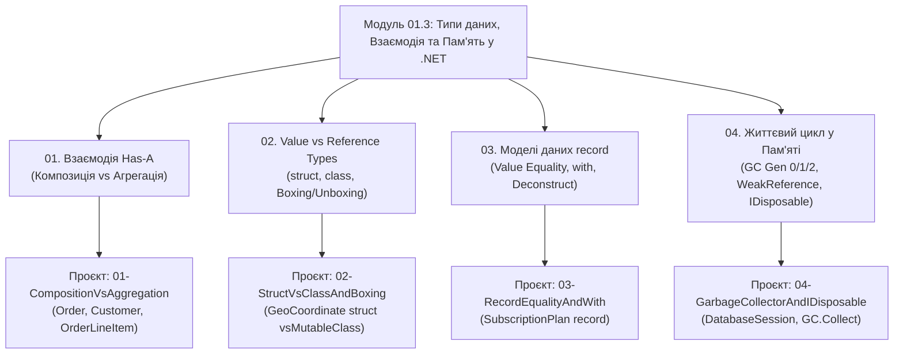

# Модуль 01.3: Взаємодія Класів, `struct` vs `record` та Життєвий Цикл Об'єкта в Пам'яті

[](https://dotnet.microsoft.com/)
[](https://github.com/)

Цей підмодуль завершує першу главу курсу (`01-Fundamentals`), підсумовуючи знання про конструювання типів та роботу пам'яті CLR перед переходом до Успадкування та Поліморфізму (`02-OOP-Core`):

1. **Композиція та Агрегація (`Has-A`)**: як будувати складні доменні моделі з простих класів і хто відповідає за життєвий цикл вкладених об'єктів.
2. **Значущі типи (`struct`) проти Посилальних (`class`)**: де фізично лежать байти в пам'яті, як працюють `readonly struct` та чому виникає пастка продуктивності **Boxing / Unboxing**.
3. **Незмінні моделі даних (`record`)**: структурна рівність за значенням полів (`Value Equality`), клонування з модифікацією через оператор `with` та деконструкція в кортежі (`Deconstruct`).
4. **Керування пам'яттю (Garbage Collector та `IDisposable`)**: покоління купи (`Gen 0`, `Gen 1`, `Gen 2`, LOH), слабкі посилання (`WeakReference`) та детерміноване звільнення зовнішніх ресурсів ОС через `using`.

---

## Архітектурна карта модуля



---

## Матриця проєктів та лекційних посібників

| Розділ | Проєкт | Лекційний посібник у `Docs/` | Ключові концепції та механізми CLR |
|:---:|:---|:---|:---|
| **01** | [`01-CompositionVsAggregation`](01-CompositionVsAggregation/Program.cs) | [`01_Composition_And_Aggregation.md`](Docs/01_Composition_And_Aggregation.md) | Зв'язок `Has-A`, UML-нотація ромбів (`o--` vs `*--`), делегування поведінки, захист внутрішніх колекцій через `IReadOnlyList<T>` |
| **02** | [`02-StructVsClassAndBoxing`](02-StructVsClassAndBoxing/Program.cs) | [`02_Structs_And_Boxing.md`](Docs/02_Structs_And_Boxing.md) | Розміщення на Стеку проти Купи, копіювання за значенням, `readonly struct`, IL-інструкції `box` та `unbox.any` |
| **03** | [`03-RecordEqualityAndWith`](03-RecordEqualityAndWith/Program.cs) | [`03_Records_And_Value_Equality.md`](Docs/03_Records_And_Value_Equality.md) | `Reference Equality` проти `Value Equality`, синтезований `IEquatable<T>`, неруйнівна мутація `with`, `record class` vs `record struct` |
| **04** | [`04-GarbageCollectorAndIDisposable`](04-GarbageCollectorAndIDisposable/Program.cs) | [`04_Garbage_Collector_And_IDisposable.md`](Docs/04_Garbage_Collector_And_IDisposable.md) | Алгоритм Mark-and-Compact, покоління `Gen 0/1/2`, LOH, `WeakReference`, патерн `IDisposable`, `using` та `GC.SuppressFinalize` |

---

## Короткий довідник: Коли обирати `class`, `record` чи `struct`?

| Тип | Семантика пам'яті | Порівняння `==` | Мутабельність | Типовий сценарій використання у проектах |
|:---|:---|:---|:---|:---|
| **`class`** | Reference Type (Купа) | За адресою (`ReferenceEquals`) | Контрольована зміна стану через методи | Доменні сутності з життєвим циклом (`Order`, `BankAccount`), сервіси, контролери |
| **`record class`** | Reference Type (Купа) | За значенням полів (`Value Equality`) | Незмінний за замовчуванням (`init`) | DTO, події домену, конфігурації, відповіді API (`SubscriptionPlan`) |
| **`readonly struct`** | Value Type (Стек / Inline) | Побітове / `IEquatable<T>` | Повністю незмінний (`readonly`) | Малі атомарні величини до 16–24 байт (`GeoCoordinate`, `Money`, `Point2D`) |
| **`record struct`** | Value Type (Стек / Inline) | За значенням полів (`Value Equality`) | Бажано `readonly record struct` | Малі структури даних, де потрібні готові `==`, `GetHashCode()`, `ToString()` та `with` без алокацій у купі |

---

## Збірка та запуск

Усі проєкти об'єднані у файл рішення `StructsRecordsAndGC.sln` і підтримують .NET 10:

```bash
# Збірка всього підмодуля
dotnet build StructsRecordsAndGC.sln -c Release

# Послідовний запуск усіх 4 демонстраційних проєктів
dotnet run --project 01-CompositionVsAggregation/01-CompositionVsAggregation.csproj
dotnet run --project 02-StructVsClassAndBoxing/02-StructVsClassAndBoxing.csproj
dotnet run --project 03-RecordEqualityAndWith/03-RecordEqualityAndWith.csproj
dotnet run --project 04-GarbageCollectorAndIDisposable/04-GarbageCollectorAndIDisposable.csproj
```
