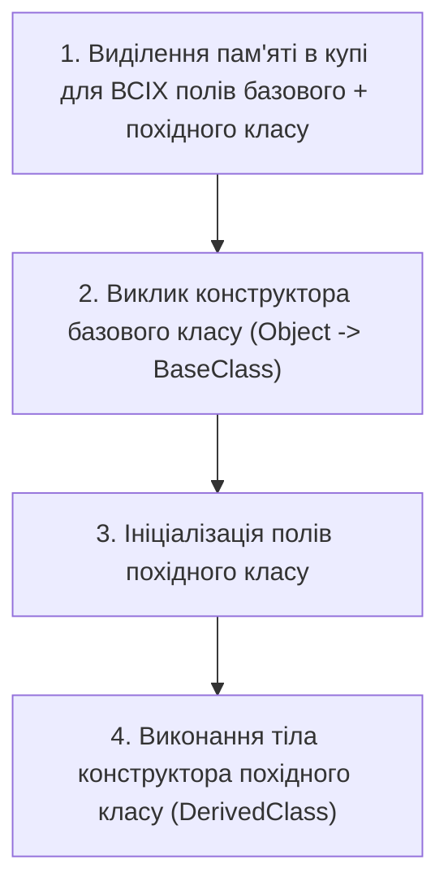

# Лекція 1: Успадкування, Базові Конструктори та Ключове Слово `base`

## 1. Концепція успадкування (Inheritance)

**Успадкування** — це фундаментальний механізм ООП, що дозволяє створити новий клас (похідний / `derived class`) на основі вже існуючого (базового / `base class`). Похідний клас автоматично переймає всі поля, властивості та методи базового класу (окрім конструкторів), додаючи до них власні або модифікуючи існуючі.

* Відношення між базовим і похідним класом виражається принципом **«IS-A»** («є»): `Dog` **є** `Animal`, `Manager` **є** `Employee`.

---

## 2. Порядок виконання конструкторів

При створенні екземпляра похідного класу конструктори викликаються у суворій послідовності: **від вершини ієрархії донизу (від базового до похідного)**:



### Передача параметрів у базовий конструктор:
```csharp
public class Person
{
    public string Name { get; }
    public Person(string name) => Name = name;
}

public class Employee : Person
{
    public decimal Salary { get; }

    // Виклик базового конструктора через base(...):
    public Employee(string name, decimal salary) : base(name)
    {
        Salary = salary;
    }
}
```

---

## 3. Модифікатор доступу `protected`

* Члени класу, оголошені як **`protected`**, є **приватними для зовнішнього світу**, але **відкритими для всіх похідних класів**.
* Це дозволяє похідним класам мати доступ до важливих внутрішніх деталей реалізації без порушення інкапсуляції для зовнішніх користувачів типу.
