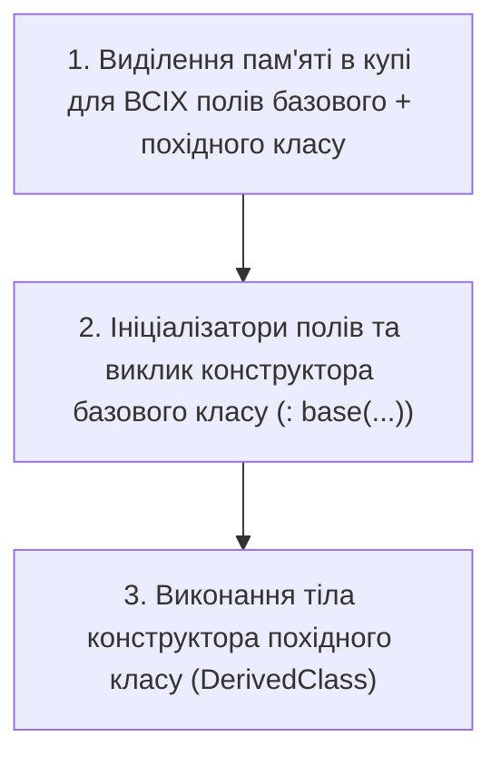

# 01. Базове спадкування, ключове слово `base` та конструктори

## 1. Концепція успадкування (Inheritance)

**Успадкування** — це фундаментальний механізм ООП, що дозволяє створити новий клас (похідний / `derived class`) на основі вже існуючого (базового / `base class`). Похідний клас автоматично переймає всі поля, властивості та методи базового класу (окрім конструкторів і фіналізаторів), додаючи до них власні або розширюючи існуючі.

* Відношення між базовим і похідним класом виражається принципом **«IS-A»** («є»): `Dog` **є** `Animal`, `Manager` **є** `Employee`.
* Якщо похідний клас оголошує поле або метод із тим самим іменем, що є в базовому класі, модифікатор **`new`** явно позначає **маскування (приховування)** успадкованого члена.
* Ключове слово **`base`** дозволяє звернутися з похідного класу безпосередньо до прихованого члена базового класу (`base.Field1`) або викликати базовий конструктор (`: base(...)`).

---

## 2. Порядок виконання конструкторів (`base` та `this`)

При створенні екземпляра похідного класу конструктори викликаються у суворій послідовності: **від вершини ієрархії донизу (від базового до похідного)**:

* **`: base(...)`** — делегує ініціалізацію базової частини об'єкта конкретному конструктору базового класу.
* **`: this(...)`** — делегує роботу іншому перевантаженому конструктору **цього ж класу**, дозволяючи уникнути дублювання коду ініціалізації.

---

## Матриця проєктів цієї секції

| Проєкт | Сторінка / Тема | Що демонструє |
|:---|:---|:---|
| [`SOLIS-p177`](../SOLIS-p177/Program.cs) | Solis, с. 177 | Оголошення похідного класу `OtherClass : SomeClass` та вільний доступ до власних і успадкованих полів/методів. |
| [`SOLIS-p180`](../SOLIS-p180/Program.cs) | Solis, с. 180 | Навмисне приховування (маскування) полів і методів базового класу за допомогою ключового слова `new`. |
| [`SOLIS-p181`](../SOLIS-p181/Program.cs) | Solis, с. 181 | Використання префікса `base.Field1` для доступу до затуленого члена базового класу зсередини похідного. |
| [`SOLIS-p196`](../SOLIS-p196/Program.cs) | Solis, с. 196 | Порядок виклику конструкторів в ієрархії та передача аргументів у базовий конструктор через `: base(...)`. |
| [`Ex-ThisInConstructor`](../Ex-ThisInConstructor/Program.cs) | Практикум | Ланцюжки конструкторів усередині одного класу через `: this(...)` та розрізнення однойменних полів через `this.name`. | 