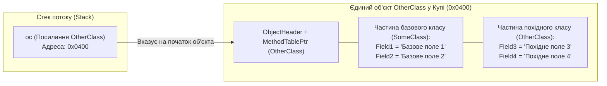
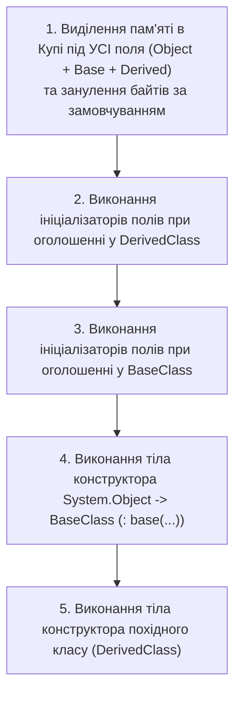

# Лекція 01: Базове спадкування, Розміщення полів у Пам'яті та Конструктори (`base` і `this`)

**Успадкування (Inheritance)** — це фундаментальний механізм ООП, який дозволяє створити новий спеціалізований клас (**похідний / `derived class`**) на основі вже існуючого (**базового / `base class`**). Похідний клас автоматично переймає всі поля, властивості та методи базового класу (окрім конструкторів і фіналізаторів), додаючи власний стан або розширюючи поведінку.

---

## 1. Семантика `IS-A` та Розміщення Похідного Об'єкта в Купі CLR

Відношення між похідним і базовим класом описується правилом **«IS-A» («Є різновидом»)**: `Manager` **є** `Employee`, `Dog` **є** `Animal`. У C# підтримується **одиночне спадкування класів (Single Implementation Inheritance)**: клас може мати лише один безпосередній базовий клас, а коренем усієї ієрархії завжди виступає `System.Object`.

Коли ми створюємо екземпляр похідного класу `new OtherClass()` (`SOLIS-p177`), середовище CLR виділяє в керованій купі **єдиний неперервний блок пам'яті**, який містить спочатку всі поля базового класу (`SomeClass`), а одразу за ними — поля похідного класу (`OtherClass`):



> [!NOTE]
> Навіть якщо поле базового класу оголошене як `private`, воно **фізично присутнє** всередині пам'яті кожного екземпляра похідного класу (просто компілятор не дозволяє звертатися до нього напряму з коду спадкоємця без публічних або захищених методів базового класу).

---

## 2. Маскування членів (`new`) та Доступ до базового класу (`base.Field`)

Що відбувається, якщо в похідному класі оголосити поле або метод із тим самим іменем, яке вже існує в базовому класі (`SOLIS-p180`, `SOLIS-p181`)?
1. Компілятор видасть попередження `CS0108` («член приховує успадкований член»), якщо ми явно не вкажемо ключове слово **`new`**, яке підтверджує, що **приховування (hiding / masking)** зроблено свідомо.
2. При цьому старе поле базового класу **не зникає**! В об'єкті в купі тепер існують **два окремі поля** з однаковим коротшим ім'ям: `SomeClass.Field1` та `OtherClass.Field1`.
3. Щоб звернутися з методу похідного класу саме до прихованого члена базового класу, використовується префікс **`base.`** (`SOLIS-p181`):

```csharp
class SomeClass
{
    public string Field1 = "Field1 — значення з базового класу (SomeClass)";
}

class OtherClass : SomeClass
{
    // Модифікатор 'new' явно маскує базове поле Field1 власним полем похідного класу:
    new public string Field1 = "Field1 — нове значення у похідному класі (OtherClass)";

    public void PrintBothFields()
    {
        Console.WriteLine(Field1);      // Читає this.Field1 (з OtherClass)
        Console.WriteLine(base.Field1); // Читає приховане поле з базової частини (SomeClass)
    }
}
```

---

## 3. Порядок виконання Конструкторів в Ієрархії (`: base(...)` та `: this(...)`)

Конструктори **не успадковуються** похідними класами, але базова частина об'єкта зобов'язана бути коректно проініціалізованою перед тим, як почне працювати код конструктора спадкоємця (`SOLIS-p196`).

Тому при виклику `new DerivedClass(...)` ініціалізація відбувається у суворій послідовності:



### Порівняння `: base(...)` та `: this(...)` (`SOLIS-p196` та `Ex-ThisInConstructor`):

| Синтаксис | Куди передає керування | Типовий сценарій використання |
|:---|:---|:---|
| **`: base(args)`** | Викликає обраний конструктор **безпосереднього базового класу** | Передача обов'язкових параметрів (наприклад, `id`, `userName`), які зберігаються у базовому класі (`SOLIS-p196`) |
| **`: this(args)`** | Викликає інший перевантажений конструктор **цього ж самого класу** | Усунення дублювання коду ініціалізації (Constructor Chaining — вузькі конструктори делегують роботу головному конструктору, див. `Ex-ThisInConstructor`) |

```csharp
public class Employee
{
    public string FullName { get; }
    public Employee(string fullName) => FullName = fullName;
}

public class Manager : Employee
{
    public string Department { get; }
    public int TeamSize { get; }

    // 1. Головний конструктор передає ім'я в базовий клас через : base(fullName)
    public Manager(string fullName, string department, int teamSize)
        : base(fullName)
    {
        Department = department;
        TeamSize = teamSize;
    }

    // 2. Перевантажений конструктор делегує роботу головному конструктору через : this(...)
    public Manager(string fullName, string department)
        : this(fullName, department, teamSize: 5)
    {
    }
}
```

> [!WARNING]
> Якщо базовий клас має лише конструктор із параметрами (і не має конструктора без параметрів `Base()`), то похідний клас **зобов'язаний** явно викликати `: base(...)` у своїх конструкторах, інакше виникне помилка компіляції `CS7036`.

---

## Матриця проєктів цієї секції

| Проєкт | Сторінка / Тема | Що демонструє |
|:---|:---|:---|
| [`SOLIS-p177`](../SOLIS-p177/Program.cs) | Solis, с. 177 | Оголошення похідного класу `OtherClass : SomeClass` та вільний доступ до власних і успадкованих полів/методів. |
| [`SOLIS-p180`](../SOLIS-p180/Program.cs) | Solis, с. 180 | Навмисне приховування (маскування) полів і методів базового класу за допомогою ключового слова `new`. |
| [`SOLIS-p181`](../SOLIS-p181/Program.cs) | Solis, с. 181 | Використання префікса `base.Field1` для доступу до затуленого члена базового класу зсередини похідного. |
| [`SOLIS-p196`](../SOLIS-p196/Program.cs) | Solis, с. 196 | Порядок виклику конструкторів в ієрархії та передача аргументів у базовий конструктор через `: base(...)`. |
| [`Ex-ThisInConstructor`](../Ex-ThisInConstructor/Program.cs) | Практикум | Ланцюжки конструкторів усередині одного класу через `: this(...)` та розрізнення однойменних полів через `this.name`. |
