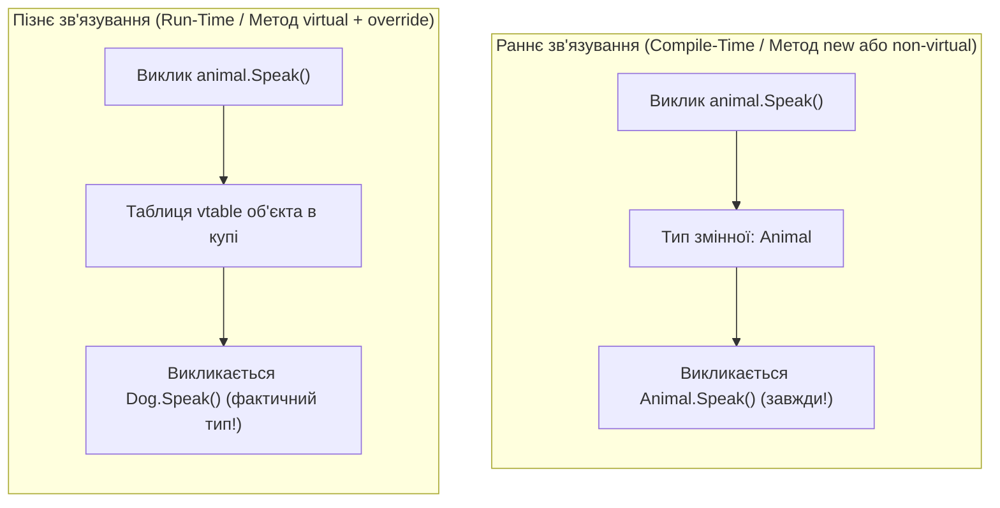

# Лекція 2: Поліморфізм, Віртуальні Методи (`override`) проти Приховування (`new`)

Одне з найпоширеніших джерел багів у початківців C# — це плутанина між **перевизначенням (`override`)** та **приховуванням членів (`new`)**.

---

## 1. Раннє (Статичне) проти Пізнього (Динамічного) Зв'язування



---

## 2. Порівняння поведінки: `override` vs `new`

```csharp
public class Animal
{
    public virtual void SpeakOverride() => Console.WriteLine("Animal voice");
    public void SpeakNew() => Console.WriteLine("Animal non-virtual");
}

public class Dog : Animal
{
    public override void SpeakOverride() => Console.WriteLine("Гав-гав! (Dog override)");
    public new void SpeakNew() => Console.WriteLine("Гав-гав! (Dog new hiding)");
}
```

### Результат при виклику через базовий тип (`Animal`):
```csharp
Animal myDog = new Dog(); // Upcasting

myDog.SpeakOverride(); // ➔ "Гав-гав! (Dog override)" -> Справжній поліморфізм!
myDog.SpeakNew();      // ➔ "Animal non-virtual"    -> Приховування НЕ працює поліморфно!
```

| Критерій | Перевизначення (`override`) | Приховування (`new`) |
|:---|:---:|:---:|
| **Вимога до базового методу** | Має бути `virtual`, `abstract` або `override` | Може бути будь-яким методом |
| **Зв'язування** | **Динамічне** (за фактичним типом об'єкта в купі) | **Статичне** (за типом змінної під час компіляції) |
| **Таблиця vtable** | Перезаписує слот у таблиці методів | Створює окремий новий метод |
| **Чи є поліморфізмом?** | **ТАК** | **НІ** (лише маскує ім'я) |
