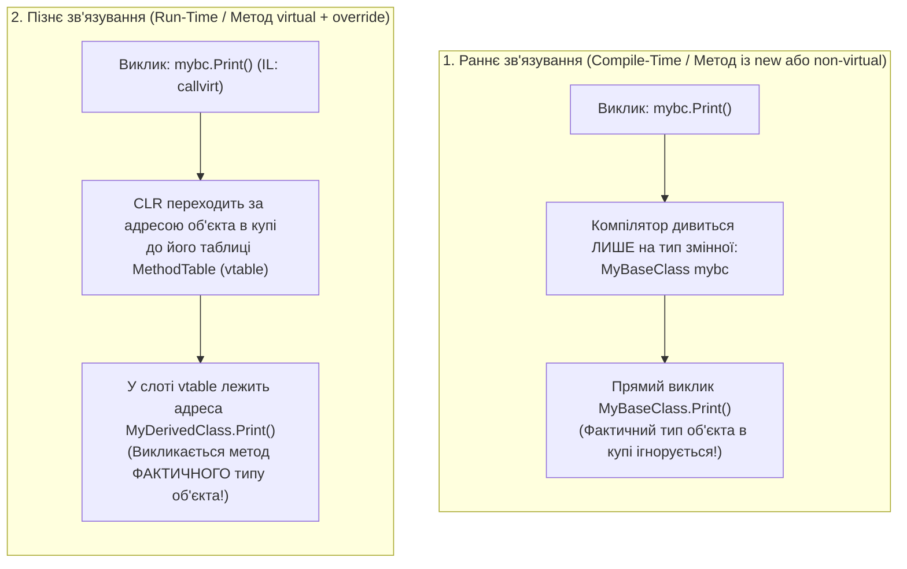

# Лекція 02: Віртуальні члени (`virtual`), Перевизначення (`override`) проти Приховування (`new`)

Одне з найважливіших питань об'єктно-орієнтованого програмування та технічних співбесід з C# — це різниця між **поліморфним перевизначенням методу (`virtual` + `override`)** та **статичним приховуванням члена (`new`)**. Щоб безпомилково розуміти поведінку будь-якої ієрархії класів, потрібно розглянути, як CLR диспетчеризує виклики через **таблицю віртуальних методів (`vtable`)**.

---

## 1. Раннє (Статичне) проти Пізнього (Динамічного) Зв'язування

Уявімо, що ми створили об'єкт похідного класу `MyDerivedClass`, але зберегли адресу цього об'єкта у змінній базового типу:
```csharp
MyDerivedClass derived = new MyDerivedClass();
MyBaseClass mybc = derived; // Upcasting: змінна типу MyBaseClass вказує на реальний об'єкт MyDerivedClass у купі
mybc.Print();               // Який саме метод Print() виконається?
```

Відповідь залежить від того, як оголошено метод `Print()` (`SOLIS-p183` проти `SOLIS-p185`):



---

## 2. Таблиця віртуальних методів (`vtable`) та Розрив ланцюжка на 3 рівнях (`SOLIS-p187` vs `SOLIS-p188`)

Кожен тип у CLR має структуру метаданих `MethodTable`, частиною якої є масив вказівників на віртуальні методи — **`vtable` (Virtual Method Table)**:
* Коли базовий клас оголошує `public virtual void Print()`, компілятор виділяє у `vtable` **Слот #0** і записує туди адресу `MyBaseClass.Print`.
* Коли похідний клас пише `public override void Print()`, він **перезаписує Слот #0** адресою свого нового методу `MyDerivedClass.Print`.
* Але якщо третій клас в ієрархії (`SecondDerived` у `SOLIS-p188`) замість `override` напише **`new public void Print()`**, він **НЕ перезаписує Слот #0**, а створює окремий незв'язаний метод!

Подивімося, до чого це призводить у багаторівневій ієрархії `MyBaseClass -> MyDerivedClass -> SecondDerived`:

```csharp
class MyBaseClass
{
    public virtual void Print() => Console.WriteLine("Базовий клас (MyBaseClass)");
}

class MyDerivedClass : MyBaseClass
{
    // Перезаписує Слот #0 у vtable:
    public override void Print() => Console.WriteLine("Похідний клас 1 (MyDerivedClass)");
}

class SecondDerivedWithOverride : MyDerivedClass
{
    // SOLIS-p187: Знову перезаписує Слот #0 у vtable:
    public override void Print() => Console.WriteLine("Похідний клас 2 з override (SecondDerived)");
}

class SecondDerivedWithNew : MyDerivedClass
{
    // SOLIS-p188: Модифікатор 'new' РОЗРИВАЄ поліморфний ланцюжок!
    // У Слоті #0 таблиці vtable залишається адреса MyDerivedClass.Print()!
    public new void Print() => Console.WriteLine("Похідний клас 2 з new (SecondDerived)");
}
```

### Результат виклику через базове посилання `MyBaseClass`:
1. У **`SOLIS-p187` (`override` на 3-му рівні)**: виклик `((MyBaseClass)secondDerived).Print()` дивиться у Слот #0 і викликає **`SecondDerived.Print()`**.
2. У **`SOLIS-p188` (`new` на 3-му рівні)**: виклик `((MyBaseClass)secondDerived).Print()` дивиться у Слот #0, бачить там останній зареєстрований `override` і викликає **`MyDerivedClass.Print()`**! А метод із `new` доступний лише тоді, коли змінна явно типізована як `SecondDerivedWithNew`.

---

## 3. Віртуальні властивості (`SOLIS-p189`)

Оскільки властивості у C# під час компіляції перетворюються на пару методів `get_PropertyName()` та `set_PropertyName()`, вони так само підтримують модифікатори `virtual` та `override` (`SOLIS-p189`):

```csharp
class MyBaseClass
{
    private int _myInt = 5;
    public virtual int MyProperty
    {
        get => _myInt;
        set => _myInt = value;
    }
}

class MyDerivedClass : MyBaseClass
{
    private int _myInt = 10;
    // Перевизначаємо поведінку читання властивості поліморфно:
    public override int MyProperty
    {
        get => _myInt;
        set => _myInt = value;
    }
}
```

---

## 4. Підсумкова порівняльна таблиця: `override` проти `new`

| Критерій | Перевизначення (`override`) | Приховування (`new`) |
|:---|:---|:---|
| **Вимога до члена в базовому класі** | Обов'язково має бути `virtual`, `abstract` або `override` | Може використовуватися для будь-якого нестатичного члена (навіть звичайного поля!) |
| **Механізм виклику в CLR** | **Динамічне (пізнє) зв'язування** за реальним типом об'єкта в Купі через `vtable` | **Статичне (раннє) зв'язування** виключно за типом змінної під час компіляції |
| **Вплив на `vtable`** | Замінює адресу методу в існуючому віртуальному слоті | Залишає старий слот незмінним, розриваючи поліморфну диспетчеризацію для базових посилань |
| **Чи можна викликати базову реалізацію?** | Так, через `base.Method()` усередині похідного класу | Так, через `base.Method()` або приведення `((BaseClass)obj).Method()` ззовні |
| **Коли застосовувати на практиці?** | **99% випадків ООП**: для справжнього поліморфізму в ієрархіях | Лише при оновленні сторонніх бібліотек, коли базовий клас додав невіртуальний метод із таким самим ім'ям |

---

## Матриця проєктів цієї секції

| Проєкт | Сторінка / Тема | Що демонструє |
|:---|:---|:---|
| [`SOLIS-p183`](../SOLIS-p183/Program.cs) | Solis, с. 183 | Чому метод із `new` не є поліморфним: при зверненні через посилання `MyBaseClass` викликається стара базова версія методу. |
| [`SOLIS-p185`](../SOLIS-p185/Program.cs) | Solis, с. 185 | Справжній поліморфізм через `virtual` та `override`: виклик через базове посилання `MyBaseClass` виконує код `MyDerivedClass`. |
| [`SOLIS-p187`](../SOLIS-p187/Program.cs) | Solis, с. 187 | Багаторівневе перевизначення (`MyBaseClass -> MyDerivedClass -> SecondDerived`) — виклик завжди доходить до найпохіднішого `override`. |
| [`SOLIS-p188`](../SOLIS-p188/Program.cs) | Solis, с. 188 | Як модифікатор `new` на третьому рівні (`SecondDerived`) розриває ланцюжок `vtable`, змушуючи базове посилання зупинятися на `MyDerivedClass`. |
| [`SOLIS-p189`](../SOLIS-p189/Program.cs) | Solis, с. 189 | Віртуальні властивості (`virtual int MyProperty` та `override int MyProperty`) і поліморфна робота їхніх `get`-аксесорів. |
