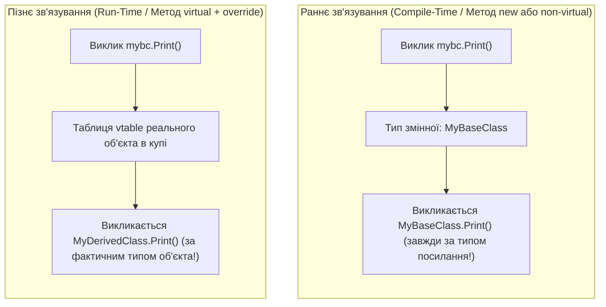

# 02. Віртуальні члени (`virtual`), Перевизначення (`override`) vs Приховування (`new`)

Одне з найважливіших понять ООП у C# — це різниця між **поліморфним перевизначенням (`override`)** та **статичним приховуванням членів (`new`)**.

---

## 1. Раннє (Статичне) проти Пізнього (Динамічного) Зв'язування

---

## 2. Порівняння поведінки: `override` vs `new`

| Критерій | Перевизначення (`override`) | Приховування (`new`) |
|:---|:---:|:---:|
| **Вимога до базового члена** | Має бути `virtual`, `abstract` або `override` | Може бути будь-яким нестатичним членом |
| **Зв'язування** | **Динамічне** (за фактичним типом об'єкта в купі) | **Статичне** (за типом змінної під час компіляції) |
| **Таблиця віртуальних методів (`vtable`)** | Замінює адресу методу в слоті таблиці `vtable` | Створює новий незалежний слот, розриваючи ланцюжок перевизначень |
| **Чи працює для властивостей?** | Так (аксесори `get`/`set` також можуть бути `virtual`/`override`) | Так (ховає властивість базового класу) |

---

## Матриця проєктів цієї секції

| Проєкт | Сторінка / Тема | Що демонструє |
|:---|:---|:---|
| [`SOLIS-p183`](../SOLIS-p183/Program.cs) | Solis, с. 183 | Чому метод із `new` не є поліморфним: при зверненні через посилання `MyBaseClass` викликається стара базова версія методу. |
| [`SOLIS-p185`](../SOLIS-p185/Program.cs) | Solis, с. 185 | Справжній поліморфізм через `virtual` та `override`: виклик через базове посилання `MyBaseClass` виконує код `MyDerivedClass`. |
| [`SOLIS-p187`](../SOLIS-p187/Program.cs) | Solis, с. 187 | Багаторівневе перевизначення (`MyBaseClass -> MyDerivedClass -> SecondDerived`) — виклик завжди доходить до найпохіднішого `override`. |
| [`SOLIS-p188`](../SOLIS-p188/Program.cs) | Solis, с. 188 | Як модифікатор `new` на третьому рівні (`SecondDerived`) розриває ланцюжок `vtable`, змушуючи базове посилання зупинятися на `MyDerivedClass`. |
| [`SOLIS-p189`](../SOLIS-p189/Program.cs) | Solis, с. 189 | Віртуальні властивості (`virtual int MyProperty` та `override int MyProperty`) і поліморфна робота їхніх `get`-аксесорів. | 