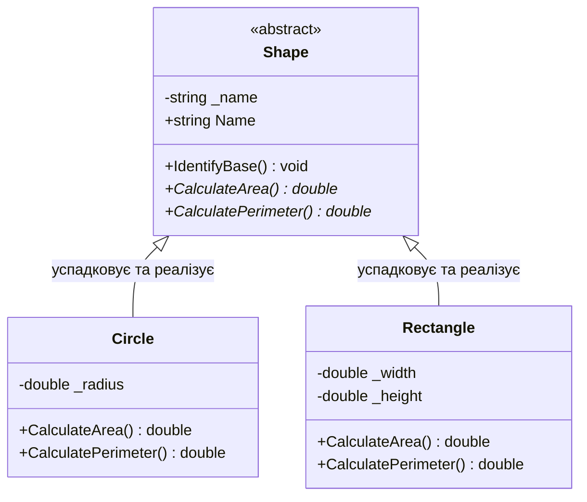

# 03. Абстрактні класи та абстрактні члени (`abstract`)

## 1. Концепція абстракції в об'єктно-орієнтованому проєктуванні

У складних ієрархіях класів часто виникає потреба визначити спільний контракт поведінки та часткову базову функціональність для групи споріднених сутностей, але при цьому заборонити створення безпосереднього екземпляра базового класу. Для цього в C# використовується модифікатор `abstract`.

**Абстрактний клас (`abstract class`)** — це неповний клас-каркас, призначений виключно для наслідування:
* Заборонено створювати екземпляр через `new AbClass()` — компілятор C# видасть помилку `CS0144`.
* Може містити звичайні поля, константи, невіртуальні та віртуальні методи з повною реалізацією.
* Може містити **абстрактні члени** (`abstract` методи, властивості, індексатори, події) без тіла реалізації (`{ }`), які зобов'язаний реалізувати перший неабстрактний спадкоємець через `override`.

---

## 2. Архітектура та розподіл обов'язків



---

## 3. Внутрішній устрій та патерн Template Method

Абстрактний клас ідеально підходить для реалізації поведінкового патерну **Template Method (Шаблонний метод)**:
1. Базовий клас визначає загальний алгоритм у конкретному методі (скелет алгоритму).
2. Окремі кроки алгоритму оголошуються абстрактними методами, які конкретизують нащадки.

```csharp
public abstract class DataProcessor
{
    // Шаблонний метод: фіксує послідовність кроків
    public void Process()
    {
        ReadData();
        TransformData();
        SaveData();
    }

    // Спільна готова реалізація
    protected void SaveData() => Console.WriteLine("Збереження результату в сховище.");

    // Кроки, специфічні для кожного типу джерела:
    protected abstract void ReadData();
    protected abstract void TransformData();
}

public class CsvDataProcessor : DataProcessor
{
    protected override void ReadData() => Console.WriteLine("Читання CSV-файлу з диска...");
    protected override void TransformData() => Console.WriteLine("Парсинг рядків CSV у DTO...");
}
```

---

## 4. Порівняння: Абстрактний клас проти Конкретного класу та Інтерфейсу

| Характеристика | Звичайний клас | Абстрактний клас (`abstract`) | Інтерфейс (`interface`) |
|:---|:---|:---|:---|
| Створення через `new` | Дозволено | Заборонено (помилка компіляції) | Заборонено |
| Реалізація методів | Обов'язкова для всіх членів | Змішана (частина готова, частина `abstract`) | За замовчуванням відсутня (крім DIM у C# 8+) |
| Поля екземпляра (`state`) | Так, необмежено | Так, підтримує стан об'єкта | Ні (тільки статичні поля/константи) |
| Множинне успадкування | Ні (лише 1 базовий клас) | Ні (лише 1 базовий клас) | Так (множинна реалізація контрактів) |
| Конструктори | Так | Так (викликаються через `base(...)`) | Ні |

---

## 5. Матриця проєктів цієї секції

| Проєкт | Посилання на вихідний код | Що демонструє під капотом |
|:---|:---|:---|
| [`SOLIS-p207`](../SOLIS-p207/Program.cs) | [Program.cs](../SOLIS-p207/Program.cs) | Оголошення `abstract class AbClass` із конкретним методом `IdentifyBase()` та абстрактним методом `IdentifyDerived()`. |
| [`SOLIS-p208`](../SOLIS-p208/Program.cs) | [Program.cs](../SOLIS-p208/Program.cs) | Поєднання стану (поля, константи), обчислювального методу `PerimeterLength()` та абстрактних членів (`PrintStuff`, `MyInt`). |
