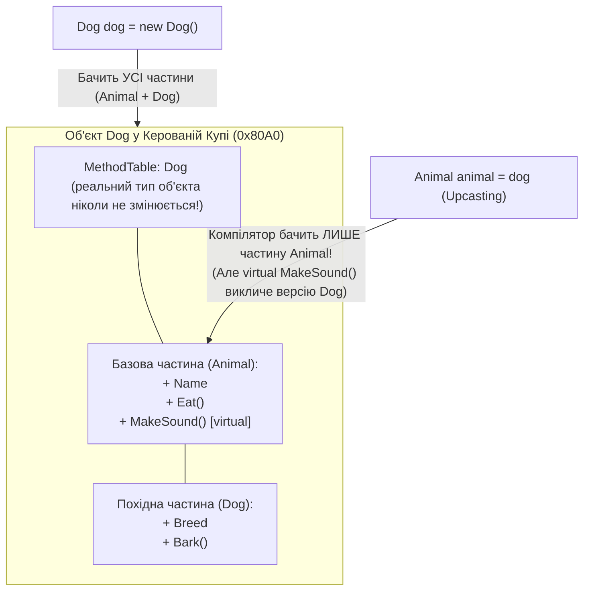

# Лекція 04: Приведення типів в ієрархії — Upcasting, Downcasting, Оператори `is` та `as`

Коли ієрархія класів побудована, виникає практична потреба переміщувати посилання на об'єкти **вгору** (до базового класу для уніфікованої обробки в колекціях) та **вниз** (до конкретного похідного класу для доступу до специфічних членів). У C# ці операції називаються **Upcasting** та **Downcasting**.

---

## 1. Висхідне приведення (`Upcasting`) та Видимість Членів (`Ex-Upcasting`)

**Upcasting (висхідне приведення)** — це перетворення посилання похідного класу (`Dog`, `Cat`) на посилання його базового класу (`Animal`). Оскільки будь-який `Dog` гарантовано **є** `Animal` (`IS-A`), таке приведення виконується **неявно (implicitly)** і є **100% безпечним на етапі компіляції**:



### Що відбувається під час Upcasting?
1. **Сам об'єкт у купі не змінюється і не копіюється**: змінні `dog` та `animal` містять **ту саму адресу в пам'яті** (`ReferenceEquals(dog, animal) == true`).
2. **Обмежується «кут зору» компілятора**: через змінну `Animal animal` можна викликати лише те, що оголошено у класі `Animal` (`Eat()`, `MakeSound()`). Спроба викликати специфічний метод `animal.Bark()` призведе до помилки компіляції, хоча фізично цей метод у об'єкта є.
3. **Навіщо це потрібно?** Upcasting дозволяє об'єднати різні підкласи в єдиний поліморфний масив або список (`Animal[] zoo = { new Dog(), new Cat() };`) і обробляти їх єдиним циклом (`Ex-Upcasting`).

---

## 2. Низхідне приведення (`Downcasting`) та Пастка `InvalidCastException` (`Ex-Downcasting`)

**Downcasting (низхідне приведення)** — це зворотний перехід від посилання базового типу (`Animal`) до конкретного похідного типу (`Dog`). Оскільки у змінній типу `Animal` під час виконання може лежати не `Dog`, а `Cat`, компілятор вимагає **явного приведення** і вставляє в IL-код інструкцію перевірки типу `castclass`:

```csharp
Animal someAnimal = new Cat { Name = "Мурзик" }; // У купі реально лежить Cat!

// Bad: Сліпе класичне приведення (Explicit Cast) без перевірки:
// Під час виконання інструкція 'castclass Dog' перевірить MethodTable об'єкта Cat
// і негайно аварійно зупинить програму з винятком System.InvalidCastException!
Dog wrongDog = (Dog)someAnimal;
```

---

## 3. Безпечні способи Downcasting: Оператори `is` та `as` (`Ex-Downcasting`, `Ex-AsOperator`)

Щоб ніколи не отримувати `InvalidCastException` у промисловому коді, C# пропонує два безпечні оператори перевірки динамічного типу під час виконання:

```csharp
Animal animal = GetRandomAnimal();

// Спосіб 1 (Рекомендований у сучасному C#): Оператор 'is' з Pattern Matching
// Одночасно перевіряє реальний тип у купі (та відсутність null) і одразу створює змінну dog:
if (animal is Dog dog)
{
    dog.Bark(); // Безпечний доступ до специфічних членів Dog
}

// Спосіб 2: Оператор 'as' (Ex-AsOperator)
// Намагається привести тип. Якщо об'єкт у купі НЕ є Dog — НЕ кидає виняток, а повертає null!
Dog? maybeDog = animal as Dog;
if (maybeDog is not null)
{
    maybeDog.Bark();
}
```

### Порівняльна таблиця способів приведення типів:

| Спосіб приведення | Синтаксис | Що робить при несумісному типі | Чи працює зі значущими типами (`struct`)? | Кількість перевірок типу в CLR |
|:---|:---|:---|:---:|:---:|
| **Upcasting** | `Animal a = myDog;` | Неможливо (перевіряється компілятором) | Лише до реалізованих інтерфейсів (Boxing!) | **0** (завжди безпечно) |
| **Явний каст `(T)x`** | `Dog d = (Dog)a;` | Кидає виняток **`InvalidCastException`** | Так (Unboxing з `object`) | **1** (`castclass`) |
| **Оператор `as`** | `Dog? d = a as Dog;` | Повертає **`null`** (без винятків) | Лише з `Nullable<T>` (`x as int?`) | **1** (`isinst`) |
| **Pattern Matching `is`** | `if (a is Dog d)` | Умова `if` повертає `false` | **Так**, працює з будь-якими типами | **1** (`isinst` + збереження в змінну) |

> [!TIP]
> **Антипатерн подвійної перевірки:** Ніколи не пишіть у старому стилі `if (a is Dog) { Dog d = (Dog)a; }` — це змушує середовище CLR двічі перевіряти таблицю типів одного й того самого об'єкта. Завжди використовуйте сучасне зіставлення зі зразком `if (a is Dog d)` або оператор `as` із перевіркою на `null`.

---

## Матриця проєктів цієї секції

| Проєкт | Тема | Що демонструє |
|:---|:---|:---|
| [`Ex-Upcasting`](../Ex-Upcasting/Program.cs) | Upcasting | Неявне приведення `Dog` та `Cat` до `Animal`, робота з масивом `Animal[]` та видимість членів через базове посилання. |
| [`Ex-Downcasting`](../Ex-Downcasting/Program.cs) | Downcasting + `is` | Явне низхідне приведення `(Dog)animal` та безпечна перевірка динамічного типу через оператор `is`. |
| [`Ex-AsOperator`](../Ex-AsOperator/Program.cs) | Оператор `as` | Порівняння класичного кастингу `(Dog)someAnimal` (виняток `InvalidCastException`) та оператора `as` (повернення `null`). |
