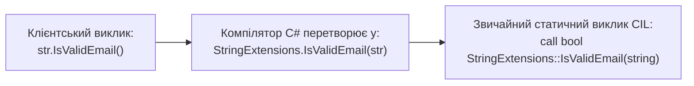

# 05. Запечатані класи (`sealed`), Статичні класи та Методи розширення

## 1. Запечатані класи та члени (`sealed`)

Модифікатор `sealed` використовується для обмеження поліморфізму та захисту ієрархії від подальшого наслідування.

### Дві форми застосування `sealed`:
1. **`sealed class`**: повністю забороняє наслідування від даного класу. Жоден інший клас не може вказати його після двокрапки `:`.
2. **`sealed override`**: застосовується до віртуального методу, що перевизначається в спадкоємці, щоб дозволити його перевизначення на поточному рівні, але заборонити подальше перевизначення в наступних поколіннях нащадків.

```csharp
public class Base
{
    public virtual void Process() => Console.WriteLine("Base.Process");
}

public class Intermediate : Base
{
    // Запечатуємо перевизначення: нащадки Intermediate не зможуть змінити Process()
    public sealed override void Process() => Console.WriteLine("Intermediate.Process");
}

public sealed class FinalWorker : Intermediate
{
    // Помилка CS0239: FinalWorker.Process() не може перевизначити запечатаний метод
    // public override void Process() { }
}
```

### JIT-девіртуалізація (Devirtualization Performance)
Коли JIT-компілятор бачить виклик віртуального методу на екземплярі `sealed`-класу, він знає, що нових спадкоємців бути не може. Замість непрямого виклику через таблицю методів (`vtable`) JIT може застосувати прямий виклик або навіть виконати **інлайнінг (Method Inlining)**, що суттєво підвищує продуктивність у гарячих циклах.

---

## 2. Статичні класи (`static class`)

Статичний клас служить виключно контейнером для статичних функцій, констант та утиліт:
* Автоматично є одночасно `abstract` і `sealed` на рівні IL-байткоду (`.class public abstract auto ansi sealed beforefieldinit`).
* Не може мати конструкторів екземпляра, не може бути інстанційований через `new`.
* Не може містити нестатичних полів або методів.

---

## 3. Методи розширення (Extension Methods)

Методи розширення дозволяють візуально "додавати" нові методи до вже існуючих типів (навіть запечатаних типів BCL, таких як `string`, `int`, або `IEnumerable<T>`), не змінюючи вихідний код і не створюючи нових похідних типів.

### Правила оголошення:
1. Має бути визначений у **неgeneric статичному класі вищого рівня**.
2. Метод повинен бути `static`.
3. Перший параметр повинен мати ключове слово **`this`**, що вказує на розширюваний тип.



```csharp
public static class StringValidationExtensions
{
    public static bool IsValidEmail(this string email)
    {
        if (string.IsNullOrWhiteSpace(email)) return false;
        return email.Contains('@') && email.Contains('.');
    }
}

// Використання:
string input = "user@domain.com";
bool valid = input.IsValidEmail(); // Синтаксичний цукор компілятора!
```

---

## 4. Порівняльна таблиця модифікаторів обмеження та розширення

| Конструкція | Мета | Створення через `new` | Наслідування | Таблиця методів (vtable) |
|:---|:---|:---:|:---:|:---:|
| `class A` | Звичайний відкритий тип | Так | Відкрито | Звичайна диспетчеризація |
| `abstract class B` | Неповний базовий контракт | Ні | Обов'язкове | Віртуальні/абстрактні слоти |
| `sealed class C` | Фінальний клас, захист інваріантів | Так | Заборонено | JIT інлайнінг / прямий виклик |
| `static class D` | Утиліти та методи розширення | Ні | Заборонено | Статичні виклики `call` |

---

## 5. Матриця проєктів цієї секції

| Проєкт | Посилання на вихідний код | Що демонструє під капотом |
|:---|:---|:---|
| [`Ex-SealedClass`](../Ex-SealedClass/Program.cs) | [Program.cs](../Ex-SealedClass/Program.cs) | Запечатування класу (`sealed class`) та запечатування окремого віртуального методу (`sealed override`). |
| [`SOLIS-p210`](../SOLIS-p210/Program.cs) | [Program.cs](../SOLIS-p210/Program.cs) | Оголошення статичного класу з утилітарними методами. |
| [`SOLIS-p212`](../SOLIS-p212/Program.cs) | [Program.cs](../SOLIS-p212/Program.cs) | Синтаксис першого методу розширення через модифікатор `this`. |
| [`SOLIS-p214`](../SOLIS-p214/Program.cs) | [Program.cs](../SOLIS-p214/Program.cs) | Робота методів розширення зі складними користувацькими типами даних. |
| [`Ex-ExtensionMethods`](../Ex-ExtensionMethods/Program.cs) | [Program.cs](../Ex-ExtensionMethods/Program.cs) | Практичний ланцюжок методів розширення для валідації та перетворення даних. |
