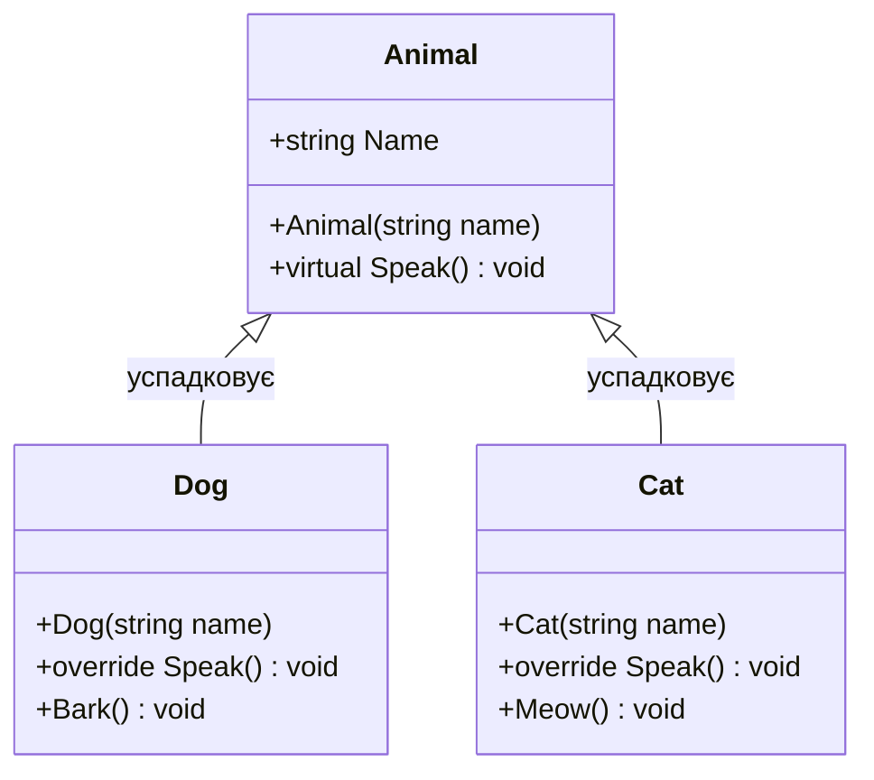

# Модуль 03: Успадкування, Поліморфізм та Ієрархії Типів у .NET 10

[](https://dotnet.microsoft.com/)
[](https://github.com/)

Третій модуль курсу **«C# & OOP Mastery»** розкриває фундаментальний стовп об'єктно-орієнтованого проектування: **успадкування та поліморфізм**. Тут детально розбираються механізми виклику базових конструкторів, таблиця віртуальних методів (`vtable`), різниця між перевизначенням (`override`) та приховуванням (`new`), абстрактні каркаси, запечатані класи (`sealed`) та безпечне приведення типів через Pattern Matching.

---

## 📖 Навчальні лекції та теоретичні гайди

Модуль супроводжується повноцінними лекційними посібниками у папці [`Docs/`](Docs/):

| # | Лекція | Ключові концепції | Посилання |
|:---:|:---|:---|:---:|
| **01** | **Основи Успадкування та Ключове Слово `base`** | Принцип IS-A, ланцюжки викликів конструкторів (знизу вгору), передача аргументів через `base(...)`, модифікатор `protected` | [👉 Читати лекцію](Docs/01_Inheritance_Basics_And_Base_Keyword.md) |
| **02** | **Віртуальні Методи (`override`) vs Приховування (`new`)** | Таблиця vtable, раннє vs пізнє зв'язування, чому `new` ламає поліморфізм при виклику через базовий тип | [👉 Читати лекцію](Docs/02_Virtual_Override_And_New_Hiding.md) |
| **03** | **Абстрактні та Запечатані Класи (`sealed`)** | Неповні класи, абстрактні методи як чисті контракти, оптимізація девіртуалізації компілятором JIT у .NET 10 | [👉 Читати лекцію](Docs/03_Abstract_And_Sealed_Classes.md) |
| **04** | **Приведення Типів: Upcasting, Downcasting, Pattern Matching** | Безпечне висхідне приведення, ризики низхідного приведення, оператори `is` / `as`, сучасні switch-вирази | [👉 Читати лекцію](Docs/04_Type_Casting_Upcasting_Downcasting.md) |

---

## 🏛️ Візуалізація поліморфізму та ієрархії



---

## 📁 Структура проектів у модулі

### Практикум приведення типів та архітектурних модифікаторів
* **[`Ex-Upcasting/`](Ex-Upcasting/Program.cs)** — Висхідне приведення: поліморфне використання похідних типів через базове посилання.
* **[`Ex-Downcasting/`](Ex-Downcasting/Program.cs)** — Низхідне приведення типів та перевірка на `InvalidCastException`.
* **[`Ex-AsOperator/`](Ex-AsOperator/Program.cs)** — Безпечне приведення через оператор `as` та перевірку на `null`.
* **[`Ex-SealedClass/`](Ex-SealedClass/Program.cs)** — Запечатані класи та методи, захист архітектури від розширення.
* **[`Ex-ThisInConstructor/`](Ex-ThisInConstructor/Program.cs)** — Взаємодія `this(...)` та `base(...)` при ініціалізації складних ієрархій.
* **[`Ex-ExtensionMethods/`](Ex-ExtensionMethods/Program.cs)** — Методи розширення для базових типів та їх доступність у похідних класах.

### Академічний атлас Solis (Детальні приклади механік)
* **[`SOLIS-p177/`](SOLIS-p177/Program.cs)** — Оголошення простого похідного класу.
* **[`SOLIS-p180/`](SOLIS-p180/Program.cs)** — Приховування членів базового класу через `new`.
* **[`SOLIS-p181/`](SOLIS-p181/Program.cs)** — Звернення до прихованого члена базового класу через `base.Method()`.
* **[`SOLIS-p183/`](SOLIS-p183/Program.cs)** — Віртуальні методи (`virtual`) та їх перевизначення (`override`).
* **[`SOLIS-p185/`](SOLIS-p185/Program.cs)** — Поліморфний виклик через базове посилання в циклі.
* **[`SOLIS-p187/`](SOLIS-p187/Program.cs)** — Перевизначення властивостей (`virtual property`).
* **[`SOLIS-p188/`](SOLIS-p188/Program.cs)** — Порядок виконання конструкторів у ланцюжку спадкування.
* **[`SOLIS-p189/`](SOLIS-p189/Program.cs)** — Передача аргументів у конструктор базового класу.
* **[`SOLIS-p196/`](SOLIS-p196/Program.cs)** — Абстрактні класи та методи.
* **[`SOLIS-p207/`](SOLIS-p207/Program.cs)** — Запечатування перевизначених методів (`sealed override`).
* **[`SOLIS-p208/`](SOLIS-p208/Program.cs)** — Оператор `is` для перевірки динамічного типу об'єкта.
* **[`SOLIS-p210/`](SOLIS-p210/Program.cs)** — Оператор `as` для безпечного приведення посилань.
* **[`SOLIS-p212/`](SOLIS-p212/Program.cs)** — Розширення ієрархій через Extension Methods.
* **[`SOLIS-p214/`](SOLIS-p214/Program.cs)** — Абстрактні властивості та їх реалізація у підкласах.

---

## 🛠️ Збірка та запуск

```bash
# Збірка всього модуля
dotnet build OOP-Inheritance.sln -c Release

# Запуск демонстрації Upcasting
dotnet run --project Ex-Upcasting/Ex-Upcasting.csproj
```
