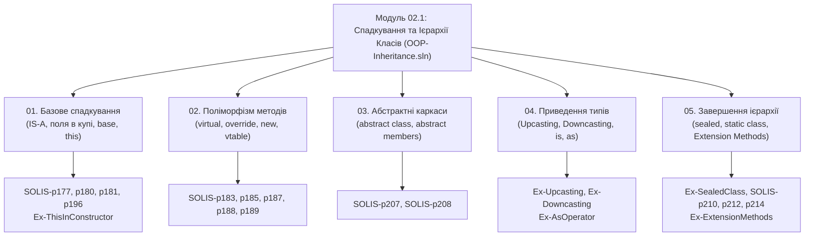

# Модуль 02.1: Спадкування та Ієрархії Класів (`01-Inheritance`)

[](https://dotnet.microsoft.com/)
[](https://github.com/)

Підмодуль курсу **«C# & OOP Mastery»**, який послідовно розкриває механізми спадкування в середовищі CLR: від розміщення полів базового і похідного класів у пам'яті та порядку виклику конструкторів `base(...)` — до таблиці віртуальних методів (`vtable`), поліморфного перевизначення (`virtual`/`override` проти статичного приховування `new`), абстрактних класів-каркасів (`abstract`), безпечного приведення типів в ієрархії (`Upcasting`/`Downcasting`/`is`/`as`) та запечатування ієрархії (`sealed`) разом із методами розширення (`Extension Methods`).

---

## Архітектурна карта модуля



---

## Структура Solution (`OOP-Inheritance.sln`) за Solution-теками

| Solution Folder | Гайд / Документація | Проєкти у секції | Ключові теми |
|:---|:---|:---|:---|
| **01. Базове спадкування, ключове слово base та конструктори** | [`01_Inheritance_Basics_And_Base_Keyword.md`](Docs/01_Inheritance_Basics_And_Base_Keyword.md) | `SOLIS-p177`, `SOLIS-p180`, `SOLIS-p181`, `SOLIS-p196`, `Ex-ThisInConstructor` | Відношення `IS-A`, об'єднання полів у купі, маскування `new`, доступ через `base.Field`, ланцюжки `: base(...)` та `: this(...)` |
| **02. Віртуальні члени (virtual), Перевизначення (override) vs Приховування (new)** | [`02_Virtual_Override_And_New_Hiding.md`](Docs/02_Virtual_Override_And_New_Hiding.md) | `SOLIS-p183`, `SOLIS-p185`, `SOLIS-p187`, `SOLIS-p188`, `SOLIS-p189` | Раннє проти пізнього зв'язування, таблиця віртуальних методів (`vtable`), розрив ланцюжка через `new`, віртуальні властивості |
| **03. Абстрактні класи та абстрактні члени (abstract)** | [`03_Abstract_Classes_And_Members.md`](Docs/03_Abstract_Classes_And_Members.md) | `SOLIS-p207`, `SOLIS-p208` | Класи-каркаси без прямого `new`, поєднання готової логіки з `abstract` методами та властивостями |
| **04. Приведення типів в ієрархії (Upcasting, Downcasting, is, as)** | [`04_Type_Casting_Upcasting_Downcasting.md`](Docs/04_Type_Casting_Upcasting_Downcasting.md) | `Ex-Upcasting`, `Ex-Downcasting`, `Ex-AsOperator` | Поліморфні колекції `Animal[]`, виняток `InvalidCastException`, перевірка типу через `is` та безпечний оператор `as` |
| **05. Запечатані класи (sealed), Статичні класи та Методи розширення** | [`05_Sealed_Static_And_Extension_Methods.md`](Docs/05_Sealed_Static_And_Extension_Methods.md) | `Ex-SealedClass`, `SOLIS-p210`, `SOLIS-p212`, `SOLIS-p214`, `Ex-ExtensionMethods` | Заборона спадкування (`sealed class`, `sealed override`), девіртуалізація JIT, статичні утиліти та синтаксис `this T` |

---

## Довідник модифікаторів спадкування в C#

| Модифікатор | Де застосовується | Вплив на ієрархію та компілятор |
|:---|:---|:---|
| **`virtual`** | Метод, властивість, індексатор, подія | Дозволяє похідним класам перевизначити реалізацію (додає слот у таблицю `vtable`) |
| **`override`** | Метод, властивість, індексатор, подія | Замінює адресу віртуального або абстрактного члена базового класу у слоті `vtable` |
| **`new`** | Будь-який член похідного класу | Явно приховує (маскує) однойменний член базового класу без поліморфізму (статичне зв'язування) |
| **`abstract`** | Клас або член класу | Забороняє `new` для класу; зобов'язує неабстрактних спадкоємців надати реалізацію через `override` |
| **`sealed`** | Клас або `override`-член | Забороняє подальше успадкування класу або подальше перевизначення конкретного методу в підкласах |

---

## Збірка та запуск

```bash
# Збірка всього рішення підмодуля
dotnet build OOP-Inheritance.sln -c Release

# Приклади запуску окремих проєктів
dotnet run --project SOLIS-p188/SOLIS-p188.csproj
dotnet run --project Ex-Upcasting/Ex-Upcasting.csproj
dotnet run --project Ex-ExtensionMethods/Ex-ExtensionMethods.csproj
```
