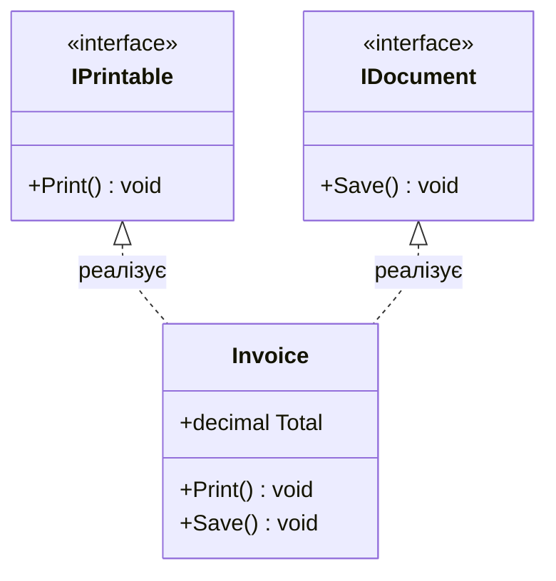

# Лекція 1: Інтерфейси як Контракти та Множинна Реалізація

## 1. Що таке Інтерфейс у C#?

**Інтерфейс (`interface`)** — це чистий контракт поведінки. Він визначає, **що саме** має вміти робити об'єкт, але (традиційно) не визначає, **як саме** він це робить.

* На відміну від класів, інтерфейс не може містити полів екземпляра (даних стану).
* Клас реалізує (`implements`) інтерфейс, гарантуючи компілятору та іншим підсистемам наявність усіх методів і властивостей, описаних у контракті.
* Всі члени інтерфейсу за замовчуванням є `public abstract`.



---

## 2. Чому C# забороняє множинне успадкування класів, але дозволяє множинну реалізацію інтерфейсів?

У мовах на кшталт C++ дозволено успадковувати декілька конкретних класів, що призводить до відомої проблеми **«Ромбоподібного успадкування» (The Deadly Diamond of Death)**:
* Якщо клас `A` має поле `x`, класи `B` та `C` успадковують `A`, а клас `D` успадковує `B` та `C` — скільки копій поля `x` буде в об'єкті `D`? Який метод викликати?

У C# ця проблема вирішена на рівні архітектури:
* Клас може мати **лише один базовий клас** (одинарне спадкування коду та стану).
* Клас може реалізовувати **необмежену кількість інтерфейсів** (множинне спадкування поведінкових контрактів). Оскільки в інтерфейсах немає екземплярних полів, колізії стану неможливі.

---

## 3. Інтерфейсний поліморфізм
Коли метод приймає інтерфейс, він стає повністю відв'язаним від конкретної реалізації:
```csharp
public void Output(IPrintable item)
{
    item.Print(); // Працює для будь-якого об'єкта: Invoice, Photo, Report, Log
}
```
Це основа принципу інверсії залежностей (**DIP** з набору SOLID).
