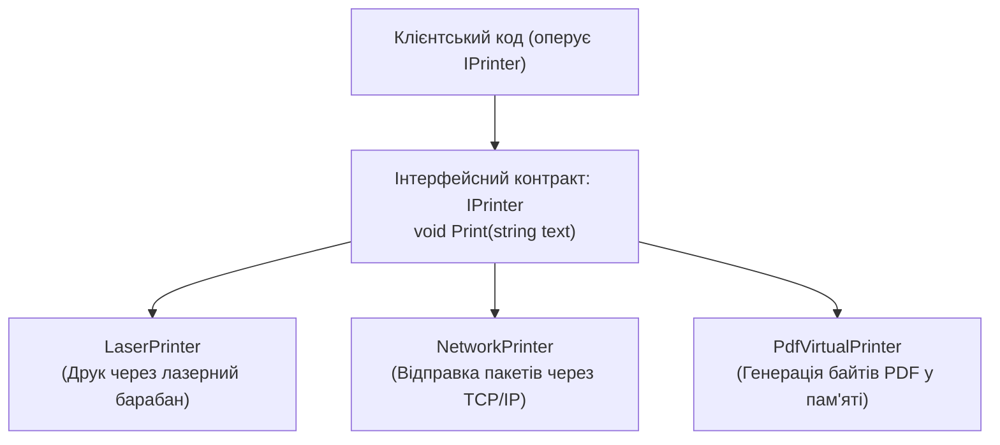

# 01. Контракти інтерфейсів, оголошення та поліморфні посилання

## 1. Що таке інтерфейс у C#?

**Інтерфейс (`interface`)** — це строго типізований контракт, який визначає, **що** клас або структура вміє робити, не накладаючи жодних обмежень на те, **як** це реалізовано.

### Ключові правила класичних інтерфейсів:
1. За замовчуванням усі члени інтерфейсу є публічними (`public`) і абстрактними.
2. Інтерфейс **не може містити полів екземпляра**, оскільки він не описує стан, а лише поведінку.
3. Клас може успадкувати лише один базовий клас, але реалізувати **довільну кількість інтерфейсів**.
4. Інтерфейсне посилання дозволяє працювати з об'єктом виключно через операції, описані цим контрактом.



---

## 2. Поліморфізм через інтерфейсні посилання

Використання інтерфейсів замість конкретних класів дозволяє досягти принципу **Low Coupling (Слабка зв'язність)** та принципу **DIP (Dependency Inversion Principle)**.

```csharp
public interface IMessageSender
{
    void SendMessage(string recipient, string text);
}

public class EmailSender : IMessageSender
{
    public void SendMessage(string recipient, string text) =>
        Console.WriteLine($"[Email] Відправлено лист до {recipient}: {text}");
}

public class SmsSender : IMessageSender
{
    public void SendMessage(string recipient, string text) =>
        Console.WriteLine($"[SMS] Відправлено смс на {recipient}: {text}");
}

// Клієнтський клас не залежить від деталей каналу зв'язку:
public class NotificationManager
{
    private readonly IMessageSender _sender;

    public NotificationManager(IMessageSender sender)
    {
        _sender = sender;
    }

    public void NotifyUser(string user, string message)
    {
        _sender.SendMessage(user, message);
    }
}
```

---

## 3. Приведення типів та перевірка через `is` / `as`

Оскільки інтерфейси можуть бути реалізовані класами з абсолютно не пов'язаних гілок спадкування, для безпечної взаємодії використовують оператори `is` та `as`:

```csharp
object obj = GetUnknownEntity();

// Перевірка та розпакування в одну дію через pattern matching:
if (obj is ILiveBirth mammal)
{
    mammal.GiveBirth();
}
```

---

## 4. Матриця проєктів цієї секції

| Проєкт | Посилання на вихідний код | Що демонструє під капотом |
|:---|:---|:---|
| [`p389[SOLIS]`](../p389[SOLIS]/Program.cs) | [Program.cs](../p389[SOLIS]/Program.cs) | Базове оголошення інтерфейсу `IInfo` та його реалізація двома різними класами `CA` і `CB`. |
| [`p397[SOLIS]`](../p397[SOLIS]/Program.cs) | [Program.cs](../p397[SOLIS]/Program.cs) | Збереження посилань на різні об'єкти в масиві типу `IInfo[]` та поліморфний виклик у циклі `foreach`. |
| [`p399[SOLIS]`](../p399[SOLIS]/Program.cs) | [Program.cs](../p399[SOLIS]/Program.cs) | Повернення екземпляра інтерфейсу як результат роботи методу-фабрики. |
| [`p413[SOLIS]`](../p413[SOLIS]/Program.cs) | [Program.cs](../p413[SOLIS]/Program.cs) | Динамічна перевірка реалізації інтерфейсу `ILiveBirth` через оператор приведення `as`. |
