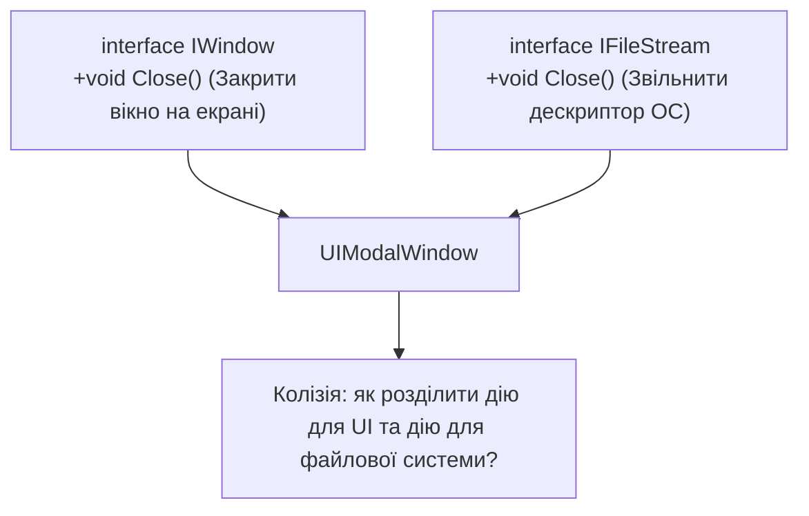

# 02. Множинна реалізація, колізії сигнатур та Явна реалізація (Explicit Implementation)

## 1. Проблема колізії імен при множинній реалізації

У C# клас може реалізувати кілька інтерфейсів. Якщо два або більше інтерфейсів оголошують метод з **однаковою назвою та параметрами**, але з різним семантичним змістом, виникає колізія.



---

## 2. Явна реалізація інтерфейсу (Explicit Interface Implementation)

**Явна реалізація** дозволяє прив'язати реалізацію методу виключно до конкретного інтерфейсу, додаючи ім'я інтерфейсу перед назвою методу: `void IWindow.Close()`.

### Правила явної реалізації:
1. Модифікатор доступу (`public`, `private`) **заборонений** — метод автоматично доступний лише через посилання відповідного інтерфейсу.
2. Метод **не доступний** напряму через посилання на клас `myWindow.Close()`.
3. Виклик можливий лише після приведення до відповідного інтерфейсу: `((IWindow)myWindow).Close()`.

```csharp
public interface ILeftControl
{
    void Move();
}

public interface IRightControl
{
    void Move();
}

public class RobotArm : ILeftControl, IRightControl
{
    // Неявна або явна реалізація:
    void ILeftControl.Move()
    {
        Console.WriteLine("Рух маніпулятора ліворуч на 10 градусів.");
    }

    void IRightControl.Move()
    {
        Console.WriteLine("Рух маніпулятора праворуч на 10 градусів.");
    }
}

// Виклик:
RobotArm arm = new RobotArm();
// arm.Move(); // Помилка компіляції CS1061!

ILeftControl left = arm;
left.Move(); // Рух ліворуч

IRightControl right = arm;
right.Move(); // Рух праворуч
```

---

## 3. Порівняння: Звичайна (неявна) проти Явної реалізації

| Критерій | Звичайна реалізація (Implicit) | Явна реалізація (Explicit) |
|:---|:---|:---|
| Синтаксис | `public void Print()` | `void IPrinter.Print()` |
| Модифікатори доступу | `public` (обов'язково) | Заборонені компілятором |
| Доступ через тип класу | Так (`obj.Print()`) | Ні (помилка компіляції) |
| Доступ через інтерфейс | Так (`((IPrinter)obj).Print()`) | Так (`((IPrinter)obj).Print()`) |
| Віртуальність | Може бути `virtual` / `override` | Не може бути `virtual` (фіксована) |
| Сфера використання | Загальний публічний API класу | Розв'язання колізій або приховування допоміжних API |

---

## 4. Матриця проєктів цієї секції

| Проєкт | Посилання на вихідний код | Що демонструє під капотом |
|:---|:---|:---|
| [`p401[SOLIS]`](../p401[SOLIS]/Program.cs) | [Program.cs](../p401[SOLIS]/Program.cs) | Множинна реалізація двох інтерфейсів `IIfc1` та `IIfc2` одним класом `MyClass`. |
| [`p402[SOLIS]`](../p402[SOLIS]/Program.cs) | [Program.cs](../p402[SOLIS]/Program.cs) | Однаковий метод `PrintOut` у двох інтерфейсах: єдина спільна публічна реалізація. |
| [`p404[SOLIS]`](../p404[SOLIS]/Program.cs) | [Program.cs](../p404[SOLIS]/Program.cs) | Явна реалізація `void IIfc1.PrintOut()` та `void IIfc2.PrintOut()` для розділення логіки. |
| [`p408[SOLIS]`](../p408[SOLIS]/Program.cs) | [Program.cs](../p408[SOLIS]/Program.cs) | Доступ до явно реалізованих членів через приведення типу екземпляра в клієнтському коді. |
