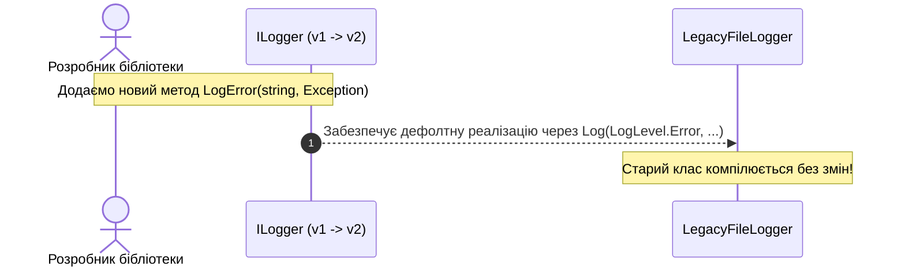

# 03. Еволюція інтерфейсів: Методи за замовчуванням (DIM), статика та приватні члени у C# 8+

## 1. Чому виникли Default Interface Methods (DIM)?

В класичному C# додавання нового методу до вже опублікованого інтерфейсу було **критичною руйнівною зміною (Breaking Change)**: усі сторонні класи, які реалізовували цей інтерфейс, переставали компілюватися доки не допишуть новий метод.

Починаючи з **C# 8.0 (.NET Core 3.0 / .NET 10)**, інтерфейси отримали можливість надавати **реалізацію за замовчуванням (Default Interface Methods — DIM)**.



---

## 2. Синтаксис та можливості сучасних інтерфейсів

У сучасних версіях C# в інтерфейсі дозволено оголошувати:
1. **Методи за замовчуванням з тілом**: працюють як віртуальні fallback-реалізації.
2. **Статичні методи та константи**: для фабричних методів та утиліт.
3. **Статичні віртуальні методи (C# 11 / .NET 7+)**: `static abstract T operator +(T a, T b)` для узагальненої математики (Generic Math).
4. **Приватні (`private`) та захищені (`protected`) методи**: для внутрішньої декомпозиції коду дефолтних реалізацій.

```csharp
public interface IAnalyticsLogger
{
    // Обов'язковий контракт (клас мусить реалізувати)
    void Log(string eventName, string payload);

    // Метод за замовчуванням (DIM):
    void LogWarning(string message)
    {
        // Викликає приватний допоміжний метод інтерфейсу:
        FormatAndSend("WARN", message);
    }

    // Приватний метод всередині інтерфейсу (C# 8+):
    private void FormatAndSend(string level, string msg)
    {
        Log("Telemetry", $"[{level}] {DateTime.UtcNow:O} - {msg}");
    }

    // Статичний фабричний метод:
    public static IAnalyticsLogger CreateDefault() => new ConsoleAnalyticsLogger();
}
```

---

## 3. Важливий нюанс виклику методів за замовчуванням

Метод за замовчуванням **не успадковується класом як власний відкритий метод**! Він існує лише на рівні інтерфейсного контракту.

```csharp
public class CustomLogger : IAnalyticsLogger
{
    public void Log(string eventName, string payload) =>
        Console.WriteLine($"{eventName}: {payload}");
}

// Виклик:
CustomLogger logger = new CustomLogger();
// logger.LogWarning("Test"); // Помилка компіляції CS1061!

IAnalyticsLogger ifc = logger;
ifc.LogWarning("Test"); // Працює коректно через інтерфейсне посилання!
```

---

## 4. Матриця проєктів цієї секції

| Проєкт | Посилання на вихідний код | Що демонструє під капотом |
|:---|:---|:---|
| [`InterfacesAfterCSharpVer8`](../InterfacesAfterCSharpVer8/Program.cs) | [Program.cs](../InterfacesAfterCSharpVer8/Program.cs) | Повний практикум сучасного синтаксису: дефолтні методи, приватні допоміжні методи та статичні члени інтерфейсу. |
