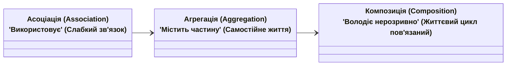

# Лекція 4: Сучасні Інтерфейси (C# 8+) та Відношення між Сутностями

## 1. Революція інтерфейсів: C# 8+ до .NET 10

Традиційно інтерфейси були суто декларативними. Починаючи з C# 8+, вони отримали безпрецедентну гнучкість:

1. **Методи за замовчуванням (Default Interface Methods - DIM):**
   * Інтерфейс може надавати базову реалізацію методу:
   ```csharp
   public interface ILogger
   {
       void Log(string message);
       void LogError(string message) => Log($"[ERROR] {message}"); // Метод з дефолтною реалізацією
   }
   ```
   * Це дозволяє еволюціонувати бібліотечним інтерфейсам без руйнування існуючих клієнтських реалізацій!
2. **Статичні члени та статичні методи у інтерфейсах (`static abstract`):**
   * Введено у C# 11/.NET 7 для загальної математики (`Generic Math`). Інтерфейси можуть вимагати статичних операторів `+`, `-`, або фабричних методів `Create()`.
3. **Приватні методи в інтерфейсах:** для усунення дублювання між методами за замовчуванням.

---

## 2. Відношення між сутностями: Асоціація, Агрегація, Композиція



| Тип зв'язку | Формула | Життєвий цикл | Приклад у коді |
|:---|:---:|:---:|:---|
| **Асоціація (Association)** | «A знає про B» | Повністю незалежний | Студент записується на Курс (`Student` та `Course`). Студент може існувати без курсу, курс без студента. |
| **Агрегація (Aggregation)** | «A містить B» (Weak Has-A) | Незалежний | Бібліотека та Книга (`Library` та `Book`). Якщо спалити будівлю бібліотеки, книга як сутність може існувати в іншому місці. |
| **Композиція (Composition)** | «B є невіддільною частиною A» (Strong Has-A) | **Спільний / Нерозривний** | Автомобіль та Двигун (`Car` та `Engine`). Двигун створюється разом з автомобілем і знищується разом із ним. |
