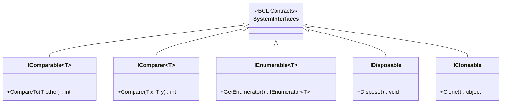

# 04. Стандартні інтерфейси BCL .NET (`IComparable`, `IComparer`, `IEnumerable`, `ICloneable`, `IDisposable`)

## 1. Канонічні контракти стандартної бібліотеки .NET

Платформа .NET базується на десятках стандартизованих інтерфейсів, які забезпечують взаємодію користувацьких типів із вбудованими механізмами CLR, колекціями, сортуванням та мовними конструкціями (`foreach`, `using`).



---

## 2. Порівняння ключових системних контрактів

### 2.1. `IComparable<T>` проти `IComparer<T>`
* **`IComparable<T>`** реалізується **самим об'єктом**, задаючи його природний порядок сортування за замовчуванням (`objA.CompareTo(objB)`).
* **`IComparer<T>`** реалізується **окремим зовнішнім класом-стратегією** для альтернативних сортувань (наприклад, сортування за віком, сортування за спаданням ціни).

```csharp
public class Student : IComparable<Student>
{
    public string Name { get; set; } = "";
    public int Grade { get; set; }

    // Природне сортування за балом:
    public int CompareTo(Student? other) =>
        other is null ? 1 : this.Grade.CompareTo(other.Grade);
}

// Зовнішня стратегія: сортування за іменем
public class StudentNameComparer : IComparer<Student>
{
    public int Compare(Student? x, Student? y) =>
        string.Compare(x?.Name, y?.Name, StringComparison.OrdinalIgnoreCase);
}
```

### 2.2. Пастки `ICloneable`
Контракт `ICloneable` повертає `object Clone()`, але не вказує, чи клонування є **поверхневим (Shallow Copy)**, чи **глибоким (Deep Copy)**. У сучасному .NET рекомендується уникати `ICloneable` на користь строго типізованих методів копіювання, конструкторів копіювання або оператора `with` у `record`.

---

## 3. Матриця проєктів цієї секції

| Проєкт | Посилання на вихідний код | Що демонструє під капотом |
|:---|:---|:---|
| [`p390[SOLIS]`](../p390[SOLIS]/Program.cs) | [Program.cs](../p390[SOLIS]/Program.cs) | Вбудований інтерфейс `IComparable` для сортування масиву цілих чисел `Array.Sort()`. |
| [`p393[SOLIS]`](../p393[SOLIS]/Program.cs) | [Program.cs](../p393[SOLIS]/Program.cs) | Реалізація `IComparable` у власному класі `MyClass` для порівняння екземплярів за числовим полем. |
| [`ex-Icomparable`..`02`](../ex-Icomparable/Program.cs) | [01](../ex-Icomparable/Program.cs), [02](../ex-Icomparable02/Program.cs) | Послідовні приклади реалізації природного сортування користувацьких моделей. |
| [`ex-IComparer01`..`02`](../ex-IComparer01/Program.cs) | [01](../ex-IComparer01/Program.cs), [02](../ex-IComparer02/Program.cs) | Окремі класи порівняння за різними полями за допомогою `IComparer<T>`. |
| [`ex-IEnumerable01`..`02`](../ex-IEnumerable01/Program.cs) | [01](../ex-IEnumerable01/Program.cs), [02](../ex-IEnumerable02/Program.cs) | Підтримка протоколу перебору елементів колекції для циклу `foreach`. |
| [`ex-IClonable01`..`02`](../ex-IClonable01/Program.cs) | [01](../ex-IClonable01/Program.cs), [02](../ex-IClonable02/Program.cs) | Порівняння поверхневого копіювання `MemberwiseClone()` та глибокого копіювання зв'язаних об'єктів. |
| [`ex-IDisposable01`..`02`](../ex-IDisposable01/Program.cs) | [01](../ex-IDisposable01/Program.cs), [02](../ex-IDisposable02/Program.cs) | Детерміноване звільнення некерованих ресурсів через `IDisposable` та конструкцію `using`. |
