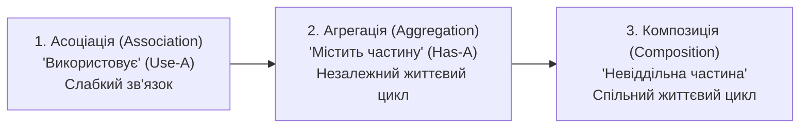
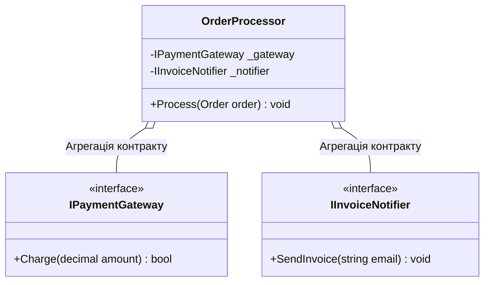

# 05. Інтерфейси у зв'язках об'єктів (Асоціація, Агрегація, Композиція)

## 1. Типи зв'язків між об'єктами в UML

В об'єктно-орієнтованому дизайні зв'язки між сутностями поділяються за силою зв'язку та життєвим циклом компонентів:

---

## 2. Як інтерфейси послаблюють залежність (Decoupling)

Коли класи пов'язуються напряму з конкретними класами, це створює жорстку залежність (Tight Coupling). Введення інтерфейсів перетворює зв'язок на контрактний:

### 1. Асоціація через інтерфейс (`InterfacesAssociation`)
Клас `A` отримує інтерфейс `IB` тимчасово як аргумент методу, не зберігаючи його як постійне поле екземпляра.

### 2. Агрегація через інтерфейс (`InterfacesAggregation`)
Клас-контейнер зберігає посилання на `IService`, передане йому ззовні (через Dependency Injection або властивість). Якщо контейнер знищується, сервіс продовжує існувати.

### 3. Композиція через інтерфейс (`InterfacesComposition`)
Контейнер володіє життєвим циклом компонента, але звертається до нього виключно через інтерфейс, що полегшує тестування через фабрики або заміщення в юніт-тестах.

---

## 3. Порівняльна таблиця взаємодії

| Тип зв'язку | Формула взаємодії | Володіння екземпляром | Ступінь зв'язності через інтерфейс |
|:---|:---|:---:|:---:|
| **Асоціація** | Об'єкт тимчасово викликає метод контракту | Немає | Мінімальна |
| **Агрегація** | Об'єкт зберігає посилання на контракт ззовні | Спільне / зовнішнє | Низька |
| **Композиція** | Об'єкт створює і знищує підпорядкований компонент | Повне володіння | Контрольована контрактом |

---

## 4. Матриця проєктів цієї секції

| Проєкт | Посилання на вихідний код | Що демонструє під капотом |
|:---|:---|:---|
| [`InterfacesAssociation`](../InterfacesAssociation/Program.cs) | [Program.cs](../InterfacesAssociation/Program.cs) | Слабкий зв'язок асоціації: передача контракту як параметра методу. |
| [`InterfacesAggregation`](../InterfacesAggregation/Program.cs) | [Program.cs](../InterfacesAggregation/Program.cs) | Зв'язок агрегації: ін'єкція залежності через конструктор із незалежним життєвим циклом. |
| [`InterfacesComposition`](../InterfacesComposition/Program.cs) | [Program.cs](../InterfacesComposition/Program.cs) | Зв'язок композиції: управління життєвим циклом підпорядкованого вузла через інтерфейсний фасад. |
