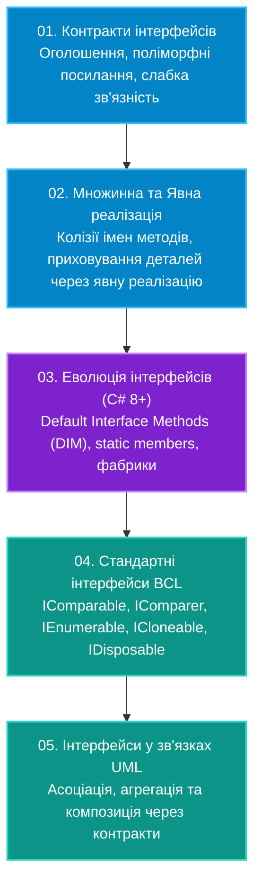

# Підмодуль 02: Інтерфейси та Поліморфізм (`OOP - Interfaces.sln`)

Цей підмодуль присвячений всебічному дослідженню інтерфейсів у C#: від класичних абстрактних контрактів і множинної реалізації до явної реалізації, методів за замовчуванням у C# 8+ (DIM), стандартних інтерфейсів BCL (`IComparable`, `IComparer`, `IEnumerable`, `ICloneable`, `IDisposable`) та ролі інтерфейсів в архітектурних зв'язках UML (асоціація, агрегація, композиція).

---

## Дорожня карта вивчення інтерфейсів



---

## Навігація по теоретичних та практичних посібниках (`Docs`)

| Розділ | Тематика та ключові концепції | Посилання на документ |
|:---:|:---|:---|
| **01** | Контракти інтерфейсів, поліморфізм посилань та приведення типів | [Docs/01_Interface_Contracts_And_References.md](Docs/01_Interface_Contracts_And_References.md) |
| **02** | Множинна реалізація, колізії однакових сигнатур та явна реалізація | [Docs/02_Multiple_And_Explicit_Implementation.md](Docs/02_Multiple_And_Explicit_Implementation.md) |
| **03** | Еволюція інтерфейсів у сучасному C#: методи за замовчуванням (DIM), статика | [Docs/03_Modern_Interfaces_CSharp8_Plus.md](Docs/03_Modern_Interfaces_CSharp8_Plus.md) |
| **04** | Стандартні інтерфейси BCL .NET (`IComparable`, `IComparer`, `ICloneable`, `IDisposable`) | [Docs/04_Standard_BCL_Interfaces.md](Docs/04_Standard_BCL_Interfaces.md) |
| **05** | Інтерфейси в моделюванні зв'язків об'єктів (Асоціація, Агрегація, Композиція) | [Docs/05_Interfaces_In_UML_Relationships.md](Docs/05_Interfaces_In_UML_Relationships.md) |

---

## Структура Solution-тек у рішенні `OOP - Interfaces.sln`

* **`01. Контракти інтерфейсів (Оголошення, реалізація, інтерфейсні посилання)`**
  * `p389[SOLIS]`, `p397[SOLIS]`, `p399[SOLIS]`, `p413[SOLIS]`
* **`02. Множинна реалізація, колізії імен та Явна реалізація (Explicit Implementation)`**
  * `p401[SOLIS]`, `p402[SOLIS]`, `p404[SOLIS]`, `p408[SOLIS]`
* **`03. Еволюція інтерфейсів (Default Interface Methods у C# 8+)`**
  * `InterfacesAfterCSharpVer8`
* **`04. Стандартні інтерфейси .NET BCL`**
  * `p390[SOLIS]`, `p393[SOLIS]`, `ex-Icomparable01`..`02`, `ex-IComparer01`..`02`, `ex-IEnumerable01`..`02`, `ex-IClonable01`..`02`, `ex-IDisposable01`..`02`
* **`05. Інтерфейси у зв'язках об'єктів (Асоціація, Агрегація, Композиція)`**
  * `InterfacesAssociation`, `InterfacesAggregation`, `InterfacesComposition`

---

## Збірка та запуск

```powershell
dotnet build "02-OOP-Core/02-Interfaces-And-Polymorphism/OOP - Interfaces.sln" -c Release
```
