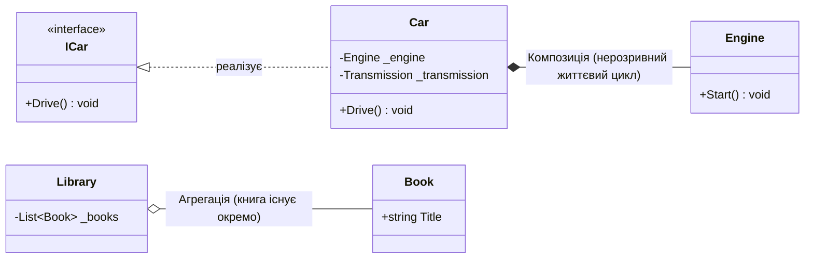

# Модуль 04: Інтерфейси, Поліморфізм та UML-Зв'язки у .NET 10

[](https://dotnet.microsoft.com/)
[](https://github.com/)

Четвертий модуль курсу **«C# & OOP Mastery»** присвячений серцю чистої архітектури — **інтерфейсам**. Тут вивчаються інтерфейси як поведінкові контракти, механізм явної реалізації (`Explicit Implementation`), стандартні інтерфейси платформи .NET BCL (`IComparable`, `IComparer`, `ICloneable`, `IDisposable`, `IEnumerable`), методи за замовчуванням (C# 8+), а також фундаментальні архітектурні відношення між сутностями: **Асоціація, Агрегація та Композиція**.

---

## 📖 Навчальні лекції та теоретичні гайди

Модуль структуровано за 4 лекційними посібниками у каталозі [`Docs/`](Docs/):

| # | Лекція | Ключові концепції | Посилання |
|:---:|:---|:---|:---:|
| **01** | **Інтерфейси як Контракти та Множинна Реалізація** | Відсутність множинного успадкування класів, інтерфейсний поліморфізм, повна відв'язка коду | [👉 Читати лекцію](Docs/01_Interface_Contracts_And_Multiple_Implementation.md) |
| **02** | **Явна Реалізація Інтерфейсів (Explicit Implementation)** | Вирішення конфліктів однакових імен, приховування технічного API, виклик через інтерфейсне посилання | [👉 Читати лекцію](Docs/02_Explicit_Interface_Implementation.md) |
| **03** | **Стандартні Інтерфейси Бібліотеки BCL** | Сортування: `IComparable<T>` vs `IComparer<T>`, клонування: `ICloneable` (Shallow vs Deep copy), `IDisposable`, `IEnumerable<T>` | [👉 Читати лекцію](Docs/03_Standard_BCL_Interfaces.md) |
| **04** | **Сучасні Інтерфейси (C# 8+) та UML-Відношення** | Default Interface Methods (DIM), `static abstract`, зв'язки: Асоціація vs Агрегація vs Композиція | [👉 Читати лекцію](Docs/04_Modern_Interfaces_And_UML_Relations.md) |

---

## 🏛️ Візуалізація архітектурних зв'язків



---

## 📁 Структура проектів у модулі

### 1. Архітектурні зв'язки (UML Relationships)
* **[`InterfacesAssociation/`](InterfacesAssociation/Program.cs)** — Асоціація («знає про»): зв'язок `Student` та `Course`.
* **[`InterfacesAggregation/`](InterfacesAggregation/Program.cs)** — Агрегація («містить частину»): `Library` містить `Book`.
* **[`InterfacesComposition/`](InterfacesComposition/Program.cs)** — Композиція («жорстке володіння»): `Car` володіє `Engine` та `Transmission`.

### 2. Сучасні можливості інтерфейсів (C# 8+ до .NET 10)
* **[`InterfacesAfterCSharpVer8/`](InterfacesAfterCSharpVer8/Program.cs)** — Дефолтні реалізації методів (DIM), приватні та статичні члени інтерфейсів.

### 3. Стандартні інтерфейси платформи BCL
* **[`ex-Icomparable/`](ex-Icomparable/Program.cs)** та **[`ex-IComparable02/`](ex-IComparable02/Program.cs)** — Реалізація природного сортування через `IComparable<T>`.
* **[`ex-IComparer01/`](ex-IComparer01/Program.cs)** та **[`ex-Icomparer02/`](ex-Icomparer02/Program.cs)** — Альтернативні стратегії сортування через `IComparer<T>`.
* **[`ex-IClonable01/`](ex-IClonable01/Program.cs)** та **[`ex-IClonable02/`](ex-IClonable02/Program.cs)** — Поверхневе проти глибокого клонування (`MemberwiseClone`).
* **[`ex-IDisposable01/`](ex-IDisposable01/Program.cs)** та **[`ex-IDisposable02/`](ex-IDisposable02/Program.cs)** — Детерміноване очищення некерованих ресурсів.
* **[`ex-IEnumerable01/`](ex-IEnumerable01/Program.cs)** та **[`ex-IEnumerable02/`](ex-IEnumerable02/Program.cs)** — Власна реалізація `IEnumerable` та створення колекцій для `foreach`.

### 4. Академічний атлас Solis
* **[`p389[SOLIS]/`](p389[SOLIS]/Program.cs)** — Базове оголошення інтерфейсу та його реалізація.
* **[`p390[SOLIS]/`](p390[SOLIS]/Program.cs)** — Отримання інтерфейсного посилання через кастинг.
* **[`p393[SOLIS]/`](p393[SOLIS]/Program.cs)** — Множинна реалізація кількох інтерфейсів одним класом.
* **[`p397[SOLIS]/`](p397[SOLIS]/Program.cs)** — Успадкування інтерфейсів один від одного.
* **[`p399[SOLIS]/`](p399[SOLIS]/Program.cs)** — Явна реалізація інтерфейсів для усунення колізій імен.
* **[`p401[SOLIS]/`](p401[SOLIS]/Program.cs)** — Доступ до явно реалізованих членів.
* **[`p402[SOLIS]/`](p402[SOLIS]/Program.cs)** — Приховування членів при повторній реалізації в похідних класах.
* **[`p404[SOLIS]/`](p404[SOLIS]/Program.cs)** — Віртуальні методи як реалізація інтерфейсу.
* **[`p408[SOLIS]/`](p408[SOLIS]/Program.cs)** — Перевизначення інтерфейсних методів у похідних класах.
* **[`p413[SOLIS]/`](p413[SOLIS]/Program.cs)** — Комплексний практичний приклад.

---

## 🛠️ Збірка та запуск

```bash
# Збірка всього модуля
dotnet build "OOP - Interfaces.sln" -c Release

# Запуск демонстрації композиції
dotnet run --project InterfacesComposition/InterfacesComposition.csproj
```
