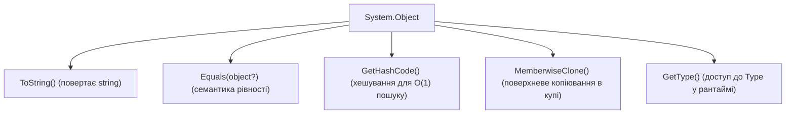

# 01. Корінь ієрархії `System.Object` та семантика рівності

## 1. Анатомія класу `System.Object`

У системі типів .NET кожен тип (посилальний чи значущий) прямо або опосередковано походить від `System.Object`. Компілятор автоматично підставляє це успадкування, якщо базовий тип не вказано явно.

### 4 фундаментальні віртуальні методи `object`:
1. **`ToString()`**: повертає текстове представлення екземпляра (за замовчуванням повертає повне ім'я типу `Namespace.TypeName`).
2. **`Equals(object? obj)`**: визначає рівність двох об'єктів. За замовчуванням порівнює посилання (`ReferenceEquals`).
3. **`GetHashCode()`**: генерує 32-бітний числовий хеш-код для використання в хеш-таблицях (`Dictionary`, `HashSet`).
4. **`Finalize()`**: викликається збирачем сміття (GC) перед звільненням об'єкта (в синтаксисі C# записується як деструктор `~MyClass()`).



---

## 2. Непорушний контракт між `Equals` та `GetHashCode`

Якщо ви перевизначаєте `Equals`, ви **зобов'язані** перевизначити `GetHashCode`. Компілятор C# видасть попередження `CS0659`, якщо це правило порушено.

### Правила контракту:
1. **Якщо `a.Equals(b) == true`**, тоді **обов'язково `a.GetHashCode() == b.GetHashCode()`**.
2. Якщо хеш-коди двох об'єктів різні, вони **гарантовано не рівні**.
3. Якщо хеш-коди однакові, об'єкти **можуть бути як рівними, так і нерівними** (явище колізії хешів).
4. Хеш-код мусить залежати **виключно від незмінних (immutable) полів**, інакше об'єкт "загубиться" в `HashSet` або `Dictionary`.

```csharp
public sealed class CustomerId : IEquatable<CustomerId>
{
    public int Value { get; }

    public CustomerId(int value) => Value = value;

    public override bool Equals(object? obj) =>
        obj is CustomerId other && Equals(other);

    public bool Equals(CustomerId? other) =>
        other is not null && Value == other.Value;

    public override int GetHashCode() => HashCode.Combine(Value);

    public static bool operator ==(CustomerId? left, CustomerId? right) =>
        EqualityComparer<CustomerId>.Default.Equals(left, right);

    public static bool operator !=(CustomerId? left, CustomerId? right) =>
        !(left == right);
}
```

---

## 3. Матриця проєкту цієї секції

| Проєкт | Посилання на вихідний код | Що демонструє під капотом |
|:---|:---|:---|
| [`01-SystemObjectAndEquality`](../01-SystemObjectAndEquality/Program.cs) | [Program.cs](../01-SystemObjectAndEquality/Program.cs) | Перевизначення `ToString`, безпечна реалізація `IEquatable<T>`, контракт із `GetHashCode` та поведінка `MemberwiseClone`. |
