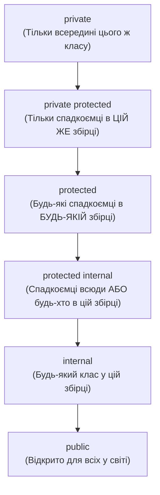

# 02. Інкапсуляція в ієрархіях: `protected`, `internal`, `private protected`

## 1. Межі видимості членів в успадкуванні

Інкапсуляція є першим стовпом ООП, але в ієрархіях спадкування виникає потреба відкрити окремі деталі реалізації для нащадків, зберігши їх повністю закритими від зовнішніх споживачів.



---

## 2. Практичний приклад: Захист бізнес-інваріантів у банківських рахунках

У проєкті [`02-HierarchyEncapsulationAndProtected`](../02-HierarchyEncapsulationAndProtected/Program.cs) реалізовано базовий клас `BankAccount`, який інкапсулює баланс:

```csharp
public abstract class BankAccount
{
    // Поле балансу суворо приватне: нащадки не можуть випадково присвоїти довільне значення!
    private decimal _balance;

    public decimal Balance => _balance;

    protected BankAccount(decimal initialBalance)
    {
        if (initialBalance < 0) throw new ArgumentOutOfRangeException(nameof(initialBalance));
        _balance = initialBalance;
    }

    // Захищений метод мутації: дозволяє нащадкам змінювати баланс тільки через валідацію
    protected void ModifyBalance(decimal delta)
    {
        _balance += delta;
    }

    public abstract bool Withdraw(decimal amount);
}

public class SavingsAccount : BankAccount
{
    public decimal MinimumBalance { get; }

    public SavingsAccount(decimal initialBalance, decimal minBalance)
        : base(initialBalance)
    {
        MinimumBalance = minBalance;
    }

    public override bool Withdraw(decimal amount)
    {
        if (Balance - amount < MinimumBalance) return false;
        ModifyBalance(-amount); // Використання захищеного API базового класу
        return true;
    }
}
```

---

## 3. Матриця проєкту цієї секції

| Проєкт | Посилання на вихідний код | Що демонструє під капотом |
|:---|:---|:---|
| [`02-HierarchyEncapsulationAndProtected`](../02-HierarchyEncapsulationAndProtected/Program.cs) | [Program.cs](../02-HierarchyEncapsulationAndProtected/Program.cs) | Інкапсуляція внутрішнього стану рахунків `BankAccount`, `SavingsAccount` та `CreditLineAccount` за допомогою модифікаторів `protected` та `private protected`. |
