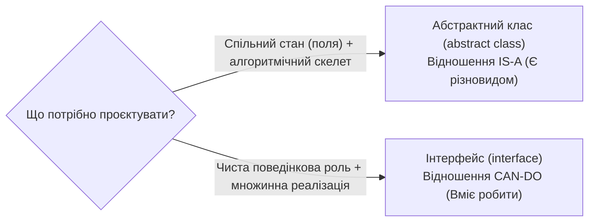

# 03. Абстрактний клас проти Інтерфейсу та патерн Template Method

## 1. Фундаментальний архітектурний вибір

Розробники постійно стикаються з вибором: оголосити базовий контракт як `abstract class` чи як `interface`?



---

## 2. Реалізація патерну Template Method

Абстрактні класи є природним вибором для патерну **Template Method (Шаблонний метод)**, оскільки інтерфейси не можуть гарантувати виконання обов'язкових кроків у фіксованому порядку зі спільним станом.

```csharp
public abstract class ReportExporter
{
    // Шаблонний метод фіксує скелет експорту звіту:
    public byte[] Export(ReportData data)
    {
        ValidateData(data);
        var formatted = FormatReport(data);
        var finalBytes = ApplyPackaging(formatted);
        LogExportCompleted(data.Title);
        return finalBytes;
    }

    private void ValidateData(ReportData data)
    {
        if (data == null) throw new ArgumentNullException(nameof(data));
    }

    // Кроки, які реалізують спеціалізовані спадкоємці:
    protected abstract byte[] FormatReport(ReportData data);
    protected virtual byte[] ApplyPackaging(byte[] content) => content; // Опціональний хук

    private void LogExportCompleted(string title) =>
        Console.WriteLine($"[Audit] Звіт '{title}' успішно експортовано.");
}
```

---

## 3. Матриця порівняння концепцій

| Критерій | Абстрактний клас | Інтерфейс |
|:---|:---|:---|
| Природа зв'язку | **IS-A** (Ієрархія сутностей) | **CAN-DO** (Здатність, контракт поведінки) |
| Стан (поля) | Підтримує повноцінний стан об'єкта | Лише константи та статичні змінні |
| Множинність | Одинарне спадкування | Множинна реалізація |
| Еволюція в BCL | Додавання неабстрактних методів безпечне | Потребує DIM (C# 8+), інакше ламає компіляцію |
| Патерни GoF | Template Method, State | Strategy, Observer, Plugin Architecture |

---

## 4. Матриця проєкту цієї секції

| Проєкт | Посилання на вихідний код | Що демонструє під капотом |
|:---|:---|:---|
| [`03-AbstractClassVsInterface`](../03-AbstractClassVsInterface/Program.cs) | [Program.cs](../03-AbstractClassVsInterface/Program.cs) | Поєднання абстрактного базового класу експортерів `ReportExporter` із композиційними інтерфейсними ролями `ICompressible` та `IEncryptable`. |
