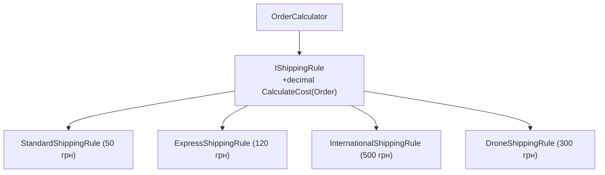

# 04. Поліморфізм замість умовних операторів та Композиція проти Спадкування

## 1. Антипатерн каскадних перевірок (`switch` / `if-else`)

У недосвідчених проєктах додавання нової поведінки часто реалізується через розростання блоків `switch (type)`:

```csharp
// АНТИПАТЕРН (Bad):
public decimal CalculateShipping(Order order)
{
    switch (order.Type)
    {
        case OrderType.Standard: return 50m;
        case OrderType.Express: return 120m;
        case OrderType.International: return 500m;
        case OrderType.DroneDelivery: return 300m; // Щоразу правимо той самий метод!
        default: throw new NotSupportedException();
    }
}
```

Кожне додавання нового типу порушує принцип **Open/Closed Principle (OCP)** і змушує змінювати вже протестований код.

---

## 2. Поліморфізм як розв'язання (Еталонне рішення)

Замість перевірок типів створюється сімейство поліморфних стратегій `IShippingRule`:



```csharp
public interface IShippingRule
{
    decimal CalculateCost(Order order);
}

public class DroneShippingRule : IShippingRule
{
    public decimal CalculateCost(Order order) => 300m;
}

// Клієнтський код відкритий до нових правил без модифікацій:
public class ShippingCalculator
{
    public decimal ComputeTotal(Order order, IShippingRule rule) =>
        rule.CalculateCost(order);
}
```

---

## 3. Композиція проти Спадкування ("Favor Composition over Inheritance")

Глибоке багаторівневе спадкування призводить до "крихкого базового класу" (Fragile Base Class problem), коли зміна батьківського класу ламає спадкоємців на третьому-четвертому рівні.

**Композиція** дозволяє збирати об'єкт із взаємозамінних поведінкових блоків (патерн Strategy):

```csharp
public class GameUnit
{
    private IMovementBehavior _movement;
    private IAttackBehavior _attack;

    public GameUnit(IMovementBehavior movement, IAttackBehavior attack)
    {
        _movement = movement;
        _attack = attack;
    }

    public void PerformAction()
    {
        _movement.Move();
        _attack.Attack();
    }

    // Можливість змінити поведінку на льоту в рантаймі:
    public void ChangeMovement(IMovementBehavior newMovement) => _movement = newMovement;
}
```

---

## 4. Матриця проєкту цієї секції

| Проєкт | Посилання на вихідний код | Що демонструє під капотом |
|:---|:---|:---|
| [`04-PolymorphismAndCompositionDesign`](../04-PolymorphismAndCompositionDesign/Program.cs) | [Program.cs](../04-PolymorphismAndCompositionDesign/Program.cs) | Практичний рефакторинг від жорсткого `switch` до поліморфного набору правил `IShippingRule` та композиційного конструювання `GameUnit`. |
