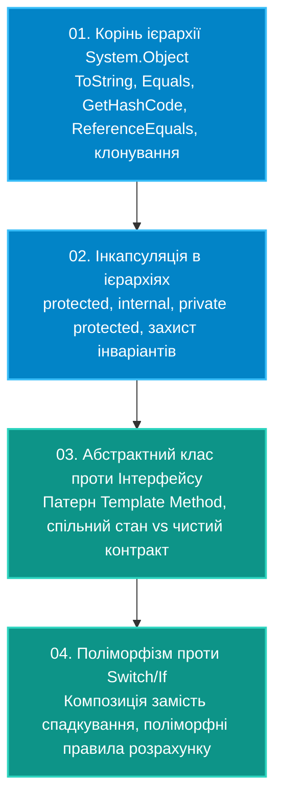

# Підмодуль 03: Проєктування ієрархій та поліморфізм на практиці (`OOP-Polymorphism-And-Design.sln`)

Цей підмодуль фокусується на глибинних інженерних аспектах об'єктно-орієнтованого проєктування в C#:
від семантики кореня ієрархії `System.Object` (рівність посилань vs значень, хешування, клонування) та тонкощів інкапсуляції в спадкоємцях (`protected`, `private protected`) до фундаментального вибору між абстрактними класами та інтерфейсами (патерн Template Method) та заміни умовних операторів поліморфними правилами замість глибокого спадкування.

---

## Навчальна дорожня карта модуля



---

## Навігація по навчальних посібниках (`Docs`)

| № | Посібник | Ключові теми та архітектурні патерни | Посилання на документ |
|:---:|:---|:---|:---|
| 01 | **Семантика System.Object** | Перевизначення `Equals`, контракт із `GetHashCode`, `MemberwiseClone` | [Docs/01_System_Object_And_Equality.md](Docs/01_System_Object_And_Equality.md) |
| 02 | **Інкапсуляція в ієрархіях** | Захист полів у спадкоємцях, `protected` vs `private protected`, безпека інваріантів | [Docs/02_Hierarchy_Encapsulation_And_Protected.md](Docs/02_Hierarchy_Encapsulation_And_Protected.md) |
| 03 | **Абстрактний клас чи Інтерфейс** | Архітектурний компроміс: стан проти поведінки, патерн Template Method | [Docs/03_Abstract_Class_Vs_Interface.md](Docs/03_Abstract_Class_Vs_Interface.md) |
| 04 | **Поліморфізм і Композиція** | Заміна `switch` на поліморфні стратегії, чому композиція перевершує множинне наслідування | [Docs/04_Polymorphism_And_Composition_Design.md](Docs/04_Polymorphism_And_Composition_Design.md) |

---

## Структура проєктів рішення `OOP-Polymorphism-And-Design.sln`

* **`01. Корінь ієрархії System.Object та семантика рівності`**
  * `01-SystemObjectAndEquality`
* **`02. Інкапсуляція в ієрархіях (protected, internal, private protected)`**
  * `02-HierarchyEncapsulationAndProtected`
* **`03. Абстрактний клас проти Інтерфейсу та патерн Template Method`**
  * `03-AbstractClassVsInterface`
* **`04. Поліморфізм замість умовних операторів та Композиція проти Спадкування`**
  * `04-PolymorphismAndCompositionDesign`

---

## Збірка та запуск

```powershell
dotnet build "02-OOP-Core/03-Polymorphism-And-Hierarchy-Design/OOP-Polymorphism-And-Design.sln" -c Release
```
