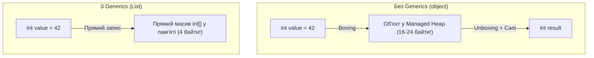

# Лекція 1: Узагальнення (Generics), Типобезпека та Проблема Boxing/Unboxing

## 1. Чому з'явилися Generics?

До появи Generics у .NET 2.0 єдиним способом створення універсальних колекцій та алгоритмів було використання типу **`object`** (вершини ієрархії типів .NET):

```csharp
// ❌ Старий підхід (ArrayList, Hashtable):
ArrayList list = new ArrayList();
list.Add(42);                  // 1. Boxing: упакування int у купу
list.Add("Hello");             // 2. Відсутність типобезпеки: можна запхати будь-що!

int val = (int)list[0];        // 3. Unboxing: розпакування
// int bad = (int)list[1];     // 4. Катастрофа в Run-Time: InvalidCastException!
```

### Проблеми підходу на `object`:
1. **Катастрофічне падіння продуктивності:** Постійне виділення пам'яті в купі та копіювання при Boxing/Unboxing перевантажує збирач сміття (GC).
2. **Втрата типобезпеки:** Компілятор не може захистити від додавання несумісних типів. Помилки «вистрілюють» лише в продакшені у клієнта.
3. **Необхідність постійного явного приведення типів.**

---

## 2. Як працюють Generics у C# .NET 10

Generics дозволяють параметризувати типи даних **без втрати продуктивності та без Boxing**:

```csharp
// ✅ Сучасний підхід (Generic):
List<int> numbers = new List<int>();
numbers.Add(42);         // Жодного Boxing! int зберігається як нативний 4-байтний примітив
// numbers.Add("Hello"); // ❌ Помилка компіляції! Компілятор захищає розробника
int num = numbers[0];    // Жодного кастингу
```



---

## 3. Корисні конструкції Generics

### 1. `default(T)`:
Повертає значення за замовчуванням для невідомого заздалегідь типу `T`:
* Для посилальних типів (`class`, `string`) ➔ `null`
* Для числових типів (`int`, `decimal`) ➔ `0`
* Для `bool` ➔ `false`
* Для користувацьких `struct` ➔ обнулена структура

### 2. `typeof(T)`:
Отримання об'єкта `Type` для аналізу метаданих типу під час виконання:
```csharp
Console.WriteLine($"Тип параметра: {typeof(T).FullName}");
```

### 3. Узагальнений метод обміну `Swap<T>`:
```csharp
public static void Swap<T>(ref T a, ref T b)
{
    T temp = a;
    a = b;
    b = temp;
}
```
Працює для будь-якого типу: `int`, `string`, `BankAccount`, користувацьких структур.
