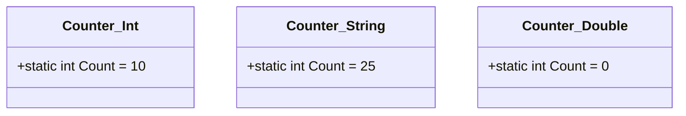

# Лекція 3: Статичні Члени в Узагальненнях та Підводні Камені (Pitfalls)

Узагальнені класи мають специфічну поведінку в середовищі CLR, яка часто стає темою запитань на технічних співбесідах.

---

## 1. Статичні члени у відкритих проти закритих типів

> **Золоте правило CLR:** Для кожного окремого **закритого типу** (`Closed Generic Type`) CLR генерує окрему таблицю методів і виділяє **окремий набір статичних полів**!

```csharp
public class Counter<T>
{
    public static int Count;
}

// Виклики:
Counter<int>.Count = 10;
Counter<string>.Count = 25;

Console.WriteLine(Counter<int>.Count);    // ➔ 10
Console.WriteLine(Counter<string>.Count); // ➔ 25 (це РІЗНІ змінні в пам'яті!)
```



*Якщо вам потрібен глобальний лічильник, спільний для ВСІХ екземплярів незалежно від типу `T`, його слід винести в нетипізований базовий клас:*
```csharp
public abstract class CounterBase
{
    public static int GlobalCount; // Єдине поле на весь процес
}

public class Counter<T> : CounterBase { ... }
```

---

## 2. Поширені підводні камені (Розбір `GenericsPitfalls`)

1. **Оператор `==` на узагальнених типах:**
   * За замовчуванням `a == b` для невідомого типу `T` заборонено компілятором, оскільки оператор `==` не є віртуальним.
   * Для перевірки на рівність слід використовувати `EqualityComparer<T>.Default.Equals(a, b)` або додавати обмеження `where T : IEquatable<T>`.
2. **Створення екземпляра через `new T()`:**
   * Конструкція `new T()` під капотом компілятора транслюється у виклик `Activator.CreateInstance<T>()`, що є повільнішим за прямий виклик конструктора. У критичних по швидкодії циклах краще передавати фабричний делегат `Func<T>`.
