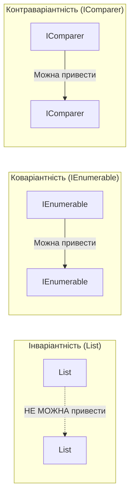

# Модуль 05: Узагальнене Програмування (Generics) у .NET 10

[](https://dotnet.microsoft.com/)
[](https://github.com/)

П'ятий модуль курсу **«C# & OOP Mastery»** присвячений потужній системі узагальнень (**Generics**). Ви дізнаєтесь, як створювати високоефективний код без упаковки (Boxing/Unboxing), керувати обмеженнями типів (`where`), уникати пасток зі статичними полями та опанувати концепцію варіантності: коваріантність (`out`) та контраваріантність (`in`).

---

## 📖 Навчальні лекції та теоретичні гайди

Модуль структуровано за 4 лекційними посібниками у каталозі [`Docs/`](Docs/):

| # | Лекція | Ключові концепції | Посилання |
|:---:|:---|:---|:---:|
| **01** | **Основи Generics та Типобезпека** | Проблема `object`, уникнення Boxing/Unboxing, `default(T)`, `typeof(T)`, алгоритм `Swap<T>` | [👉 Читати лекцію](Docs/01_Generics_Fundamentals_And_Type_Safety.md) |
| **02** | **Обмеження Параметрів Типу (`where Constraints`)** | Обмеження `class`, `struct`, `new()`, `notnull`, інтерфейсні та базові обмеження | [👉 Читати лекцію](Docs/02_Generic_Constraints_Where.md) |
| **03** | **Статика в Generics та Підводні Камені (Pitfalls)** | Окремі статичні поля на кожен закритий тип, проблеми оператора `==`, детальний розбір `GenericsPitfalls` | [👉 Читати лекцію](Docs/03_Static_Members_In_Generics_And_Pitfalls.md) |
| **04** | **Варіантність: Коваріантність (`out`) та Контраваріантність (`in`)** | Інваріантність колекцій, коваріантний вихід `out`, контраваріантний вхід `in`, стандарти BCL | [👉 Читати лекцію](Docs/04_Covariance_And_Contravariance.md) |

---

## 🏛️ Візуалізація варіантності



---

## 📁 Структура проектів у модулі

### 1. Дослідження типових помилок та пасток
* **[`GenericsPitfalls/`](GenericsPitfalls/Program.cs)** — Комплексний практикум: розбір помилок компіляції та часу виконання (Boxing, небезпечні кастинги, статичні лічильники, порівняння).

### 2. Винятки в архітектурі
* **[`ExceptionsBasics/`](ExceptionsBasics/Program.cs)** — Базові винятки та фільтрація в узагальнених контекстах.
* **[`ExceptionsCustom/`](ExceptionsCustom/Program.cs)** — Створення власних ієрархій винятків для бізнес-доменів.

### 3. Академічний атлас Solis
* **[`p367[SOLIS]/`](p367[SOLIS]/Program.cs)** — Узагальнені структури.
* **[`p455[SOLIS]/`](p455[SOLIS]/Program.cs)** — Узагальнений стек (структура даних).
* **[`p465[SOLIS]/`](p465[SOLIS]/Program.cs)** — Узагальнені методи.
* **[`p466[SOLIS]/`](p466[SOLIS]/Program.cs)** — Методи розширення для узагальнених класів.
* **[`p469[SOLIS]/`](p469[SOLIS]/Program.cs)** — Узагальнені багатоадресні делегати.
* **[`p470[SOLIS]/`](p470[SOLIS]/Program.cs)** — Узагальнені делегати з багатьма параметрами.
* **[`p471[SOLIS]/`](p471[SOLIS]/Program.cs)** — Узагальнений інтерфейс та його реалізація узагальненим класом.
* **[`p472[SOLIS]/`](p472[SOLIS]/Program.cs)** — Один клас, що реалізує кілька закритих інтерфейсів (`IMyIfc<int>` та `IMyIfc<string>`).
* **[`p474[SOLIS]/`](p474[SOLIS]/Program.cs)** — Ієрархія типів для підготовки до варіантності.
* **[`p478[SOLIS]/`](p478[SOLIS]/Program.cs)** — Контраваріантність (`in`) у делегатах.
* **[`p482[SOLIS]/`](p482[SOLIS]/Program.cs)** — Коваріантність (`out`) в інтерфейсах.

---

## 🛠️ Збірка та запуск

```bash
# Збірка всього модуля
dotnet build "OOP - Generics.sln" -c Release

# Запуск розбору типових помилок узагальнень
dotnet run --project GenericsPitfalls/GenericsPitfalls.csproj
```
