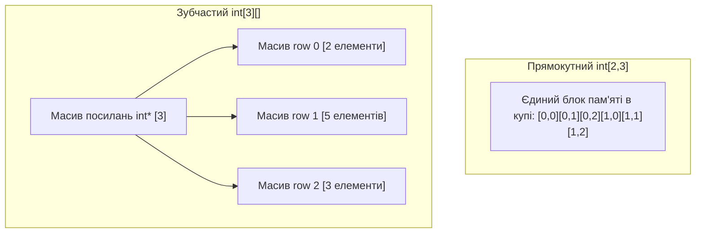

# Лекція 1: Масиви у C#: Одновимірні, Прямокутні (2D) та Зубчасті (Jagged)

Масив (`Array`) — це найпростіша структура даних у .NET, що представляє фіксовану послідовність елементів однакового типу, розміщених у **неперервній області пам'яті керованої купи**.

---

## 1. Прямокутні масиви (`Rectangular Arrays [ , ]`)

Прямокутний багатовимірний масив — це єдиний об'єкт у купі, де елементи розташовані матрицею з однаковою кількістю колонок у кожному рядку:

```csharp
int[,] matrix = new int[3, 4]; // 3 рядки, 4 колонки
matrix[0, 0] = 1;
```

* **Пам'ять:** Один монолітний блок у купі.
* **Швидкодія:** Доступ потребує внутрішнього множення індексів CLR (`row * columns + col`), проте дані лежать послідовно, що є дружнім для кешу CPU (Cache Locality).

---

## 2. Зубчасті масиви (`Jagged Arrays [ ][ ]`)

Зубчастий масив — це **«масив масивів»**. Кожен рядок є окремим незалежним об'єктом-масивом і може мати довільну довжину:

```csharp
int[][] jagged = new int[3][];
jagged[0] = new int[2]; // Рядок 0 має 2 елементи
jagged[1] = new int[5]; // Рядок 1 має 5 елементів
jagged[2] = new int[3]; // Рядок 2 має 3 елементи
```



---

## 3. Що обрати: Прямокутний чи Зубчастий?
* **Зубчастий масив (`[ ][ ]`)** у CLR працює **швидше**, ніж прямокутний (`[,]`), тому що JIT-компілятор може оптимізувати перевірку виходу за межі масиву (Bounds Check Elimination) завдяки спеціальним IL-інструкціям для одновимірних векторів (`SZArray`).
* **Прямокутний масив (`[,]`)** краще підходить для строго фіксованих матриць у графіці та математиці.
