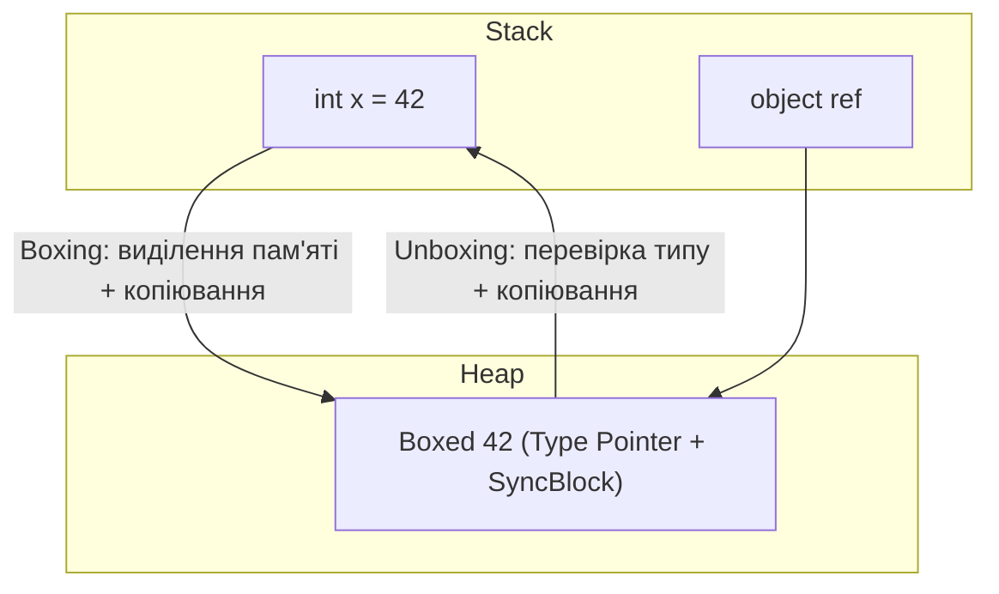

# Неузагальнені колекції: ArrayList, Hashtable та ціна Boxing/Unboxing

## Вступ
До появи узагальнень (Generics) у .NET 2.0 стандартні структури даних знаходилися у просторі імен `System.Collections` і оперували виключно типом `System.Object`. Сьогодні ці класи вважаються застарілими (legacy), проте розуміння їхньої роботи є критичним для усвідомлення еволюції платформи, аналізу legacy-коду та оптимізації продуктивності.

---

## 1. ArrayList: Динамічний масив об'єктів

`ArrayList` — це колекція зі змінним розміром, внутрішнім сховищем якої є масив `object[]`.

### Проекти для практики:
- [02-ArrayList](file:///03-Csharp-Mechanics/02-Collections/02-ArrayList/Program.cs) — Створення та наповнення різнорідними типами
- [02-01-ArrayList-Access](file:///03-Csharp-Mechanics/02-Collections/02-01-ArrayList-Access/Program.cs) — Індексація та приведення типів
- [02-03-ArrayList-Iterate](file:///03-Csharp-Mechanics/02-Collections/02-03-ArrayList-Iterate/Program.cs) — Ітерація через `foreach` та `IEnumerator`
- [02-04-ArrayList-CloneTheNon-GenericArrayList](file:///03-Csharp-Mechanics/02-Collections/02-04-ArrayList-CloneTheNon-GenericArrayList/Program.cs) — Поверхневе клонування (`Clone`)

### Архітектурна проблема: Відсутність безпеки типів (Type Safety)
Оскільки `ArrayList` приймає `object`, компілятор дозволяє додавати будь-які типи в одну колекцію:
```csharp
ArrayList list = new ArrayList();
list.Add(42);           // Boxing int -> object
list.Add("Hello");      // string
list.Add(new DateTime());

// Помилка під час виконання (Runtime Exception), а не компіляції!
foreach (int number in list)
{
    Console.WriteLine(number * 2); // InvalidCastException на другому елементі!
}
```

---

## 2. Проблема Boxing і Unboxing

При додаванні структурних типів (`int`, `double`, `struct`) у неузагальнені колекції відбувається упакування (boxing):
1. У керованій купі (Heap) виділяється пам'ять під новий об'єкт.
2. Значення зі стеку копіюється у виділену пам'ять купи.
3. Повертається посилання на об'єкт.

При вилученні (unboxing) виконується зворотна перевірка типу та копіювання значення у стек.



> **Наслідок для GC:** Мільйони операцій додавання чисел у `ArrayList` породжують мільйони дрібних об'єктів у Heap Gen 0, спричиняючи часті зупинки програми через складання сміття (Garbage Collection).

---

## 3. Hashtable: Хеш-таблиця на основі `object`

`Hashtable` представляє колекцію пар "ключ-значення", організованих на основі хеш-коду ключа (`GetHashCode()`).

### Проекти для практики:
- [03-01-HashTable](file:///03-Csharp-Mechanics/02-Collections/03-01-HashTable/Program.cs) — Ініціалізація та вилучення значень
- [03-02-HashTable-Add](file:///03-Csharp-Mechanics/02-Collections/03-02-HashTable-Add/Program.cs) — Додавання пар через `.Add()` та індексатор
- [03-03-HashTable-CloneHashtable](file:///03-Csharp-Mechanics/02-Collections/03-03-HashTable-CloneHashtable/Program.cs) — Клонування хеш-таблиці
- [03-04-HashTable-CopyHashtableToArray](file:///03-Csharp-Mechanics/02-Collections/03-04-HashTable-CopyHashtableToArray/Program.cs) — Експорт у масив через `CopyTo`

### Організація пам'яті:
```csharp
Hashtable table = new Hashtable();
table.Add(1, "One");       // Boxing ключа 1
table["Two"] = 2;          // Boxing значення 2
string val = (string)table[1]!; // Явне приведення типів
```

---

## 4. Порівняння: Legacy vs Сучасний .NET

| Характеристика | Неузагальнені (`System.Collections`) | Узагальнені (`System.Collections.Generic`) |
| :--- | :--- | :--- |
| **Приклади класів** | `ArrayList`, `Hashtable`, `Queue`, `Stack` | `List<T>`, `Dictionary<TKey, TVal>`, `Queue<T>` |
| **Безпека типів** | Відсутня (перевірка лише під час виконання) | Сувора компіляторна перевірка типів |
| **Накладні витрати** | Boxing/unboxing для value-типів, надмірний тиск на GC | Нульовий boxing для структур, пряма пам'ять |
| **Продуктивність** | Низька при роботі з великими масивами примітивів | Максимальна (на рівні звичайних масивів) |
