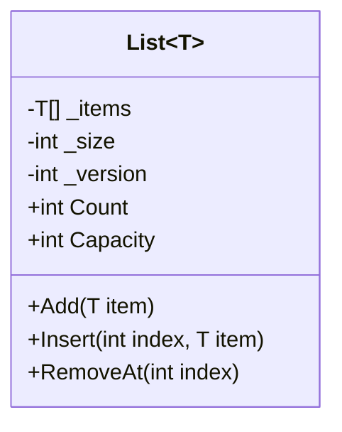
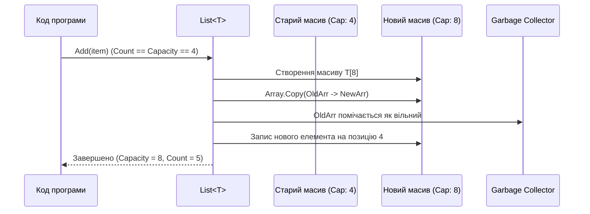

# Узагальнений список List<T>: Внутрішній устрій та динамічне розширення

## Вступ
Клас `List<T>` з простору імен `System.Collections.Generic` — найбільш часто використовувана колекція в .NET. Розуміння його внутрішнього механізму дозволяє уникнути непотрібних виділень пам'яті (allocations) та оптимізувати обчислювальну складність операцій.

---

## 1. Архітектура List<T> під капотом

Всередині `List<T>` розташований звичайний масив `T[] _items` та лічильник фактично збережених елементів `int _size` (властивість `Count`).



- **Count:** Кількість реально доданих елементів у списку.
- **Capacity:** Довжина внутрішнього масиву `_items.Length`.

---

## 2. Механізм динамічного розширення (Doubling Strategy)

Коли викликається `Add(item)` і `Count == Capacity`:
1. Виділяється новий масив розміром `Capacity * 2` (або `4`, якщо початковий розмір був `0`).
2. Всі елементи зі старого масиву копіюються в новий через оптимізований виклик `Array.Copy`.
3. Старий масив залишається в пам'яті для утилізації збирачем сміття (GC).



> **Порада щодо оптимізації:** Якщо заздалегідь відомо орієнтовну кількість елементів, завжди передавайте ємність у конструктор:
> ```csharp
> var list = new List<int>(10_000); // Одне виділення пам'яті замість десятків реалокацій
> ```

---

## 3. Складність основних операцій (Big-O)

| Операція | Метод | Амортизована складність | Примітка |
| :--- | :--- | :--- | :--- |
| **Додавання в кінець** | `Add(item)` | **O(1)** | В окремих випадках $O(N)$ через розширення буфера |
| **Доступ за індексом** | `list[index]` | **O(1)** | Пряма адресна арифметика масиву |
| **Вставка всередину** | `Insert(index, item)` | **O(N)** | Зсув усіх наступних елементів вправо через `Array.Copy` |
| **Видалення з середини**| `RemoveAt(index)` | **O(N)** | Зсув усіх наступних елементів вліво |
| **Пошук за умовою** | `Find(predicate)` | **O(N)** | Лінійне проходження елементів списку |
| **Бінарний пошук** | `BinarySearch(item)` | **O(log N)** | Вимагає попередньо відсортованого списку |

---

## 4. Проекти для практики

- [04-01-GenericList-Create](file:///03-Csharp-Mechanics/02-Collections/04-01-GenericList-Create/Program.cs) — Створення списку, співвідношення `Count` та `Capacity`, автоматичне розширення.
- [04-02-GenericList-Insert](file:///03-Csharp-Mechanics/02-Collections/04-02-GenericList-Insert/Program.cs) — Операції `Insert`, `InsertRange`, `Remove`, `RemoveAt`.
- [04-03-GenericList-FindElement](file:///03-Csharp-Mechanics/02-Collections/04-03-GenericList-FindElement/Program.cs) — Пошук: `Contains`, `IndexOf`, предикати `Find`, `FindAll`, `Exists`, `TrueForAll`.
