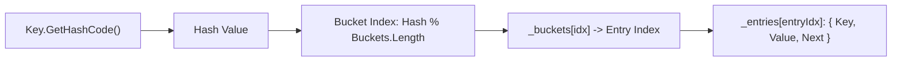

# Словники та сортовані колекції: Dictionary<TKey, TValue> і SortedList<TKey, TValue>

## Вступ
Асоціативні масиви дозволяють зберігати дані у вигляді пар "ключ-значення" і здійснювати швидкий доступ до значення за унікальним ключем. У .NET існують різні реалізації цього патерну, оптимізовані під різні сценарії використання: на основі хешування (`Dictionary`) та на основі відсортованих масивів (`SortedList`).

---

## 1. Dictionary<TKey, TValue>: Хеш-таблиця з відкритою адресацією

`Dictionary<TKey, TValue>` використовує комбінацію масиву кошиків (`int[] _buckets`) та масиву записів (`Entry[] _entries`).



### Практика:
- [GenericDictionary-06-01](file:///03-Csharp-Mechanics/02-Collections/GenericDictionary-06-01/Program.cs) — Створення, безпечний пошук через `TryGetValue`, обхід `KeyValuePair<TKey, TValue>`.

### Безпечний доступ до значень:
```csharp
var users = new Dictionary<int, string>();
users.Add(1, "Alice");

// Небезпечно: кине KeyNotFoundException, якщо ключа немає
// string user = users[99];

// Рекомендовано (сучасний ідіоматичний C#):
if (users.TryGetValue(1, out string? name))
{
    Console.WriteLine($"Користувач: {name}");
}
```

---

## 2. SortedList<TKey, TValue>: Баланс пам'яті та бінарного пошуку

`SortedList<TKey, TValue>` зберігає ключі та значення у двох синхронізованих масивах (`TKey[] _keys`, `TValue[] _values`), які підтримуються у відсортованому стані.

### Практика:
- [05-01-SortedList-Сreate](file:///03-Csharp-Mechanics/02-Collections/05-01-SortedList-Сreate/Program.cs) — Створення та порівняння ключів
- [05-02-SortedList-Add](file:///03-Csharp-Mechanics/02-Collections/05-02-SortedList-Add/Program.cs) — Додавання з автоматичним сортуванням
- [05-03-SortedList-Remove](file:///03-Csharp-Mechanics/02-Collections/05-03-SortedList-Remove/Program.cs) — Видалення за ключем або індексом
- [05-04-SortedList-CheckTheAvailability](file:///03-Csharp-Mechanics/02-Collections/05-04-SortedList-CheckTheAvailability/Program.cs) — Перевірка наявності `ContainsKey` / `ContainsValue`

---

## 3. Порівняльна таблиця складності та вибору колекції

| Критерій | `Dictionary<TKey, TValue>` | `SortedList<TKey, TValue>` | `SortedDictionary<TKey, TValue>` |
| :--- | :--- | :--- | :--- |
| **Структура даних** | Хеш-таблиця | Два паралельні масиви | Червоно-чорне дерево |
| **Пошук за ключем** | **O(1)** | **O(log N)** (Binary Search) | **O(log N)** |
| **Вставка / Видалення** | **O(1)** | **O(N)** (Зсув масивів) | **O(log N)** |
| **Порядок елементів** | Довільний (псевдовипадковий) | Відсортований за ключем | Відсортований за ключем |
| **Споживання пам'яті** | Середнє (кошики + зв'язки) | **Мінімальне** (чисті масиви) | Високе (об'єкт вузла на пару) |
| **Ідеальне застосування**| Масовий швидкий пошук | Невеликі рідко змінювані довідники | Часті вставки зі збереженням сортування |
