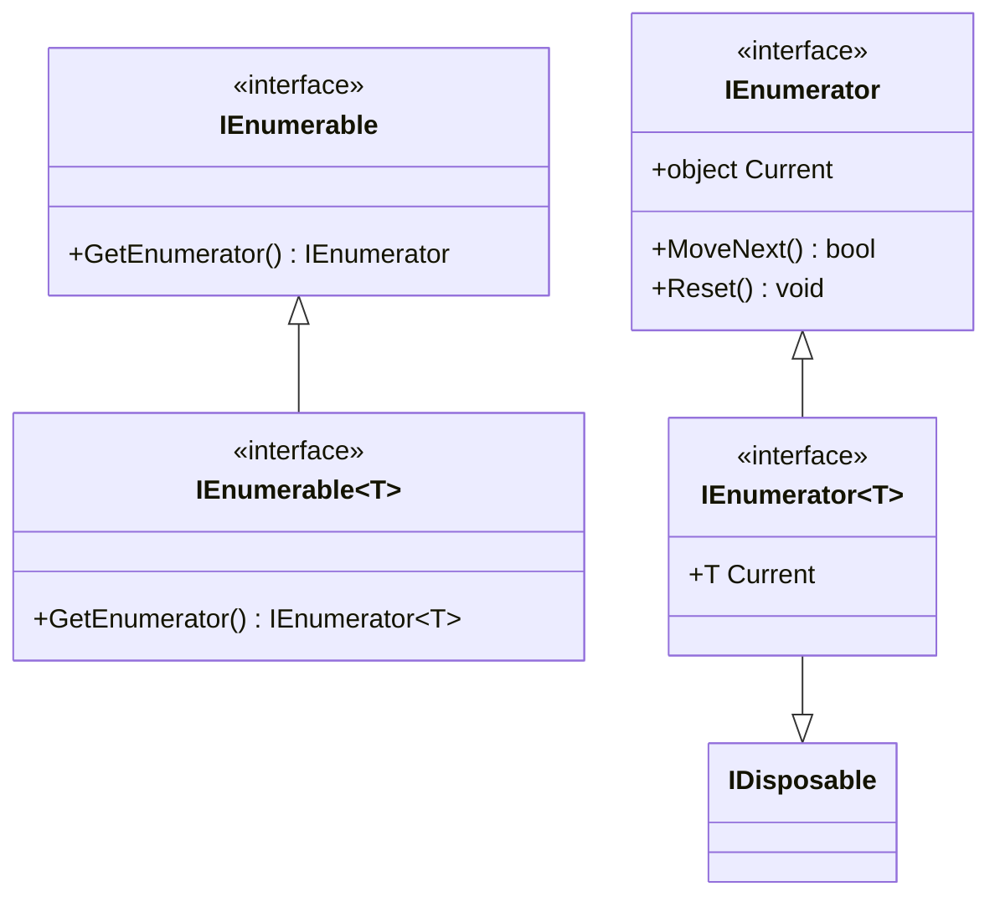

# Протоколи ітерування: IEnumerable та IEnumerator

## Вступ
Ітерування (перебір елементів) — фундаментальна операція при роботі з будь-якими колекціями даних. У .NET цей процес побудований на двох ключових інтерфейсах:
- `IEnumerable` / `IEnumerable<T>` — "той, кого можна перебирати" (постачальник перелічувача).
- `IEnumerator` / `IEnumerator<T>` — "той, хто перебирає" (курсор або покажчик поточної позиції).

---

## 1. Анатомія інтерфейсів



### Принцип роботи курсора (IEnumerator):
1. **Початковий стан:** Курсор завжди ініціалізується перед першим елементом (за домовленістю — позиція `-1`).
2. **`MoveNext()`:** Зсуває курсор на наступний елемент. Повертає `true`, якщо елемент існує, або `false`, якщо досягнуто кінця колекції.
3. **`Current`:** Повертає елемент на поточній позиції. До виклику `MoveNext()` або після повернення `false` читання `Current` призводить до невизначеної поведінки або виключення `InvalidOperationException`.
4. **`Reset()`:** Повертає курсор у стан до першого елемента (часто залишається нереалізованим або викидає `NotSupportedException`).

---

## 2. Ручна реалізація IEnumerator та IEnumerable

Для того щоб зрозуміти, що компілятор робить за лаштунками, розберемо класичну ручну реалізацію перелічувача:

```csharp
public class ColorEnumerator : IEnumerator
{
    private readonly string[] _colors;
    private int _position = -1; // Курсор перед першим елементом

    public ColorEnumerator(string[] colors)
    {
        _colors = colors;
    }

    public bool MoveNext()
    {
        if (_position < _colors.Length - 1)
        {
            _position++;
            return true;
        }
        return false;
    }

    public void Reset() => _position = -1;

    public object Current
    {
        get
        {
            if (_position < 0 || _position >= _colors.Length)
                throw new InvalidOperationException();
            return _colors[_position];
        }
    }
}
```

### Проекти для практики:
- [p492[SOLIS]](file:///03-Csharp-Mechanics/03-Enumerators-And-Iterators/p492[SOLIS]/Program.cs) — Базова ручна реалізація `IEnumerator` та `IEnumerable` з масивом кольорів.
- [ex-01](file:///03-Csharp-Mechanics/03-Enumerators-And-Iterators/ex-01/Program.cs) — Класична реалізація колекції `People` та `PeopleEnum` з бізнес-об'єктами `Person`.
- [ex-02](file:///03-Csharp-Mechanics/03-Enumerators-And-Iterators/ex-02/Program.cs) — Реалізація узагальненого `IEnumerable<T>` та робота з двома класами-обгортками.
