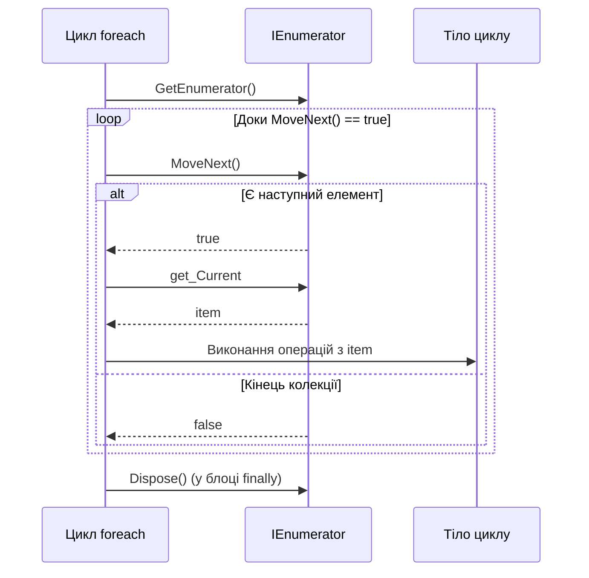

# Механіка циклу foreach та Duck Typing у C#

## Вступ
Оператор `foreach` — це синтаксичний цукор, який приховує складну взаємодію з перелічувачем, перевірки меж та коректне звільнення ресурсів через блок `finally`.

---

## 1. Декомпіляція foreach: Що генерує компілятор

Розглянемо простий цикл:
```csharp
// Те, що пише розробник:
foreach (int item in collection)
{
    Console.WriteLine(item);
}
```

Компілятор розгортає цей код у наступну конструкцію:
```csharp
// Те, що реально виконується в CLR:
IEnumerator<int> enumerator = collection.GetEnumerator();
try
{
    while (enumerator.MoveNext())
    {
        int item = enumerator.Current;
        Console.WriteLine(item);
    }
}
finally
{
    // Обов'язкове звільнення ресурсів перелічувача
    enumerator?.Dispose();
}
```



### Проекти для практики:
- [p486[SOLIS]](file:///03-Csharp-Mechanics/03-Enumerators-And-Iterators/p486[SOLIS]/Program.cs) — Базовий цикл `foreach` над масивом.
- [p490[SOLIS]](file:///03-Csharp-Mechanics/03-Enumerators-And-Iterators/p490[SOLIS]/Program.cs) — Пряме використання `IEnumerator` через `while (ie.MoveNext())`.

---

## 2. Патернне ітерування (Duck Typing)

Поширена помилкова думка полягає в тому, що для роботи `foreach` тип обов'язково повинен реалізовувати інтерфейс `IEnumerable` або `IEnumerable<T>`.

У C# оператор `foreach` використовує **патернний підхід (Duck Typing)**. Тип може бути перебраний у `foreach`, якщо він має:
1. Загальнодоступний метод `GetEnumerator()`, який повертає будь-який об'єкт (або структуру).
2. Повернутий об'єкт має метод `bool MoveNext()`.
3. Повернутий об'єкт має властивість `Current` з відкритим геттером.

### Чому це важливо для продуктивності?
Саме завдяки патернному ітеруванню структури `Span<T>` та `ReadOnlySpan<T>` у сучасному .NET можуть перебиратися через `foreach` без жодного виділення пам'яті в купі (Heap Allocation) та без приведення до інтерфейсу `IEnumerable<T>`, адже `ref struct` фізично не може реалізовувати інтерфейси.
